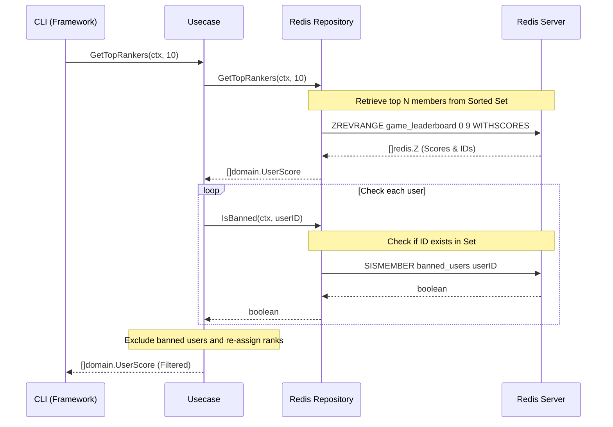

# Redis Workshop: Real-time Game Leaderboard with Sorted Sets

> **⏱️ Estimated Time**: Approx. 45 minutes
> **🎯 Level**: Intermediate
> **💻 Environment**: Linux (Podman), Go 1.25.6+

In this workshop, you will build a "Real-time Game Leaderboard System" capable of handling millions of users using Redis's powerful data structure, **Sorted Sets (ZSET)**.

> **💡 Glossary**: Please refer to the [Sorted Set (ZSET)](glossary_en.md#cache) or [Sets](glossary_en.md#cache) in the [Glossary](glossary_en.md) for technical terms used in this workshop.

## Goal

Build a leaderboard system with the following features based on **Clean Architecture**.



**What you will learn in this workshop:**

1. **Sorted Sets (ZSET)**: Leveraging automatic sorting based on scores.
2. **Sets**: Efficient management of unique collections (e.g., Ban lists).
3. **Clean Architecture**: Isolating external storage (Redis) details from the domain layer.

---

## Challenges in Real-time Aggregation

Traditionally, managing millions of users' ranks in an RDBMS (SQL) presents significant performance hurdles.

### ❌ Challenges

- **Sorting Cost**: Sorting millions of rows by score is extremely heavy if performed on every write.
- **Lock Contention**: High-frequency score updates lead to lock waits, reducing throughput.
- **Redundant Calculation**: Every time a user checks their rank, a near-full table scan is required.

### ✅ Redis Sorted Sets Solutions

- **In-memory Sorting**: Maintains a sorted state in $O(\log N)$ time upon write, making reads instantaneous.
- **Rich Command Set**: Native commands like "Get Top N" and "Get Rank of Member" are provided.

---

## Architecture

The Go application isolates business logic from the details of Redis.

### Directory Structure

```text
infra/assets/redis_leaderboard/
├── domain/         # Entities and Interfaces
├── usecase/        # Ranking and Ban logic
├── infra/          # Redis Adapter
├── main.go         # Entry point & Dependency Injection
└── go.mod
```

---

## Preparation

### 1. Enter the Working Directory

Start at the repository root and use the same terminal below.

```bash
cd infra/assets/redis_leaderboard
go mod download
# Expected output: no errors; Go requirement is 1.25.6 from go.mod
```

### 2. Start Redis (Podman)

Using Makefile (recommended):

```bash
make redis-up
```

Or directly with podman:

```bash
podman run -d --name workshop-redis -p 6379:6379 docker.io/library/redis:alpine
```

The container is dedicated to this exercise. If old scores or bans remain on a rerun, use `make redis-down` then `make redis-up` before repeating STEP 1.

### ✅ Verification Checkpoints

- [ ] Confirmed `workshop-redis` is `Up` via `podman ps`.
- [ ] Confirmed `PONG` response with `podman exec workshop-redis redis-cli ping`.

---

## Workshop Steps

### STEP 1: Add Scores (ZINCRBY)

Add points to each user's score (a user's points accumulate; Redis re-orders the set automatically).

```bash
go run main.go -action add -user user1 -score 100
go run main.go -action add -user user2 -score 250
go run main.go -action add -user user3 -score 180
```

### STEP 2: Display Top Rankers (ZREVRANGE)

Retrieve the top N members instantly.

```bash
go run main.go -action top -n 3
# Expected output: user2(250), user3(180), user1(100)
```

### Predict and Verify: Adding to the Same User

Predict the score after adding another 100 points to `user1`, then run:

```bash
go run main.go -action add -user user1 -score 100
go run main.go -action top -n 3
# Expected output: user2(250), user1(200), user3(180)
```

<details>
<summary>Hint and sample answer</summary>

ZINCRBY adds rather than overwrites. user1 reaches 200 points and moves above user3. Retrying the same command adds again, so event deduplication is a separate requirement.

</details>

### STEP 3: Ban Fraudulent Users (Sets)

Add specific users to a Ban list and exclude them from rankings.

```bash
go run main.go -action ban -user user2
go run main.go -action top -n 3
# Expected result: user2 disappears; user1(200) is first, user3(180) second.
```

---

## Clean Architecture Highlights

Business rules (UseCase layer) only know the rule: **"Banned users must not appear in the rankings."**

- **Domain**: Defines the `LeaderboardRepository` interface.
- **Infra**: Implements the interface using `go-redis`.

This configuration ensures that even if you change the storage from Redis to another high-speed database in the future, the core business logic (UseCase) remains untouched.

---

## What you learned

- How Sorted Sets (ZSET) deliver O(log N) ranked inserts and range queries
- How to model business rules (banned users) inside the UseCase layer, independent of the cache
- How the Domain-defined `LeaderboardRepository` interface keeps Redis swappable
- How to run and clean up a Redis container with Podman and verify connectivity

**Next step**: deepen the caching theory behind this workshop in [Caching Patterns in Go](../software/go_cache_patterns_en.md).

---

## Cleanup

Using Makefile (recommended):

```bash
make redis-down
```

Or directly with podman:

```bash
podman stop workshop-redis
podman rm workshop-redis
```

---

## References

- [Redis Documentation: Sorted Sets](https://redis.io/docs/data-types/sorted-sets/)
- [go-redis Guide](https://redis.uptrace.dev/)

---

## Troubleshooting

### Cannot Connect to Redis

**Symptom**: `dial tcp: connection refused`

**Cause and fix**:

- Verify that the Redis container is running

  ```bash
  podman ps --filter name=workshop-redis
  ```

- Verify that port 6379 is published

  ```bash
  podman port workshop-redis
  # Should show: 6379/tcp -> 0.0.0.0:6379
  ```

### Program Panics

**Symptom**: `runtime error: invalid memory address`

**Cause and fix**:

- The program was run before Redis was up; inspect the stack trace and make sure connection errors are handled before using the Redis client

  ```bash
  # Start Redis first
  make redis-up
  # Or restart an existing container:
  podman start workshop-redis
  ```

### Scores Are Not Reflected

**Symptom**: a user whose score was added does not appear in the ranking

**Cause and fix**:

- Inspect the sorted set directly, using the key names configured in the sample

  ```bash
  podman exec -it workshop-redis redis-cli
  > ZREVRANGE game_leaderboard 0 -1 WITHSCORES
  ```

- Check the ban list

  ```bash
  > SMEMBERS banned_users
  ```

## Environment Notes

### For macOS Users

You can use Podman or install Redis locally with Homebrew.

```bash
brew install redis
brew services start redis
```

Use `localhost:6379` when connecting to local Redis.

### For Windows Users

Use Podman in Ubuntu on WSL2, or replace `podman` with `docker` when using Docker Desktop.
