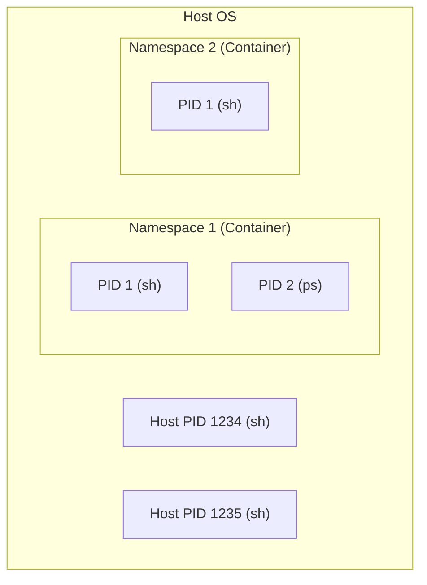

# Container Runtime Workshop: Understanding Containers through Namespaces and Cgroups

> **⏱️ Estimated Time**: Approx. 90 minutes
> **🎯 Level**: Advanced
> **💻 Environment**: Linux only (root/sudo)

In this workshop, you will learn how containers are built and restricted by manually manipulating Linux's standard features: **namespaces** and **cgroups**. Finally, you will create your own container runtime using the Go language.

> **💡 Glossary**: Please refer to [namespaces](glossary_en.md#container) and [cgroups](glossary_en.md#container) in the [Glossary](glossary_en.md) for technical terms used in this workshop.

## Goal

Demystify the "magic" of containers and implement process isolation by combining low-layer technologies (namespaces, resource limits, and virtual networking).



**What you will learn in this workshop:**

1. **Isolation via Namespaces**: Separating PID, Mount, and Network spaces.
2. **Resource Control via Cgroups**: Limiting CPU and memory usage.
3. **Networking via veth**: Establishing communication between an isolated space and the host.
4. **Implementation in Go**: Coding the container startup process using system calls.

## Prerequisites

- [ ] **Linux** host with cgroups v2 (kernel 5.8+; check with `mount | grep cgroup2` or `stat -fc %T /sys/fs/cgroup/` — should print `cgroup2fs`)
- [ ] **`sudo` privileges** — namespace and cgroup operations require root
- [ ] **Podman** 4.x or later (used only to extract the rootfs)
- [ ] **Go** 1.22 or later (`go version`)
- [ ] **iproute2** (`ip` command) for the veth networking step
- [ ] Not usable on macOS/Windows natively — use WSL2, Lima/Colima, or a cloud Ubuntu instance

---

## Challenges in Process Isolation

Traditionally, running multiple applications on a single OS led to interference between them.

### ❌ Challenges

- **Resource Contention**: One app exhausting memory can crash the entire system.
- **Security Risks**: Apps could peek into other processes or files.
- **Dependency Conflicts**: App A needing library v1 and App B needing v2 could not easily coexist.

### ✅ Container (Namespace & Cgroup) Solutions

- **Namespace**: Makes a process feel like it has its own dedicated OS by isolating its view.
- **Cgroup**: Physically limits the maximum resources a process can consume.
- **rootfs**: Provides a unique filesystem for each process, encapsulating dependencies.

---

## Architecture

We will directly call Linux kernel features to dynamically reconstruct the execution environment of a process.

### Directory Structure

```text
~/container-handson/
├── rootfs/           # Container root directory (Alpine)
├── rootfs.tar        # Exported image before extraction
├── main.go           # Source code for your custom runtime
└── mycontainer       # Compiled binary
```

---

## Preparation

### 1. Prerequisites

- **OS:** Linux (Ubuntu 24.04 recommended)
- **Permissions:** `sudo` privileges
- **Tools:** Podman (for rootfs extraction), Go

```bash
sudo apt update && sudo apt install -y podman golang-go iproute2
```

---

## Workshop Steps

### STEP 1: Prepare the Root Filesystem (rootfs)

Prepare the "insides" of the container.

```bash
mkdir -p ~/container-handson && cd ~/container-handson
podman pull alpine:latest
podman create --name tmp-alpine alpine:latest
podman export tmp-alpine > rootfs.tar
podman rm tmp-alpine
mkdir -p rootfs && tar -xf rootfs.tar -C rootfs
cp /etc/resolv.conf rootfs/etc/resolv.conf
ls -F rootfs/bin/sh
# Expected output: rootfs/bin/sh@ (trailing @ marks a symlink)
```

### ✅ Verification Checkpoints

- [ ] Confirmed the existence of `/bin/sh` using `ls -F rootfs/bin/sh`.
- [ ] Confirmed successful copy of `resolv.conf`.

### STEP 2: Isolation with Namespaces

Experience manual isolation using the `unshare` command.

1. **PID Namespace**: `sudo unshare --pid --fork /bin/sh`
   - Verify that `echo $$` outputs PID 1.
2. **Mount Namespace and chroot**:

   ```bash
   sudo unshare --pid --fork --mount /bin/sh
   # Do not propagate mount events from this new mount namespace to the host.
   mount --make-rprivate /
   chroot rootfs /bin/sh
   mount -t proc proc /proc
   ps # Only processes inside the container are visible
   # Expected output: only the shell (PID 1) and ps itself — no host processes
   ```

### ✅ Verification Checkpoints

- [ ] `echo $$` reports PID 1 inside the namespace.
- [ ] `ps` does not show host processes.

### STEP 3: Apply Resource Control (Cgroups v2)

Limit memory to 50MB and confirm that the process is killed when exceeded.

```bash
# Create cgroup
sudo mkdir -p /sys/fs/cgroup/workshop
echo 52428800 | sudo tee /sys/fs/cgroup/workshop/memory.max
echo 0 | sudo tee /sys/fs/cgroup/workshop/memory.swap.max

# Register process (Write the PID identified in another terminal)
echo $TARGET_PID | sudo tee /sys/fs/cgroup/workshop/cgroup.procs

# Verify
cat /sys/fs/cgroup/workshop/memory.max
# Expected output: 52428800
```

### ✅ Verification Checkpoints

- [ ] Confirmed `cat /sys/fs/cgroup/workshop/memory.max` is 52428800 (50MB).
- [ ] Confirmed that the process is registered in the cgroup.

### STEP 4: Network Connection via Virtual Ethernet (veth)

Connect the host and the namespace with a virtual LAN cable.

```bash
sudo ip netns add container1
sudo ip link add veth-host type veth peer name veth-child
sudo ip link set veth-child netns container1
# Host side IP setup
sudo ip addr add 10.0.0.1/24 dev veth-host
sudo ip link set veth-host up
# Configure the namespace side.
sudo ip -n container1 link set lo up
sudo ip -n container1 addr add 10.0.0.2/24 dev veth-child
sudo ip -n container1 link set veth-child up
sudo ip netns exec container1 ping -c 3 10.0.0.1
# Expected output: 3 packets transmitted, 3 received, 0% packet loss
```

### ✅ Verification Checkpoints

- [ ] Confirmed `container1` netns exists via `ip netns list`.
- [ ] Confirmed `10.0.0.1` is assigned to `veth-host`.
- [ ] Confirmed `ping -c 3 10.0.0.1` succeeds from the namespace.

### STEP 5: Implement Container in Go

Use the `syscall` package to automate namespace creation. This excerpt covers **only namespace creation**. It does not implement `chroot`, mounting `/proc`, cgroup setup, UID/GID mappings, capability dropping, or seccomp, so it is not a production OCI runtime.

```go
cmd.SysProcAttr = &syscall.SysProcAttr{
    Cloneflags: syscall.CLONE_NEWUTS | syscall.CLONE_NEWPID | syscall.CLONE_NEWNS | syscall.CLONE_NEWNET,
}
```

---

## Summary

1. Containers are "restricted processes" realized through a combination of Linux kernel features.
2. **Namespaces** control the "view" and **Cgroups** control the "resources."
3. Understanding low-layer mechanisms leads to a deeper grasp of Podman and Kubernetes behavior.

Next step: see these primitives orchestrated at scale in the [Kubernetes Basics Workshop](kubernetes_basics_en.md), or how container-based environments are provisioned as code in the [Terraform Workshop](terraform_en.md).

---

## Cleanup

```bash
# Remove the network namespace and veth pair (veth-child disappears with the netns)
sudo ip netns del container1
# veth-host may already be gone with the netns — ignore the "Cannot find device" error
sudo ip link del veth-host || true

# Remove the workshop cgroup (works only when no process is registered in it)
sudo rmdir /sys/fs/cgroup/workshop

# Remove the working directory (rootfs and the compiled binary)
# sudo is required: the extracted rootfs contains read-only directories
sudo rm -rf ~/container-handson
```

Verification:

```bash
ip netns list | grep container1   # Expected output: (no match)
ls /sys/fs/cgroup/workshop        # Expected output: "No such file or directory"
```

---

## References

- [Linux manual page: namespaces(7)](https://man7.org/linux/man-pages/man7/namespaces.7.html)
- [Control Groups v2 (Official Kernel Docs)](https://www.kernel.org/doc/html/latest/admin-guide/cgroup-v2.html)

---

## 🔧 Troubleshooting

### `syscall.CLONE_NEWPID` Fails

**Symptoms**: `operation not permitted` or `invalid argument`

**Causes and Solutions**:

- **Insufficient Permissions**: Creating namespaces other than the user namespace requires root privileges.

  Some configurations can create namespaces without root by combining a user namespace with UID/GID mappings. This workshop uses `sudo` to keep the behavior explicit.

  ```bash
  sudo ./mycontainer
  ```

### cgroup v2 is Not Mounted

**Symptoms**: Files cannot be created under `/sys/fs/cgroup`.

**Causes and Solutions**:

- The kernel version is old or cgroup v1 is in use.

  ```bash
  mount | grep cgroup
  ```

---

## 💻 Environment Notes

### For macOS Users

**This workshop is for Linux environment only.**

- Namespaces and cgroups are features unique to the Linux kernel, so they do not work on macOS.
- **Recommendation**: Use Lima, Colima, or an Ubuntu instance on the cloud.

### For Windows Users

- **WSL2**: Most features will work in the latest WSL2 environments.
- **Recommendation**: Running on an Ubuntu instance on the cloud is the most reliable way.
