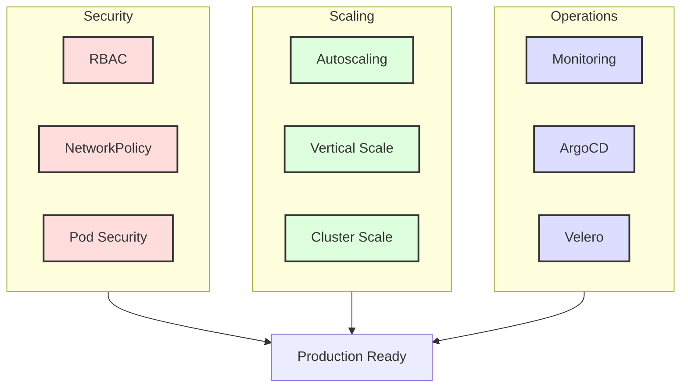

# Kubernetes Operations & Security Workshop: Advanced Features for Production

> **⏱️ Estimated Time**: Approx. 120 minutes
> **🎯 Level**: Advanced
> **💻 Environment**: Linux / macOS (kind, kubectl; Helm and ArgoCD installed during the workshop)

In this workshop, you will learn the advanced features of Kubernetes required for production operations, including security, scaling, and monitoring.

**Prerequisite workshop**: complete [`kubernetes_basics_en.md`](kubernetes_basics_en.md) first (cluster creation, Deployments, Services, Helm).

> **💡 Glossary**: For technical terms like [RBAC](glossary_en.md#security), [NetworkPolicy](glossary_en.md#security), and [HPA](glossary_en.md#kubernetes) used in this workshop, refer to the [Glossary](glossary_en.md).

---

## Why Should Software Engineers Learn Kubernetes Operations?

While developers often focus on writing application code, understanding how that code runs and stays secure in production is a critical skill for a "Senior" engineer.

1. **Security-by-Design**: By understanding RBAC and NetworkPolicies, you can design your application's security at the architecture level, ensuring it follows the principle of least privilege.
2. **Predictable Scaling**: Understanding HPA/VPA allows you to design applications that scale efficiently without resource wastage or performance bottlenecks.
3. **Operational Awareness**: Learning GitOps (ArgoCD) and Backup (Velero) ensures that you can manage the full lifecycle of your application, from deployment to disaster recovery.

---

## Goals

Master production-ready Kubernetes configurations, focusing on building a secure and scalable cluster.



**What you'll learn:**

1. **RBAC**: Role-based access control for permission management
2. **NetworkPolicy**: Control network communication
3. **Pod Security**: Pod security policies
4. **HPA/VPA**: Automatic scaling
5. **Resource Quotas**: Namespace-level resource limits
6. **GitOps**: Declarative deployment with ArgoCD
7. **Backup**: Cluster backup with Velero

---

## Prerequisites

```bash
# Prepare cluster
kind create cluster --name ops-workshop --config - <<EOF
kind: Cluster
apiVersion: kind.x-k8s.io/v1alpha4
nodes:
- role: control-plane
- role: worker
- role: worker
EOF

kubectl cluster-info --context kind-ops-workshop
```

### ✅ Checklist

- [ ] `kubectl get nodes` shows 3 nodes in Ready state

---

## Workshop Steps

### STEP 1: RBAC (Role-Based Access Control)

Implement fine-grained permission management per user/service account.

```yaml
# manifests/rbac.yaml
apiVersion: v1
kind: Namespace
metadata:
  name: development
---
apiVersion: v1
kind: ServiceAccount
metadata:
  name: app-sa
  namespace: development
---
apiVersion: rbac.authorization.k8s.io/v1
kind: Role
metadata:
  name: pod-reader
  namespace: development
rules:
  - apiGroups: [""]
    resources: ["pods", "pods/log"]
    verbs: ["get", "list", "watch"]
---
apiVersion: rbac.authorization.k8s.io/v1
kind: RoleBinding
metadata:
  name: read-pods
  namespace: development
subjects:
  - kind: ServiceAccount
    name: app-sa
    namespace: development
roleRef:
  kind: Role
  name: pod-reader
  apiGroup: rbac.authorization.k8s.io
---
apiVersion: v1
kind: Pod
metadata:
  name: test-pod
  namespace: development
spec:
  serviceAccountName: app-sa
  containers:
    - name: tester
      image: busybox:1.36
      command: ["sh", "-c", "sleep 3600"]
```

```bash
# Apply RBAC
kubectl apply -f manifests/rbac.yaml

# Verify permissions
kubectl auth can-i get pods -n development --as=system:serviceaccount:development:app-sa
kubectl auth can-i delete pods -n development --as=system:serviceaccount:development:app-sa

# Operate as ServiceAccount
kubectl get pods -n development --as=system:serviceaccount:development:app-sa
```

### ✅ Checklist

- [ ] `can-i get pods` returns `yes`
- [ ] `can-i delete pods` returns `no`
- [ ] ServiceAccount can list Pods

### STEP 2: NetworkPolicy

Control network communication between Pods.

```yaml
# manifests/network-policy.yaml
apiVersion: networking.k8s.io/v1
kind: NetworkPolicy
metadata:
  name: deny-all
  namespace: development
spec:
  podSelector: {}
  policyTypes:
    - Ingress
    - Egress
---
apiVersion: networking.k8s.io/v1
kind: NetworkPolicy
metadata:
  name: allow-web
  namespace: development
spec:
  podSelector:
    matchLabels:
      app: web
  policyTypes:
    - Ingress
    - Egress
  ingress:
    - from:
        - podSelector:
            matchLabels:
              app: frontend
      ports:
        - protocol: TCP
          port: 80
  egress:
    - to:
        - namespaceSelector:
            matchLabels:
              kubernetes.io/metadata.name: kube-system
      ports:
        - protocol: UDP
          port: 53
        - protocol: TCP
          port: 53
    - to:
        - podSelector:
            matchLabels:
              app: database
      ports:
        - protocol: TCP
          port: 5432
---
apiVersion: networking.k8s.io/v1
kind: NetworkPolicy
metadata:
  name: allow-frontend-egress
  namespace: development
spec:
  podSelector:
    matchLabels:
      app: frontend
  policyTypes:
    - Egress
  egress:
    # DNS resolution via CoreDNS
    - to:
        - namespaceSelector:
            matchLabels:
              kubernetes.io/metadata.name: kube-system
      ports:
        - protocol: UDP
          port: 53
        - protocol: TCP
          port: 53
    # frontend to web traffic
    - to:
        - podSelector:
            matchLabels:
              app: web
      ports:
        - protocol: TCP
          port: 80
```

```bash
# Verify CNI plugin (Kind uses kindnet)
# NOTE: recent kind releases make kindnet enforce basic NetworkPolicies
# (check the kind version in your environment).
# If you need advanced policies, consider Calico or Cilium.
kubectl get pods -n kube-system -l k8s-app=kindnet

# Test deployments
kubectl create deployment web --image=nginx:1.25-alpine -n development
kubectl create deployment frontend --image=busybox:1.36 -n development -- sleep 3600
kubectl create deployment database --image=postgres:16-alpine -n development

# postgres fails to start without POSTGRES_PASSWORD
kubectl set env deployment/database POSTGRES_PASSWORD=workshop -n development

# Create Services so the names resolve via DNS
kubectl expose deployment web --port=80 -n development
kubectl expose deployment database --port=5432 -n development

# Add labels (kubectl create deployment already sets app=<name> on the Pod
# template, so these report "not labeled" — that is expected)
kubectl label deployment web app=web -n development
kubectl label deployment frontend app=frontend -n development
kubectl label deployment database app=database -n development

# Apply NetworkPolicy
kubectl apply -f manifests/network-policy.yaml

# Verify connectivity (frontend → web is allowed even under deny-all)
kubectl exec -n development deploy/frontend -- wget -O- http://web -T 5
```

### ✅ Checklist

- [ ] deny-all policy blocks traffic
- [ ] allow-web enables frontend → web traffic
- [ ] web → database traffic is permitted

### STEP 3: Pod Security Standards

Enforce Pod security baselines.

```yaml
# manifests/pod-security.yaml
apiVersion: v1
kind: Namespace
metadata:
  name: secure-app
  labels:
    pod-security.kubernetes.io/enforce: restricted
    pod-security.kubernetes.io/audit: restricted
    pod-security.kubernetes.io/warn: restricted
---
apiVersion: v1
kind: Pod
metadata:
  name: secure-pod
  namespace: secure-app
spec:
  securityContext:
    runAsNonRoot: true
    runAsUser: 1000
    fsGroup: 1000
    seccompProfile:
      type: RuntimeDefault
  containers:
    - name: app
      # Note: nginx cannot start under the restricted level because it needs the
      # CHOWN / SETGID / SETUID capabilities, so use busybox httpd (runs as non-root)
      image: busybox:1.36
      command: ["httpd", "-f", "-p", "8080", "-h", "/etc"]
      securityContext:
        allowPrivilegeEscalation: false
        capabilities:
          drop:
            - ALL
        readOnlyRootFilesystem: true
```

```bash
# Apply
kubectl apply -f manifests/pod-security.yaml

# Verify
kubectl get pod secure-pod -n secure-app
kubectl exec -n secure-app secure-pod -- wget -qO- http://localhost:8080/hostname

# Verify privileged container rejection
kubectl run privileged --image=nginx:1.25-alpine -n secure-app --privileged --restart=Never
# Should error

# Check warn-mode output (shown immediately):
# relax enforce, create a violating Pod, and a Warning is printed to stderr
kubectl label namespace secure-app pod-security.kubernetes.io/enforce=privileged --overwrite
kubectl run audit-test --image=busybox:1.36 -n secure-app --restart=Never -- sleep 3600
# Warning: would violate PodSecurity "restricted:latest": ...
kubectl delete pod audit-test -n secure-app
kubectl label namespace secure-app pod-security.kubernetes.io/enforce=restricted --overwrite

# Audit-mode Violation events are recorded by the controller's periodic check,
# so they do not appear immediately after creation (the interval varies by
# Kubernetes version)
kubectl get events -n secure-app --field-selector reason=Violation
```

### ✅ Checklist

- [ ] secure-pod is created
- [ ] privileged Pod is rejected
- [ ] Audit logs show violations

### STEP 4: Horizontal Pod Autoscaler (HPA)

Automatically scale Pods based on CPU/memory usage.

```bash
# Install Metrics Server
kubectl apply -f https://github.com/kubernetes-sigs/metrics-server/releases/latest/download/components.yaml

# Kind requires --kubelet-insecure-tls (self-signed certs on kubelet)
kubectl patch deployment metrics-server -n kube-system --type=json \
  -p='[{"op":"add","path":"/spec/template/spec/containers/0/args/-","value":"--kubelet-insecure-tls"}]'

# Verify operation
kubectl get apiservice v1beta1.metrics.k8s.io
kubectl top nodes
kubectl top pods
```

```yaml
# manifests/hpa.yaml
apiVersion: apps/v1
kind: Deployment
metadata:
  name: scalable-app
spec:
  replicas: 2
  selector:
    matchLabels:
      app: scalable
  template:
    metadata:
      labels:
        app: scalable
    spec:
      containers:
        - name: app
          image: polinux/stress
          resources:
            requests:
              cpu: "100m"
              memory: "128Mi"
            limits:
              cpu: "500m"
              memory: "512Mi"
          command: ["stress"]
          args:
            [
              "--cpu",
              "2",
              "--vm",
              "1",
              "--vm-bytes",
              "128M",
              "--timeout",
              "3600s",
            ]
---
apiVersion: autoscaling/v2
kind: HorizontalPodAutoscaler
metadata:
  name: scalable-hpa
spec:
  scaleTargetRef:
    apiVersion: apps/v1
    kind: Deployment
    name: scalable-app
  minReplicas: 2
  maxReplicas: 10
  metrics:
    - type: Resource
      resource:
        name: cpu
        target:
          type: Utilization
          averageUtilization: 50
    - type: Resource
      resource:
        name: memory
        target:
          type: Utilization
          averageUtilization: 80
  behavior:
    scaleDown:
      stabilizationWindowSeconds: 300
      policies:
        - type: Percent
          value: 50
          periodSeconds: 15
    scaleUp:
      stabilizationWindowSeconds: 0
      policies:
        - type: Percent
          value: 100
          periodSeconds: 15
        - type: Pods
          value: 4
          periodSeconds: 15
      selectPolicy: Max
```

```bash
# Apply HPA
kubectl apply -f manifests/hpa.yaml

# The stress image already generates CPU load (--cpu 2 --vm 1).
# Monitor HPA in another terminal:
kubectl get hpa scalable-hpa --watch
kubectl get pods -l app=scalable --watch

# To test scale-down: remove the load (passing --cpu 0 to stress makes it exit
# immediately and causes CrashLoopBackOff, so switch to a sleep command instead)
kubectl patch deployment scalable-app --type=json \
  -p='[{"op":"replace","path":"/spec/template/spec/containers/0/command","value":["sh","-c"]},{"op":"replace","path":"/spec/template/spec/containers/0/args","value":["sleep 3600"]}]'

# Note: scaleDown.stabilizationWindowSeconds is 300 (5 minutes), so it takes
# a few minutes before replicas start to decrease
```

### ✅ Checklist

- [ ] Pod count increases with CPU usage
- [ ] Scaling stops at max replicas (10)
- [ ] Pod count decreases when load drops

### STEP 5: Resource Quotas & LimitRange

Limit resource consumption per namespace.

```yaml
# manifests/quota.yaml
apiVersion: v1
kind: ResourceQuota
metadata:
  name: compute-quota
  namespace: development
spec:
  hard:
    requests.cpu: "4"
    requests.memory: "8Gi"
    limits.cpu: "8"
    limits.memory: "16Gi"
    persistentvolumeclaims: "4"
---
apiVersion: v1
kind: LimitRange
metadata:
  name: cpu-limit-range
  namespace: development
spec:
  limits:
    - default:
        cpu: "500m"
        memory: "512Mi"
      defaultRequest:
        cpu: "100m"
        memory: "128Mi"
      type: Container
```

```bash
# Apply
kubectl apply -f manifests/quota.yaml

# Verify Quota
kubectl describe resourcequota compute-quota -n development

# Test limit exceeded
# With the LimitRange defaults (100m request per container), 10 replicas do not
# reach the quota (requests.cpu 4), so scale up to 50 replicas
kubectl create deployment big-app --image=nginx:1.25-alpine -n development --replicas=50
# The Deployment itself is created, but once the quota is reached no further
# Pods are created and READY stops partway
kubectl get deployment big-app -n development

# Check the exceeded-quota errors in ReplicaSet events
kubectl get events -n development --field-selector reason=FailedCreate
# Error creating: pods "..." is forbidden: exceeded quota: compute-quota, ...
```

### ✅ Checklist

- [ ] ResourceQuota tracks consumption
- [ ] LimitRange sets default values
- [ ] Excess Pods are rejected and FailedCreate events are recorded

### STEP 6: GitOps (ArgoCD)

Use Git repository as single source of truth for deployments.

```bash
# Install ArgoCD
kubectl create namespace argocd
# --server-side is required on recent Kubernetes versions: client-side apply
# fails with "metadata.annotations: Too long" on the ApplicationSets CRD
kubectl apply -n argocd --server-side --force-conflicts \
  -f https://raw.githubusercontent.com/argoproj/argo-cd/stable/manifests/install.yaml

# Get password
argocd admin initial-password -n argocd

# Port forward
kubectl port-forward svc/argocd-server -n argocd 8080:443
# Browser: https://localhost:8080
# User: admin

# Install CLI
brew install argocd
# Linux alternative (download the binary from the releases page):
curl -sLO https://github.com/argoproj/argo-cd/releases/latest/download/argocd-linux-amd64
sudo install -m 755 argocd-linux-amd64 /usr/local/bin/argocd

# Login
argocd login localhost:8080 --insecure --username admin --password <PASSWORD>

# Create application
argocd app create guestbook \
  --repo https://github.com/argoproj/argocd-example-apps.git \
  --path guestbook \
  --dest-server https://kubernetes.default.svc \
  --dest-namespace default

# Sync
argocd app sync guestbook

# Check status
argocd app get guestbook
```

### ✅ Checklist

- [ ] Can access ArgoCD UI
- [ ] Application is synced
- [ ] Git changes reflect in cluster

### STEP 7: Backup (Velero)

Backup and restore entire clusters.

```bash
# Install Velero
brew install velero

# Create AWS S3 bucket (or use MinIO)
aws s3 mb s3://velero-backups

# Install Velero server
velero install \
  --provider aws \
  --plugins velero/velero-plugin-for-aws:v1.8.0 \
  --bucket velero-backups \
  --secret-file ./credentials-velero \
  --use-volume-snapshots=false \
  --backup-location-config region=ap-northeast-1

# Create backup
velero backup create nginx-backup --include-namespaces development

# List backups
velero backup get

# Backup details
velero backup describe nginx-backup --details

# Test restore
kubectl delete namespace development
velero restore create --from-backup nginx-backup

# Verify restore
velero restore get
kubectl get all -n development
```

### ✅ Checklist

- [ ] Backup completes successfully
- [ ] Backup file saved to S3
- [ ] Restore recreates Namespace

---

## Summary

1. **Security**: RBAC + NetworkPolicy + Pod Security for defense-in-depth
2. **Scalability**: HPA/VPA for automatic scaling
3. **Resource Management**: Quota + LimitRange for fairness
4. **GitOps**: ArgoCD for declarative deployment
5. **Disaster Recovery**: Velero for backup

---

## Production Operations Checklist

### Security

- [ ] Apply least privilege with RBAC
- [ ] Default deny with NetworkPolicy
- [ ] Enforce Pod Security Standards
- [ ] Encrypt Secrets (at-rest)
- [ ] Perform image scanning

### Availability

- [ ] Configure PodDisruptionBudget
- [ ] Enable HPA/VPA for autoscaling
- [ ] Multi-node/availability zone
- [ ] Regular backup and restore testing

### Observability

- [ ] Prometheus + Grafana for metrics
- [ ] Loki/Elasticsearch for log aggregation
- [ ] Tempo/Jaeger for distributed tracing
- [ ] Alertmanager for alerts

---

## Cleanup

```bash
# Delete the kind cluster created in Prerequisites (removes RBAC, NetworkPolicy,
# HPA, monitoring, ArgoCD, and everything else created in this workshop)
kind delete cluster --name ops-workshop
# Expected output: Deleted nodes: ["ops-workshop-control-plane"] (message varies by kind version)

# Verify
kind get clusters
# Expected output: (no output, or only your other clusters)
```

---

## References

- [Kubernetes Security Best Practices](https://kubernetes.io/docs/concepts/security/security-checklist/)
- [ArgoCD Documentation](https://argo-cd.readthedocs.io/)
- [Velero Documentation](https://velero.io/docs/)

---

## 🔧 Troubleshooting

### HPA Not Scaling

**Symptoms**: CPU high but replicas not increasing

**Causes & Fixes**:

1. Verify Metrics Server:

   ```bash
   kubectl get apiservice v1beta1.metrics.k8s.io
   kubectl top pods
   ```

2. Check request values:

   ```bash
   kubectl describe hpa <hpa-name>
   ```

   - `resources.requests` must be set

3. Verify target values:
   - Check if `averageUtilization` is realistic

### ArgoCD Not Syncing

**Symptoms**: Diff exists between Git and cluster but no Sync

**Causes & Fixes**:

1. Check sync status:

   ```bash
   argocd app get <app-name>
   ```

2. Manual sync:

   ```bash
   argocd app sync <app-name>
   ```

3. Enable auto-sync:

   ```yaml
   syncPolicy:
     automated:
       prune: true
       selfHeal: true
   ```

### ArgoCD Pods Fail to Start Due to inotify Limits

**Symptoms**: `argocd-repo-server` is in CrashLoopBackOff and its logs show
`failed to create fsnotify Watcher: couldn't initialize inotify: too many open files`

**Causes & Fixes**: The host reached its inotify instance limit (common with multi-node kind clusters).

```bash
# Check the current limit
sysctl fs.inotify.max_user_instances

# Raise the limit and recreate the Pod
sudo sysctl -w fs.inotify.max_user_instances=1024
kubectl delete pod -n argocd -l app.kubernetes.io/name=argocd-repo-server
```

---

## 💡 Platform-Specific Notes

### Kind

- NetworkPolicy depends on CNI
- Metrics Server required for HPA
- Velero requires separate storage

### Cloud (EKS/GKE/AKS)

- Leverage managed services
- IAM integration
- Multi-zone configuration
