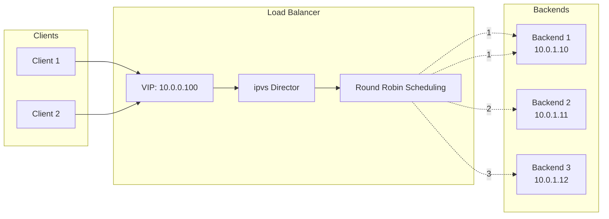
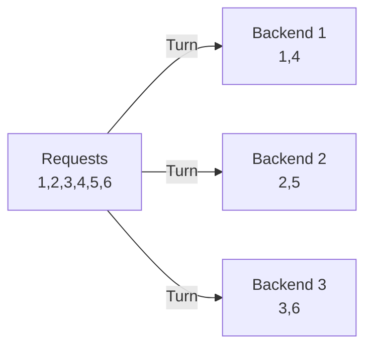
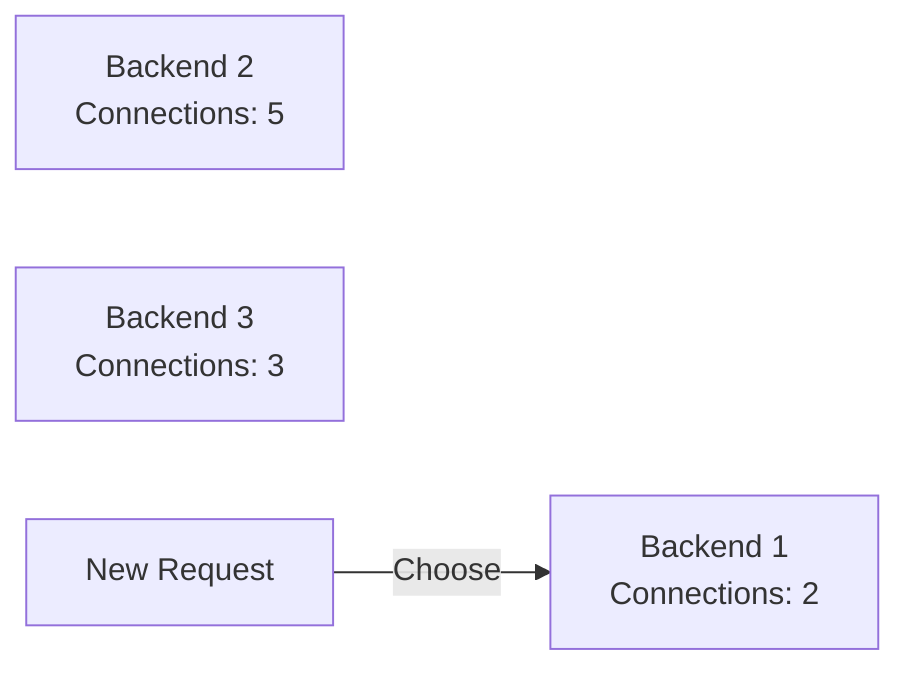
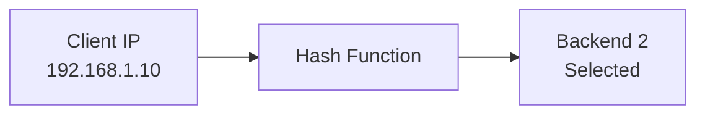
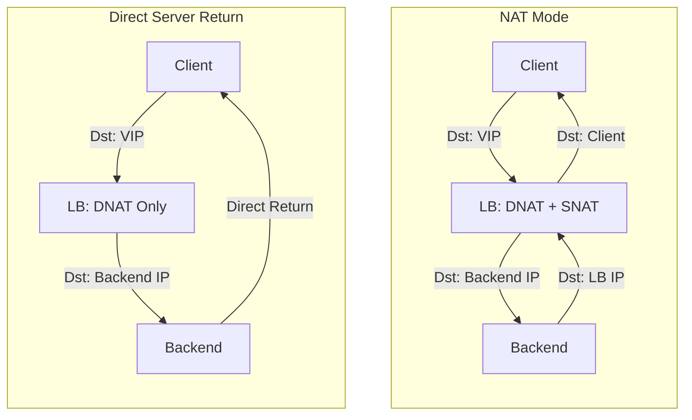

# Load Balancer Workshop: Building a Virtual LB with iptables

> **⏱️ Estimated Time**: Approx. 45 minutes
> **🎯 Level**: Intermediate
> **💻 Environment**: Linux (root/sudo, ipvsadm, iptables; WSL2 works, Docker Desktop for macOS has limitations)

In this workshop, you will learn how load balancers work behind systems like Kubernetes or HAProxy by using Linux `iptables` and `ipvs` (IP Virtual Server).

## Prerequisites

- [ ] Linux (or WSL2) with root/sudo access
- [ ] `iptables`, `ipvsadm`, and `curl` are not needed on the host — they are installed inside the containers in STEP 2
- [ ] Recommended first: [`tcpip_stack_en.md`](tcpip_stack_en.md) (NAT/DNAT fundamentals)

> **💡 Glossary**: For technical terms such as [Load Balancer](glossary_en.md#network), [DNAT](glossary_en.md#network), and [Round Robin](glossary_en.md#network), please refer to the [Glossary](glossary_en.md).

## Goal

Construct a mechanism to distribute requests to a single Virtual IP (VIP) across multiple backend servers.



**What you will learn:**

1. **DNAT (Destination NAT)**: A mechanism to rewrite and forward destination IPs.
2. **Scheduling Algorithms**: Policies for allocating requests to backends.
3. **Health Checks**: Mechanisms for liveness monitoring and automatic exclusion.

---

## Challenges of Load Balancers

Handling traffic with a single server has its limits.

### ❌ Challenges

- **Single Point of Failure (SPOF)**: If one server goes down, the entire service stops.
- **Scaling Limits**: There is an upper limit to the number of requests a single server can process.
- **Continuous Downtime**: Service must be stopped for maintenance.

### ✅ Load Balancer Solutions

- **Redundancy**: Distribute traffic across multiple backends.
- **Improved Availability**: Automatically exclude failed servers.
- **Scalability**: Add backends as needed.

---

## Scheduling Algorithms

### 1. Round Robin



Allocates requests simply in order. Traffic is distributed evenly, but server performance differences are not considered.

### 2. Least Connections



Allocates to the server with the fewest active connections. Effective when processing times are non-uniform.

### 3. IP Hash



Calculates a hash from the client IP, ensuring the same client always hits the same server. Useful for session persistence.

---

## Architecture

### NAT Mode vs DSR Mode



**NAT Mode**: Return packets also pass through the LB (simple but LB becomes a bottleneck).
**DSR Mode**: Backends respond directly to the client (high speed but complex).

---

## Setup

### 1. Prerequisites

- Podman or Docker installed
- Basic networking knowledge

### 2. Create Container Networks

```bash
# For Podman
# Public network
podman network create lb-public --subnet 10.0.0.0/24

# Backend network
podman network create lb-backend --subnet 10.0.1.0/24

# For Docker (alternatives)
docker network create lb-public --subnet 10.0.0.0/24
docker network create lb-backend --subnet 10.0.1.0/24
```

### ✅ Checkpoint

- [ ] Verified both networks are created with `podman network ls`

---

## Hands-on Steps

### STEP 1: Prepare Backend Servers

Start three backend servers.

```bash
# For Podman
# Backend 1
podman run -d --name backend1 \
  --network lb-backend \
  --ip 10.0.1.10 \
  docker.io/library/nginx:alpine

# Backend 2
podman run -d --name backend2 \
  --network lb-backend \
  --ip 10.0.1.11 \
  docker.io/library/nginx:alpine

# Backend 3
podman run -d --name backend3 \
  --network lb-backend \
  --ip 10.0.1.12 \
  docker.io/library/nginx:alpine

# For Docker (alternative: --ip is available after docker network create)
docker run -d --name backend1 --network lb-backend --ip 10.0.1.10 nginx:alpine
docker run -d --name backend2 --network lb-backend --ip 10.0.1.11 nginx:alpine
docker run -d --name backend3 --network lb-backend --ip 10.0.1.12 nginx:alpine
```

Set identification HTML for each backend.

```bash
echo "Backend 1" | podman exec -i backend1 sh -c 'cat > /usr/share/nginx/html/index.html'
echo "Backend 2" | podman exec -i backend2 sh -c 'cat > /usr/share/nginx/html/index.html'
echo "Backend 3" | podman exec -i backend3 sh -c 'cat > /usr/share/nginx/html/index.html'
```

### ✅ Checkpoint

- [ ] Verified responses by accessing each backend directly

### STEP 2: Construct the Load Balancer

Start the load balancer container.

```bash
# For Podman
# Note: podman accepts --ip only with a single --network,
# so connect the second network afterwards.
podman run -d --name loadbalancer \
  --network lb-public \
  --ip 10.0.0.10 \
  --privileged \
  docker.io/library/alpine:latest \
  sleep infinity

# Connect to the backend network afterwards (with a fixed IP)
podman network connect --ip 10.0.1.1 lb-backend loadbalancer

# For Docker (alternative)
docker run -d --name loadbalancer \
  --network lb-public \
  --privileged \
  alpine:latest \
  sleep infinity

# For Docker, connect to backend network afterward
docker network connect lb-backend loadbalancer
```

Install required packages.

```bash
podman exec loadbalancer apk add --no-cache iptables ipvsadm curl
```

### ✅ Checkpoint

- [ ] Verified iptables is available with `podman exec loadbalancer iptables --version`

### STEP 3: Enable IP Forwarding

```bash
podman exec loadbalancer sh -c "echo 1 > /proc/sys/net/ipv4/ip_forward"
```

### STEP 4: DNAT Setup with iptables (Optional)

> **📝 Note**: Normally, you would use ipvs (STEP 5). This step is for deepening your understanding of iptables.

Forward access to the VIP (10.0.0.100:80) to the backends.

```bash
# Add VIP
podman exec loadbalancer ip addr add 10.0.0.100/32 dev eth0

# Create chain for Round Robin
podman exec loadbalancer iptables -t nat -N BACKENDS

# ★ Important: Jump to BACKENDS chain for requests to VIP
podman exec loadbalancer iptables -t nat -A PREROUTING -d 10.0.0.100 -p tcp --dport 80 -j BACKENDS

# Forwarding rules to backends (using statistic module for distribution)
# Note: -p tcp is required — DNAT to an IP:port needs the protocol.
# 1/3 probability to Backend 1
podman exec loadbalancer iptables -t nat -A BACKENDS -p tcp -m statistic --mode random --probability 0.33 -j DNAT --to-destination 10.0.1.10:80
# 1/2 probability of the remaining to Backend 2
podman exec loadbalancer iptables -t nat -A BACKENDS -p tcp -m statistic --mode random --probability 0.50 -j DNAT --to-destination 10.0.1.11:80
# Remainder to Backend 3
podman exec loadbalancer iptables -t nat -A BACKENDS -p tcp -j DNAT --to-destination 10.0.1.12:80
```

> **💡 Explanation**: Using the `statistic` module allows iptables to achieve load balancing. Probabilities are calculated as follows:
>
> - 1st: 1/3 ≈ 0.33
> - 2nd: 1/2 = 0.50 (probability of picking one from the remaining two)
> - 3rd: 100% (the rest always goes here)

### ✅ Checkpoint

- [ ] Verified VIP is added with `podman exec loadbalancer ip addr show`

### STEP 5: Advanced Load Balancing with IPVS

Use ipvs for more flexible scheduling. This is the main part of the workshop.

```bash
# Clear iptables rules (if you executed STEP 4)
podman exec loadbalancer iptables -t nat -F

# Initialize ipvs (VIP:Port, Scheduler: Round Robin)
podman exec loadbalancer ipvsadm -A -t 10.0.0.100:80 -s rr

# Add backends (-m: NAT mode, -g: DR mode)
# * NAT mode routes return packets through the LB, DR mode returns directly.
podman exec loadbalancer ipvsadm -a -t 10.0.0.100:80 -r 10.0.1.10:80 -m -w 1
podman exec loadbalancer ipvsadm -a -t 10.0.0.100:80 -r 10.0.1.11:80 -m -w 1
podman exec loadbalancer ipvsadm -a -t 10.0.0.100:80 -r 10.0.1.12:80 -m -w 1

# Verify settings
podman exec loadbalancer ipvsadm -L -n
```

Expected output:

```text
IP Virtual Server version 1.2.1 (size=4096)
Prot LocalAddress:Port Scheduler Flags
  -> RemoteAddress:Port           Forward Weight ActiveConn InActConn
TCP  10.0.0.100:80 rr
  -> 10.0.1.10:80                 Masq    1      0          0
  -> 10.0.1.11:80                 Masq    1      0          0
  -> 10.0.1.12:80                 Masq    1      0          0
```

### ✅ Checkpoint

- [ ] Verified backends are registered with `podman exec loadbalancer ipvsadm -L`

### STEP 6: Verification

```bash
# Access from a test client
podman run --rm --network lb-public \
  docker.io/library/alpine:latest \
  sh -c "apk add curl && for i in \$(seq 1 12); do curl -s 10.0.0.100; echo; done"
```

Expected result: Backends are distributed evenly.

```text
Backend 1
Backend 2
Backend 3
Backend 1
Backend 2
Backend 3
...
```

Check connection statistics:

```bash
podman exec loadbalancer ipvsadm -L --stats
```

Expected output example (`-c` and `--stats` cannot be combined):

```text
IP Virtual Server version 1.2.1 (size=4096)
Prot LocalAddress:Port               Conns   InPkts  OutPkts  InBytes OutBytes
  -> RemoteAddress:Port
TCP  10.0.0.100:80                      12       84       60     5496     6096
  -> 10.0.1.10:80                        4       28       20     1832     2032
  -> 10.0.1.11:80                        4       28       20     1832     2032
  -> 10.0.1.12:80                        4       28       20     1832     2032
```

### STEP 7: Health Check Verification

Observe the behavior when one backend is stopped. Note that `ipvsadm` itself has **no health check** — it keeps sending requests to a stopped backend (about 1 out of 3 requests times out with round robin). Tools like `keepalived` automate exactly the removal performed manually below.

```bash
# Stop Backend 1
podman stop backend1

# Send requests again — requests are still routed to the stopped Backend 1 and time out
podman run --rm --network lb-public \
  docker.io/library/alpine:latest \
  sh -c "apk add curl && for i in \$(seq 1 6); do curl -s -m 3 10.0.0.100; echo; done"

# Expected result: Backend 2 / Backend 3 responses mixed with timed-out (empty) replies

# Remove the dead backend from the service (what keepalived does automatically)
podman exec loadbalancer ipvsadm -d -t 10.0.0.100:80 -r 10.0.1.10:80

# Send requests again
podman run --rm --network lb-public \
  docker.io/library/alpine:latest \
  sh -c "apk add curl && for i in \$(seq 1 6); do curl -s 10.0.0.100; echo; done"

# Expected result: Only Backend 2 and Backend 3 respond
# Backend 2
# Backend 3
# Backend 2
# Backend 3
# ...
```

### ✅ Checkpoint

- [ ] Confirmed requests are evenly distributed across active backends
- [ ] Checked connection statistics with `podman exec loadbalancer ipvsadm -L --stats`
- [ ] Confirmed that some requests time out while the stopped backend remains registered
- [ ] Confirmed traffic is diverted after removing the stopped backend with `ipvsadm -d`

---

## Comparison of Scheduling Algorithms

### Round Robin

```bash
podman exec loadbalancer ipvsadm -E -t 10.0.0.100:80 -s rr
```

### Least Connections

```bash
podman exec loadbalancer ipvsadm -E -t 10.0.0.100:80 -s lc
```

### Weighted Round Robin

```bash
# Remove and re-add backends with weights
podman exec loadbalancer ipvsadm -d -t 10.0.0.100:80 -r 10.0.1.10:80
podman exec loadbalancer ipvsadm -d -t 10.0.0.100:80 -r 10.0.1.11:80
podman exec loadbalancer ipvsadm -d -t 10.0.0.100:80 -r 10.0.1.12:80

# Add with weights (-w: weight). Use NAT mode (-m) — DR mode (-g) requires the
# VIP on each backend and L2 adjacency, which this setup does not provide.
podman exec loadbalancer ipvsadm -a -t 10.0.0.100:80 -r 10.0.1.10:80 -m -w 3  # 3x
podman exec loadbalancer ipvsadm -a -t 10.0.0.100:80 -r 10.0.1.11:80 -m -w 2  # 2x
podman exec loadbalancer ipvsadm -a -t 10.0.0.100:80 -r 10.0.1.12:80 -m -w 1  # 1x
```

---

## What you learned

- A virtual load balancer needs only three kernel features: a **VIP address**, **DNAT** to rewrite destinations, and a **scheduler** to pick a backend.
- `ipvs` maintains connection state per service, so established sessions stick to one backend even under round-robin scheduling.
- Scheduling choice (rr / lc / sh) is a trade-off between fairness, backend cost awareness, and session stickiness.
- This is the same machinery Kubernetes kube-proxy can use — you have built its mental model by hand.

**Next**: [`k8s_lb_en.md`](k8s_lb_en.md) for the same pattern in a podman/VLAN environment, or [`envoy_en.md`](envoy_en.md) for an application-level (L7) load balancer.

## Cleanup

```bash
# Restart backend (if stopped)
podman start backend1

# Remove containers
podman rm -f backend1 backend2 backend3 loadbalancer

# Remove networks
podman network rm lb-public lb-backend

# For Docker
docker rm -f backend1 backend2 backend3 loadbalancer
docker network rm lb-public lb-backend
```

---

## References

- [Linux Virtual Server Documentation](http://www.linuxvirtualserver.org/)
- [ipvsadm(8) - Linux man page](https://linux.die.net/man/8/ipvsadm)
- [Kubernetes Services: iptables proxy mode](https://kubernetes.io/docs/concepts/services-networking/service/)

---

## 🔧 Troubleshooting

### Cannot Access VIP

**Symptoms**: `Connection refused` or `Connection timed out`

**Causes and Solutions:**

- **IP Forwarding Disabled**: Check if `sysctl net.ipv4.ip_forward` is set to `1`.
- **iptables Rule Order**: Verify the order of rules in the `PREROUTING` chain.
- **Backend Route**: Ensure the backend recognizes the LB's IP (10.0.1.1) as the default gateway.

### Distribution is Not Even

**Symptoms**: Requests concentrate on a specific backend.

**Causes and Solutions:**

- **Using NAT Mode**: Switching to DSR (DR mode) improves performance.
- **Keep-Alive Connections**: HTTP/1.1 Keep-Alive might be reusing connections.

### ipvsadm Statistics Not Increasing

**Symptoms**: Connection count in `ipvsadm -L -c` does not increase.

**Causes and Solutions:**

- **Firewall**: Check if packets are being dropped with `iptables -L -n -v`.
- **IPVS Initialization**: Clear and reset with `ipvsadm -C`.

---

## Environment-specific Notes

### macOS

Docker Desktop for Mac runs a Linux VM, so the steps are generally the same, but the `--privileged` flag may be required.

### Windows

Recommended to run in WSL2. Docker Desktop for Windows also works with the same steps.
