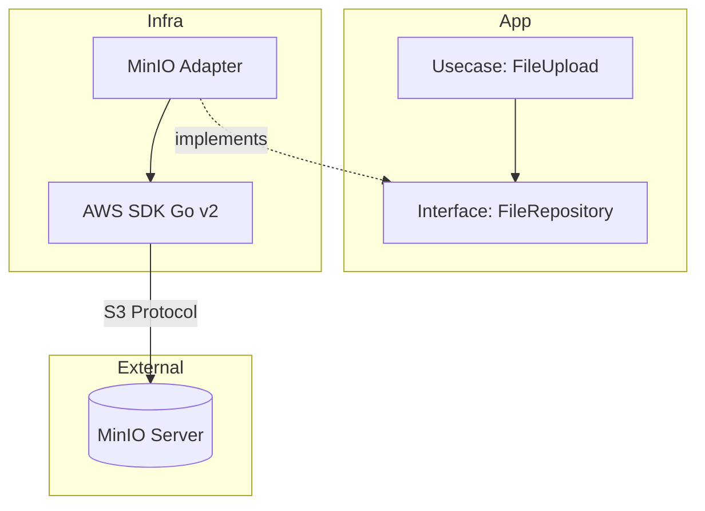

# Object Storage Workshop: Learning S3-Compatible API with MinIO

> **⏱️ Estimated Time**: Approx. 60 minutes
> **🎯 Level**: Intermediate
> **💻 Environment**: any (containers only), Go 1.25.5+

In this workshop, you will build an AWS S3-compatible object storage server using **MinIO** and learn how to implement file upload, download, and secure file sharing using Presigned URLs from a Go application.

> **💡 Glossary**: Please refer to [Object Storage](glossary_en.md#storage), [Bucket](glossary_en.md#storage), or [Presigned URL](glossary_en.md#security) in the [Glossary](glossary_en.md) for technical terms used in this workshop.

**⚠️ MinIO image availability (2026)**: MinIO stopped publishing free community container images in October 2025 and later removed its Docker Hub and quay.io repositories. This lab uses the frozen Bitnami mirror (`docker.io/bitnamilegacy/minio`), which is fine for local study — never use it in production. The last community build has **no embedded web Console**; this workshop verifies everything through the S3 API (`aws` CLI / `mc`).

## Goal

By completing this workshop, you will be able to:

- Understand basic object storage concepts (Buckets, Objects)
- Build an S3-compatible environment locally using MinIO
- Manipulate files from an application using the Go SDK (`aws-sdk-go-v2`)
- Master how to generate Presigned URLs to grant temporary access privileges

## Prerequisites

- [ ] **Podman** 4.x or later with `podman compose` available (`podman --version`)
- [ ] **Go** 1.25 or later (`go version`)
- [ ] **AWS CLI** (used for the client verification in Preparation)
- [ ] **MinIO Client (`mc`)** (optional — alternative to AWS CLI)

---

## Anti-Patterns and Solutions

### ❌ Anti-Pattern: Saving Files to Web Server

Saving uploaded images to the web server's local disk (`./uploads`).

- **Problem**: Files are not shared when the server scales out (multiple instances). Disk capacity overflows.

### ❌ Anti-Pattern: Saving Binaries to DB

Saving images as BLOBs in an RDBMS.

- **Problem**: DB size bloats, negatively affecting backups and performance.

### ✅ Solution: Object Storage (S3/MinIO)

- **Scalability**: Can save files without worrying about capacity.
- **Stateless**: Keeps web servers stateless, making scale-out easy.
- **API Access**: Accessible from anywhere via HTTP.

---

## Architecture

Following Clean Architecture, S3 operation details are hidden in the `infra` layer. The App (Usecase) only knows the abstract interface "save file".



### Directory Structure

```text
infra/assets/minio/
├── docker-compose.yml
├── main.go                 # Sample App entry point (upload/share commands)
├── go.mod
└── internal/
    ├── domain/repository/  # FileRepository interface
    ├── infra/minio/        # MinIO Adapter (S3 / Presigned URL operations)
    └── usecase/            # FileUsecase (Upload / ShareLink)
```

---

## Preparation

### 1. Start MinIO

```bash
cd infra/assets/minio
podman compose up -d
```

S3 API: `http://localhost:9000` — User / Pass: `minioadmin` / `minioadmin`

### ✅ Verification Checkpoints

- [ ] Confirmed MinIO container is running via `podman ps`.
- [ ] Confirmed the health endpoint responds: `curl -s -o /dev/null -w '%{http_code}' http://localhost:9000/minio/health/live` prints `200`.
- [ ] Confirmed a test bucket can be created via the client in the next step.

### 2. Client Setup (Alias)

Verify connection using MinIO Client (`mc`) or AWS CLI.

```bash
# Using AWS CLI (configured to point to local MinIO)
aws --endpoint-url http://localhost:9000 s3 mb s3://my-bucket
# Expected output: make_bucket: my-bucket
```

---

## Workshop Steps

### STEP 1: Bucket Creation and Basic Operations

Run the Go application to create a bucket `workshop-images` and upload a file.

**Code Example (Infra Layer)**:

```go
// internal/infra/minio/minio_adapter.go (Excerpt)
func (a *Adapter) Upload(ctx context.Context, key string, data []byte) error {
    // PutObject to S3 (MinIO)
    _, err := a.client.PutObject(ctx, &s3.PutObjectInput{
        Bucket: aws.String(a.bucket),
        Key:    aws.String(key),
        Body:   bytes.NewReader(data),
    })
    if err != nil {
        return fmt.Errorf("failed to upload object to minio: %w", err)
    }
    return nil
}
```

Command:

```bash
go run main.go upload sample.jpg
# Expected output: Successfully uploaded sample.jpg to bucket workshop-images
```

### STEP 2: Generate Presigned URL

Issue a time-limited access URL for a file in a private bucket. This allows you to securely show files only to specific users without making the bucket itself public.

**Code Example (Usecase / Infra Layers)**:

```go
// internal/usecase/file_usecase.go (Excerpt)
func (u *FileUsecase) GetShareLink(ctx context.Context, filename string) (string, error) {
    // Presigned URL expiry as business logic
    return u.repo.GeneratePresignedURL(ctx, filename, 15*time.Minute)
}
```

```go
// internal/infra/minio/minio_adapter.go (Excerpt)
func (a *Adapter) GeneratePresignedURL(ctx context.Context, key string, expires time.Duration) (string, error) {
    // Issue a GET URL valid for expires via the presign client
    req, err := a.presignClient.PresignGetObject(ctx, &s3.GetObjectInput{
        Bucket: aws.String(a.bucket),
        Key:    aws.String(key),
    }, s3.WithPresignExpires(expires))
    if err != nil {
        return "", fmt.Errorf("failed to generate presigned URL from minio: %w", err)
    }
    return req.URL, nil
}
```

Command:

```bash
go run main.go share sample.jpg
# Expected output:
# Presigned URL (valid for 15m):
# http://localhost:9000/workshop-images/sample.jpg?X-Amz-Algorithm=...
```

**Why is it secure?**: The URL contains a cryptographic signature, so if any part of the path or expiration time is tampered with, it becomes invalid.

### ✅ Verification Checkpoints

- [ ] Confirmed `go run main.go upload` succeeded and file is visible in MinIO.
- [ ] Confirmed `go run main.go share` generates a valid-looking URL.
- [ ] Confirmed `curl -I "<URL>"` returns HTTP 200 OK.

### STEP 3: Validate URL

Access the generated URL via a browser or `curl` to verify that the image can be downloaded. Also verify that access is denied after the specified expiration time (e.g., 15 minutes).

---

## Clean Architecture Highlights

### Dependency Inversion

The business logic (Usecase) only has the intent to "save a file" and does not know the detail "save to S3".
This allows switching between local disk in development, AWS S3 in production, and MinIO in on-premise environments without changing code (only changing DI).

---

## What you learned

- Why object storage (S3/MinIO) beats local disks and DB BLOBs for uploaded files
- How to run an S3-compatible storage server locally with Podman
- How to operate buckets and objects with the AWS SDK from Go while keeping the details in the infra layer
- How Presigned URLs grant time-limited access to private objects without publishing the bucket
- How signature-based URL validation makes tampering with path or expiration impossible

## Cleanup

```bash
podman compose down
```

Uploaded data is kept in the named volume `minio_data`, so it survives `podman compose down`. Run `podman compose down -v` if you also want to delete the data.

---

## Next Steps

- **Event Notification**: Trigger Lambda (OpenFaaS) on file upload to perform image resizing
- **Lifecycle Policy**: Configure automatic deletion/archiving of old files

---

## References

- [MinIO Documentation](https://min.io/docs/minio/container/index.html)
- [MinIO Client Complete Reference (`mc`)](https://min.io/docs/minio/linux/reference/minio-mc.html)
- [Amazon S3 API Reference](https://docs.aws.amazon.com/AmazonS3/latest/API/Welcome.html)
- [Amazon S3 User Guide: Sharing Objects with Presigned URLs](https://docs.aws.amazon.com/AmazonS3/latest/userguide/ShareObjectPreSignedURL.html)

---

## 🔧 Troubleshooting

### Connection Refused

**Symptoms**: `dial tcp 127.0.0.1:9000: connect: connection refused`

**Causes and Solutions**:

- **Container Not Running**: Ensure `podman compose up -d` completed successfully.
- **Port Conflict**: Check if another process is using port 9000 (`lsof -i:9000`).

### Signature Verification Error

**Symptoms**: Accessing the generated URL returns a `SignatureDoesNotMatch` error.

**Causes and Solutions**:

- **Credentials Mismatch**: Ensure the `accessKey`/`secretKey` constants in `main.go` match MinIO's settings (`minioadmin`).
- **Clock Skew**: Significant time difference between the client (Go app) and server (MinIO) can invalidate signatures.

---

## 💻 Environment Notes

### For macOS Users

- If `localhost` is unreachable, try `127.0.0.1` or the IP address of your Podman machine.

### For Windows Users

- When using WSL2, ensure localhost forwarding is working for your browser. Use `curl` inside WSL if browser access fails.
