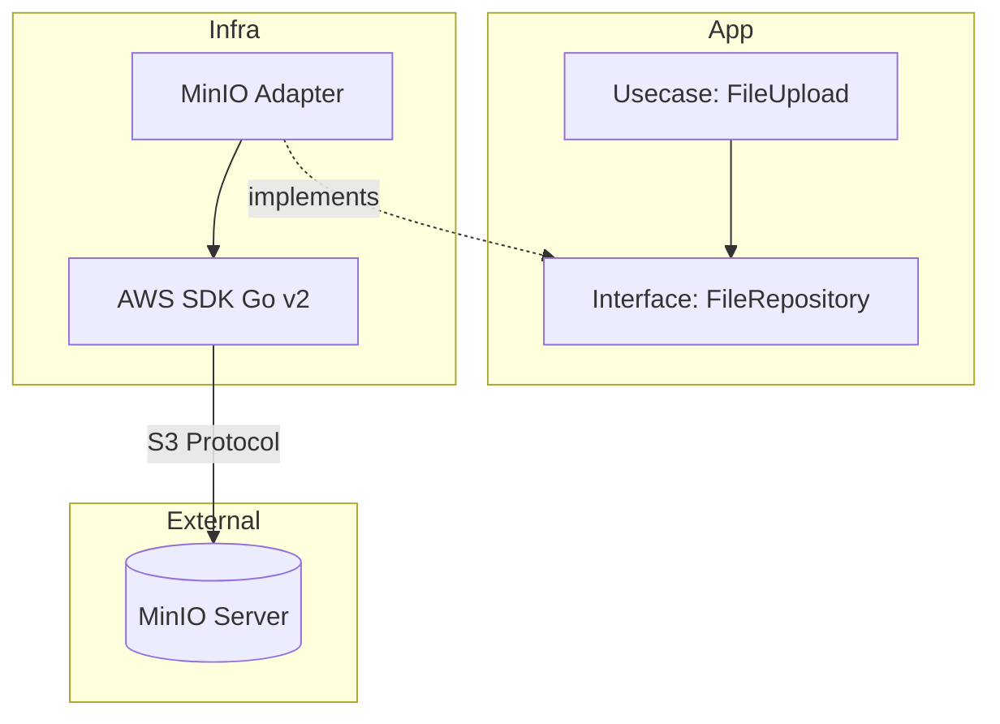

# オブジェクトストレージ実習：MinIO で学ぶ S3 互換 API

> **⏱️ 所要時間**: 約 60 分
> **🎯 レベル**: 中級
> **💻 環境**: any (containers only)

この実習では、AWS S3 互換のオブジェクトストレージサーバーである **MinIO** を構築し、Go アプリケーションからファイルのアップロード、ダウンロード、および署名付き URL（Presigned URL）を使用したセキュアなファイル共有の実装方法を学びます。

> **💡 用語集**: この実習で登場する[Object Storage](glossary_ja.md#storage)や[Bucket](glossary_ja.md#storage)、[Presigned URL](glossary_ja.md#security)などの専門用語は [用語集](glossary_ja.md) を参照してください。

**⚠️ MinIO イメージの入手性について（2026 年時点）**: MinIO は 2025 年 10 月に無料のコミュニティコンテナイメージの公開を終了し、その後 Docker Hub / quay.io のリポジトリも削除されました。本実習では凍結された Bitnami ミラー（`docker.io/bitnamilegacy/minio`）を使用します。ローカル学習には問題ありませんが、本番では使用しないでください。なお最終コミュニティビルドには**埋め込み Web コンソールが存在しない**ため、本実習ではすべて S3 API（`aws` CLI / `mc`）経由で確認します。

## ゴール

この実習を完了すると、以下のことができるようになります：

- オブジェクトストレージの基本概念（バケット、オブジェクト）を理解する
- MinIO を使用してローカルに S3 互換環境を構築する
- Go SDK (`aws-sdk-go-v2`) を使用してアプリケーションからファイルを操作する
- 署名付き URL を生成し、一時的なアクセス権限を付与する方法を習得する

## 前提条件

- [ ] **Podman** 4.x 以上（`podman compose` が使えること、`podman --version` で確認）
- [ ] **Go** 1.25 以上（`go version` で確認）
- [ ] **AWS CLI**（準備のクライアント確認で使用）
- [ ] **MinIO Client (`mc`)**（任意 — AWS CLI の代替）

---

## アンチパターンと解決策

### ❌ アンチパターン：Web サーバーへのファイル保存

アップロードされた画像を Web サーバーのローカルディスク（`./uploads`）に保存する。

- **問題点**: サーバーをスケールアウト（複数台構成）した際にファイルが共有されない。ディスク容量が溢れる。

### ❌ アンチパターン：DB へのバイナリ保存

画像を BLOB として RDBMS に保存する。

- **問題点**: DB のサイズが肥大化し、バックアップやパフォーマンスに悪影響を与える。

### ✅ 解決策：オブジェクトストレージ (S3/MinIO)

- **スケーラビリティ**: 容量を気にせず保存可能。
- **ステートレス**: Web サーバーをステートレスに保てるため、スケールアウトが容易。
- **API アクセス**: HTTP 経由でどこからでもアクセス可能。

---

## アーキテクチャ

クリーンアーキテクチャに従い、S3 操作の詳細は `infra` 層に隠蔽します。アプリ（Usecase）は「ファイルを保存する」という抽象的なインターフェースのみを知っています。



### 想定ディレクトリ構造

```text
infra/assets/minio/
├── docker-compose.yml
├── main.go                 # サンプルアプリのエントリーポイント (upload/share コマンド)
├── go.mod
└── internal/
    ├── domain/repository/  # FileRepository インターフェース
    ├── infra/minio/        # MinIO アダプター (S3 / Presigned URL 操作)
    └── usecase/            # FileUsecase (Upload / ShareLink)
```

---

## 準備

### 1. MinIO の起動

```bash
cd infra/assets/minio
podman compose up -d
```

S3 API: `http://localhost:9000` — ユーザー / パス: ともに `minioadmin`

### ✅ チェックポイント

- [ ] `podman ps` で MinIO コンテナが実行中であることを確認した
- [ ] ヘルスチェックエンドポイントが応答することを確認した: `curl -s -o /dev/null -w '%{http_code}' http://localhost:9000/minio/health/live` が `200` を表示
- [ ] 次のステップのクライアントでテスト用のバケットが作成できることを確認した

### 2. クライアント設定 (Alias)

MinIO クライアント (`mc`) が利用可能な場合、または AWS CLI を使用して接続確認を行います。

```bash
# AWS CLI の場合 (ローカルのMinIOに向ける設定)
aws --endpoint-url http://localhost:9000 s3 mb s3://my-bucket
# Expected output: make_bucket: my-bucket
```

---

## 実習ステップ

### STEP 1: バケットの作成と基本操作

Go アプリケーションを実行し、バケット `workshop-images` を作成してファイルをアップロードします。

**コード実装例 (Infra層)**:

```go
// internal/infra/minio/minio_adapter.go (抜粋)
func (a *Adapter) Upload(ctx context.Context, key string, data []byte) error {
    // S3 (MinIO) にファイルをPutObjectする
    _, err := a.client.PutObject(ctx, &s3.PutObjectInput{
        Bucket: aws.String(a.bucket),
        Key:    aws.String(key),
        Body:   bytes.NewReader(data),
    })
    if err != nil {
        return fmt.Errorf("failed to upload object to minio: %w", err)
    }
    return nil
}
```

実行コマンド:

```bash
go run main.go upload sample.jpg
# Expected output: Successfully uploaded sample.jpg to bucket workshop-images
```

### STEP 2: 署名付き URL (Presigned URL) の生成

プライベートなバケットにあるファイルに対して、期限付きのアクセス URL を発行します。これにより、バケット自体を公開設定にすることなく、特定のユーザーにのみファイルを安全に見せることができます。

**コード実装例 (Usecase層 / Infra層)**:

```go
// internal/usecase/file_usecase.go (抜粋)
func (u *FileUsecase) GetShareLink(ctx context.Context, filename string) (string, error) {
    // ビジネスロジックとしての有効期限設定
    return u.repo.GeneratePresignedURL(ctx, filename, 15*time.Minute)
}
```

```go
// internal/infra/minio/minio_adapter.go (抜粋)
func (a *Adapter) GeneratePresignedURL(ctx context.Context, key string, expires time.Duration) (string, error) {
    // presign クライアントで expires の間だけ有効な GET 用 URL を発行
    req, err := a.presignClient.PresignGetObject(ctx, &s3.GetObjectInput{
        Bucket: aws.String(a.bucket),
        Key:    aws.String(key),
    }, s3.WithPresignExpires(expires))
    if err != nil {
        return "", fmt.Errorf("failed to generate presigned URL from minio: %w", err)
    }
    return req.URL, nil
}
```

実行コマンド:

```bash
go run main.go share sample.jpg
# Expected output:
# Presigned URL (valid for 15m):
# http://localhost:9000/workshop-images/sample.jpg?X-Amz-Algorithm=...
```

**なぜ安全なのか？**: URL には暗号学的な署名が含まれており、有効期限やパスの一部でも改ざんされると無効になります。

### ✅ チェックポイント

- [ ] `go run main.go upload` が正常に終了し、`aws --endpoint-url http://localhost:9000 s3 ls s3://workshop-images` でファイルを確認できた
- [ ] `go run main.go share` で生成された URL が期待通りの形式であることを確認した
- [ ] `curl -I "<URL>"` で HTTP 200 OK が返ることを確認した

### STEP 3: URL の検証

生成された URL をブラウザまたは `curl` で叩き、画像がダウンロードできることを確認します。指定した有効期限（例：15 分）が過ぎると、アクセスできなくなることも確認します。

---

## クリーンアーキテクチャのポイント

### 依存関係の逆転

ビジネスロジック（Usecase）は「ファイルを保存したい」という意図のみを持ち、「S3 に保存する」という詳細は知りません。
これにより、開発環境ではローカルディスク、本番環境では AWS S3、オンプレ環境では MinIO といった切り替えが、コードの修正なし（DI の変更のみ）で可能になります。

---

## 学んだこと

- アップロードファイルの保存先として、ローカルディスクや DB の BLOB よりオブジェクトストレージ (S3/MinIO) が適する理由
- Podman を使ってローカルに S3 互換ストレージサーバーを構築する方法
- Go から AWS SDK でバケット・オブジェクトを操作し、その詳細を infra 層に隠蔽する方法
- Presigned URL でバケットを公開せずに、期限付きのアクセス権を付与する方法
- 署名により、URL のパスや有効期限の改ざんが検知される仕組み

## 片付け

```bash
podman compose down
```

アップロードしたデータは名前付きボリューム `minio_data` に保存されるため、`podman compose down` でも残ります。データも削除したい場合は `podman compose down -v` を実行してください。

---

## 次のステップ

- **イベント通知**: ファイルアップロードをトリガーに Lambda (OpenFaaS) を起動し、画像縮小処理を行う
- **ライフサイクルポリシー**: 古いファイルを自動的に削除・アーカイブする設定

---

## 参考文献

- [MinIO ドキュメント](https://min.io/docs/minio/container/index.html)
- [MinIO Client (`mc`) リファレンス](https://min.io/docs/minio/linux/reference/minio-mc.html)
- [Amazon S3 API リファレンス](https://docs.aws.amazon.com/AmazonS3/latest/API/Welcome.html)
- [Amazon S3 ユーザーガイド: Presigned URL でのオブジェクト共有](https://docs.aws.amazon.com/AmazonS3/latest/userguide/ShareObjectPreSignedURL.html)

---

## 🔧 トラブルシューティング

### 接続エラー (Connection Refused)

**症状**: `dial tcp 127.0.0.1:9000: connect: connection refused`

**原因と対処**:

- **コンテナ未起動**: `podman compose up -d` が成功しているか確認してください。
- **ポート競合**: 既に他のプロセスが 9000 番ポートを使用していないか確認してください (`lsof -i:9000`)。

### 署名検証エラー (Signature Does Not Match)

**症状**: 生成された URL にアクセスすると `SignatureDoesNotMatch` エラーが出る

**原因と対処**:

- **認証情報の不一致**: `main.go` の `accessKey`/`secretKey` 定数が MinIO の設定値 (`minioadmin`) と一致しているか確認してください。
- **時刻のズレ**: クライアント（Go アプリ）とサーバー（MinIO）の時刻が著しくズレていると署名が正しく検証されません。

---

## 💻 環境別注意事項

### macOS の場合

- `localhost` でアクセスできない場合、`127.0.0.1` または Podman マシンの IP アドレスを試してください。

### Windows の場合

- WSL2 を使用している場合、Windows 側のブラウザからアクセスするには localhost 転送が正しく機能している必要があります。不可能な場合は WSL 内部の `curl` を使用してください。
