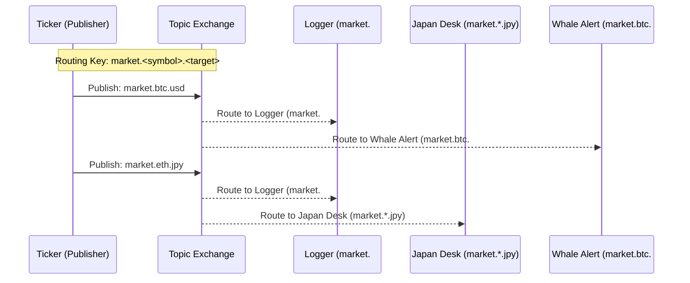

# RabbitMQ Workshop: Real-time Crypto Monitoring System with Topic Exchange

> **⏱️ Estimated Time**: Approx. 60 minutes
> **🎯 Level**: Intermediate
> **💻 Environment**: Linux | macOS (Podman or Docker)

In this workshop, you will build a system that flexibly filters and processes real-time trade data using the powerful **Topic Exchange** feature of **RabbitMQ**.

> **💡 Glossary**: Please refer to the [Pub/Sub Pattern](glossary_en.md#mq) or [Wildcard Matching](glossary_en.md#mq) in the [Glossary](glossary_en.md) for technical terms used in this workshop.

## Goal

Build a monitoring system based on **Clean Architecture** with the following features.



**What you will learn in this workshop:**

1. **Pub/Sub Pattern**: Complete decoupling of senders and receivers.
2. **Topic Exchange**: Advanced routing using dot-separated keys.
3. **Wildcard Matching**: Using `*` (one word) and `#` (zero or more words).

## Prerequisites

- [ ] **Podman** 4.x or later (Docker also works — replace `podman` with `docker`)
- [ ] **Go** 1.25 or later (`go version`)
- [ ] **make** (used by `make mq-up` / `make mq-down`)
- [ ] At least 4 terminal windows (ticker + 3 consumers)
- [ ] Recommended: [RabbitMQ](glossary_en.md#mq) basics from the [Glossary](glossary_en.md)

---

## Challenges in Communication Design

Directly communicating between microservices (e.g., via HTTP) presents several issues.

### ❌ Challenges

- **Tight Coupling**: The sender must know "who receives the data," requiring code changes whenever a new consumer is added.
- **Fault Tolerance**: If the receiver is down, the sender's process may block or error out.
- **Scalability**: Receivers can be overwhelmed by sudden bursts of data (spikes).

### ✅ Message Queue (RabbitMQ) Solutions

- **Asynchronous Communication**: The sender simply drops a message into the queue and moves on, independent of the receiver's state.
- **Loose Coupling**: Senders only care about the "Exchange." RabbitMQ manages who gets the message.
- **Buffering**: Unprocessed messages wait in the queue, allowing consumers to process them at their own pace.

---

## Architecture

The system centers around a Topic Exchange that dynamically controls message destinations.

### Directory Structure

```text
infra/assets/rabbitmq_crypto/
├── cmd/                        # Entry points for each role
│   ├── ticker/                 # Data generation & distribution
│   ├── logger/                 # All-records logging
│   ├── alert/                  # Whale alert detection
│   └── japandesk/              # JPY monitoring
└── internal/
    ├── domain/                 # Entities, Repository Interface
    ├── usecase/                # Simulation and Monitoring logic
    └── infra/                  # RabbitMQ Adapter
```

---

## Preparation

### 1. Start RabbitMQ (with Management Plugin)

```bash
cd infra/assets/rabbitmq_crypto
make mq-up
# Expected output: long container ID printed by `podman run -d`
```

_Note: Access the management UI at [http://localhost:15672](http://localhost:15672) (guest/guest)._

### ✅ Verification Checkpoints

- [ ] Confirmed `workshop-mq` is `Up` via `podman ps`.
- [ ] Confirmed the management UI at [http://localhost:15672](http://localhost:15672) is accessible.

### 2. Install Dependencies

```bash
go mod tidy
```

---

## Workshop Steps

### STEP 1: Stream Market Data (Ticker)

Start the `ticker` that continuously generates trade data.

```bash
go run cmd/ticker/main.go
# Expected output: "Ticker starting... (Ctrl+C to stop)" and publishing every 0.5s
```

_Note: It will keep publishing messages with keys like `market.btc.usd`._

### ✅ Verification Checkpoints

- [ ] The ticker terminal shows published messages and routing keys.
- [ ] The management UI's Exchanges tab shows activity for `crypto_market`.

### STEP 2: Log All Transactions (Topic: `market.#`)

Use the `#` wildcard to subscribe to all currency pairs.

```bash
go run cmd/logger/main.go
# Expected output: "Logger starting (market.#)..." followed by a JSON trade
# message every 0.5s (e.g. {"id":"...","symbol":"btc","target_currency":"usd",...})
```

### STEP 3: Conditional Filtering

Start consumers matching specific conditions in separate terminals.

- **JPY-pair only**: `go run cmd/japandesk/main.go` (Key: `market.*.jpy`)
- **Large BTC trades**: `go run cmd/alert/main.go` (Key: `market.btc.#`)

---

### ✅ Verification Checkpoints

- [ ] `logger` receives all currency pairs.
- [ ] `japandesk` receives only routing keys ending in `.jpy`.
- [ ] `alert` receives only routing keys beginning with `market.btc`.

---

## Clean Architecture Highlights

The code communicates with RabbitMQ through an interface defined in `internal/domain`.

```go
type TradePublisher interface {
    Publish(ctx context.Context, trade Trade) error
}
```

This design allows you to swap the broker for Kafka or NATS in the future by simply replacing the infrastructure implementation without touching the business logic (UseCase).

---

## What you learned

- How a message queue decouples senders from receivers (async communication and buffering)
- How a Topic Exchange routes messages with dot-separated routing keys
- How the `*` (one word) and `#` (zero or more words) wildcards differ in bindings
- How Clean Architecture hides the broker behind a domain-defined publisher interface
- How to verify routing behavior from the RabbitMQ management UI

Next step: learn how to make consumers retry-safe with the [Idempotency Pattern Workshop](../software/idempotency_en.md), or how brokers scale out in the [Sharding guide](sharding_en.md).

## Cleanup

```bash
make mq-down
```

---

## References

- [RabbitMQ Tutorial - Topic Exchange (Go)](https://www.rabbitmq.com/tutorials/tutorial-five-go.html)
- [AMQP 0-9-1 Model Explained](https://www.rabbitmq.com/tutorials/amqp-concepts.html)

---

## Troubleshooting

### Consumers Receive No Messages

Ensure the ticker is running in another terminal:

```bash
go run cmd/ticker/main.go
```

Open <http://localhost:15672> with `guest/guest`. In Exchanges, verify that `crypto_market` exists. In Queues, inspect the consumer queues and their bindings.

### Connection Errors

For `dial tcp: connection refused`, check the following:

- The RabbitMQ container is running:

  ```bash
  podman ps --filter name=workshop-mq
  ```

- Ports 5672 (AMQP) and 15672 (management) are published:

  ```bash
  podman port workshop-mq
  ```

### Cannot Open the Management UI

Check that the management plugin is enabled and that your firewall allows port 15672.

```bash
podman logs workshop-mq
```

## Environment Notes

### For macOS Users

RabbitMQ can also be installed locally with Homebrew.

```bash
brew install rabbitmq
brew services start rabbitmq
```

For this local setup, use <http://localhost:15672> and the default `guest/guest` credentials.

### For Windows Users

Use Podman in Ubuntu on WSL2, or replace `podman` with `docker` for Docker Desktop. Windows Firewall may need to allow ports 5672 and 15672.
