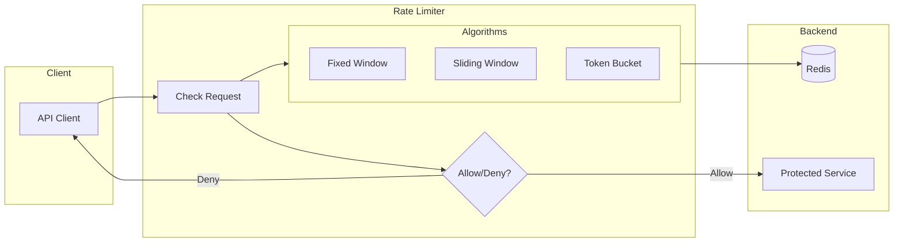
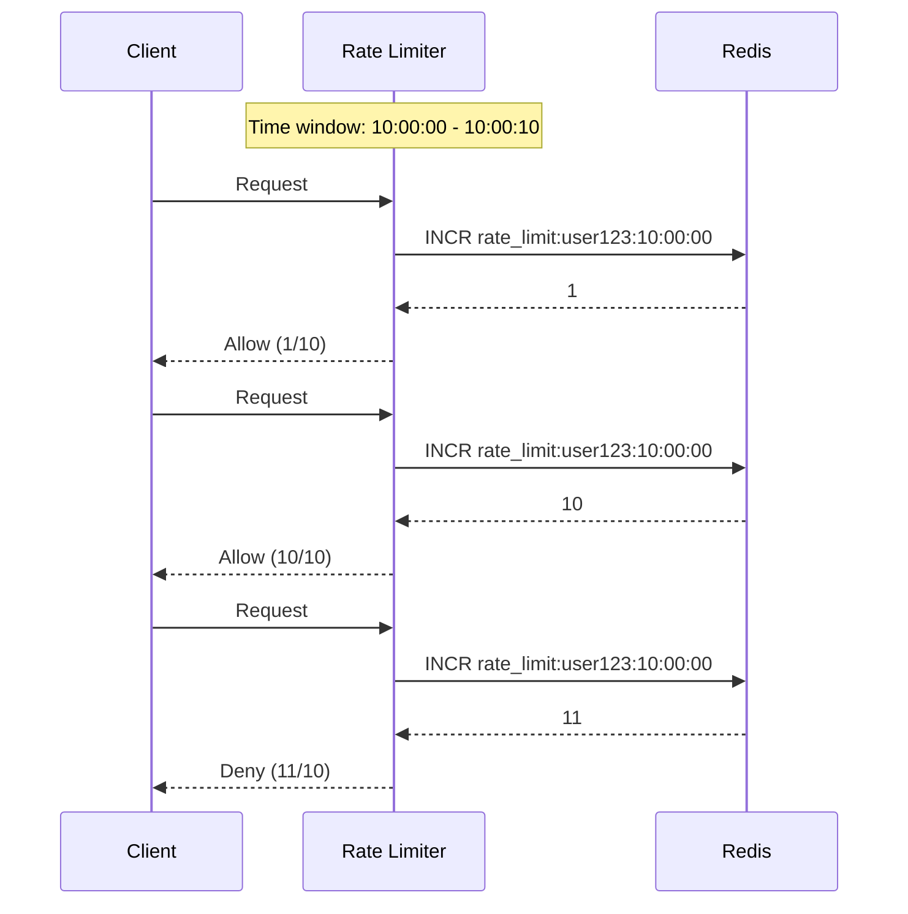
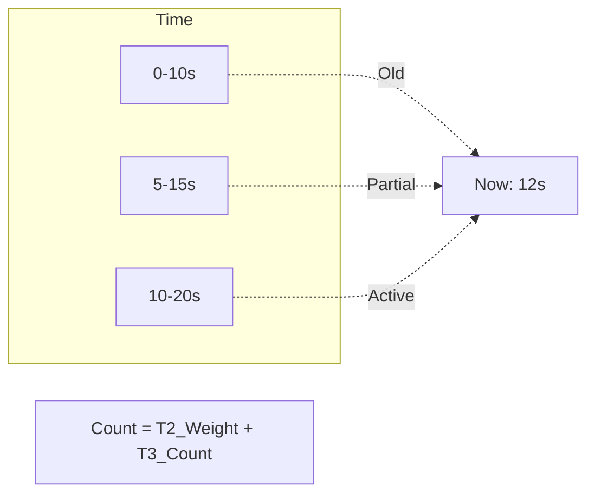
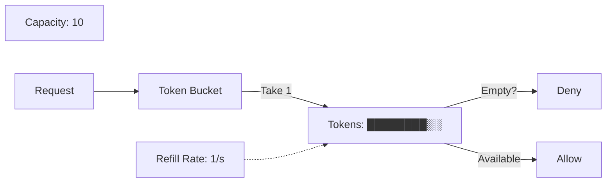

# Rate Limiting Workshop: Request Throttling with Redis

> **⏱️ Estimated Time**: Approx. 60 minutes
> **🎯 Level**: Beginner
> **💻 Environment**: Linux / macOS (podman or docker, Go 1.23+)

In this workshop, you will build a "Rate Limiting" system to prevent overload of APIs and Web services using Redis data structures.

> **💡 Glossary**: For technical terms such as [Rate Limiting](glossary_en.md#rate-limiting), [Token Bucket](glossary_en.md#rate-limiting), and [Sliding Window](glossary_en.md#rate-limiting), please refer to the [Glossary](glossary_en.md).

## Prerequisites

- [ ] Go 1.23 or later (`go version`)
- [ ] Podman (`podman version`) or Docker
- [ ] Basic Go syntax (functions, structs, interfaces) — see `../software/clean_arch_en.md` for the layering used in the asset

Port 6379 must be free on localhost.

## Implementation Code

The complete implementation for this workshop can be found in [`infra/assets/rate_limiting/`](assets/rate_limiting/).

```bash
cd infra/assets/rate_limiting
ls -la
# domain/  usecase/  main.go  go.mod  go.sum
```

## Goal

Implement multiple algorithms (Fixed Window, Sliding Window, Token Bucket) and understand their characteristics and use cases.



**What you will learn:**

1. **Fixed Window**: Simple, but suffers from request bursts at window boundaries.
2. **Sliding Window**: Smoother limiting, but with higher computational cost.
3. **Token Bucket**: Balance between burst tolerance and steady-state rate limiting.

---

## Challenges of Rate Limiting

Excessive requests to an API can impact the entire system.

### ❌ Challenges

- **Resource Exhaustion**: Database connections, CPU, and memory are used up.
- **Cascading Failures**: Impact spreads to downstream services.
- **Increased Costs**: Sudden spikes in pay-as-you-go cloud service fees.
- **Unfairness**: A few users monopolize resources.

### ✅ Rate Limiting Solutions

- **Protection**: Safeguard backend services from overload.
- **Fairness**: Provide equal access opportunities to all users.
- **Cost Management**: Predictable resource usage.

---

## Algorithm Comparison

### 1. Fixed Window



**Pros**: Memory efficient, easy to implement.
**Cons**: Traffic can double at window boundaries.

#### Boundary Spike Example

```text
Limit: 10 requests / 10 seconds

Time 00:09: 10 requests -> Allowed (Window 1: 0-10s)
Time 00:11: 10 requests -> Allowed (Window 2: 10-20s)

Result: 20 requests in 2 seconds = 2x the configured traffic!
```

Algorithms like Sliding Window or Token Bucket solve this issue.

### 2. Sliding Window



**Pros**: Smooth limiting, no spikes at boundaries.
**Cons**: Higher computational cost and memory usage.

### 3. Token Bucket



**Pros**: Allows bursts, flexible rate settings.
**Cons**: Complex parameter tuning.

---

## Architecture

### Target Directory Structure

```text
infra/assets/rate_limiting/
├── domain/         # Definition of limiting rules (RateLimiter interface)
├── usecase/        # Implementation of each algorithm (Lua scripts)
└── main.go         # Entry point (test CLI)
```

---

## Setup

### 1. Start Redis

```bash
# For Podman
podman run -d --name rate-limit-redis -p 6379:6379 docker.io/library/redis:alpine

# For Docker (alternative)
docker run -d --name rate-limit-redis -p 6379:6379 redis:alpine
```

### 2. Project Setup

```bash
cd infra/assets/rate_limiting
go mod tidy
```

### ✅ Checkpoint

- [ ] Confirmed Redis is running with `podman ps`

---

## Hands-on Steps

### STEP 1: Implement Fixed Window

Implement a counter per time window.

```bash
# Max 5 requests per 10 seconds
go run main.go -algorithm fixed-window -user user1 -limit 5 -window 10s
```

**Implementation Highlights:**

Read the corresponding algorithm in [limiters.go](assets/rate_limiting/usecase/limiters.go), including its Lua script and error handling.

### ✅ Checkpoint

- [ ] Confirmed the 6th request is denied after 5 successes
- [ ] Confirmed it resets in the next time window

### STEP 2: Implement Sliding Window

Approximate the count over the last N seconds using a weighted counter for the current and previous windows.

```bash
# Max 5 requests in the last 10 seconds
go run main.go -algorithm sliding-window -user user2 -limit 5 -window 10s
```

**Implementation Highlights:**

Read the corresponding algorithm in [limiters.go](assets/rate_limiting/usecase/limiters.go), including its Lua script and error handling.

### ✅ Checkpoint

- [ ] Confirmed smoother limiting compared to Fixed Window
- [ ] Confirmed no spikes at window boundaries

### STEP 3: Implement Token Bucket

Implement burstable rate limiting.

```bash
# Capacity 10, Refill rate 1/sec
go run main.go -algorithm token-bucket -user user3 -capacity 10 -rate 1
```

**Implementation Highlights:**

Read the corresponding algorithm in [limiters.go](assets/rate_limiting/usecase/limiters.go), including its Lua script and error handling.

### ✅ Checkpoint

- [ ] Confirmed bursts (temporary large request volume) are allowed
- [ ] Confirmed rate limiting works in steady-state

### STEP 4: Algorithm Comparison

Compare the characteristics of each algorithm.

This workshop's implementation is a CLI that performs one decision per invocation (no HTTP server is started). Run the same command repeatedly to observe each algorithm's behavior.

```bash
# Spike test at boundaries: 20 requests in quick succession against Fixed Window
for i in {1..20}; do
  go run main.go -algorithm fixed-window -user cmp1 -limit 5 -window 10s
done
# Expected output (first 5 lines):
# [fixed-window] Allowed: User cmp1
# ...
# Expected output (6th and later lines):
# [fixed-window] Denied: User cmp1 (Rate limit exceeded)
```

```bash
# Compare with Token Bucket (capacity 5, refill 1/sec) under the same load
for i in {1..20}; do
  go run main.go -algorithm token-bucket -user cmp2 -capacity 5 -rate 1
  sleep 0.5
done
# Expected output (initial burst is allowed, then denials while the bucket refills):
# [token-bucket] Allowed: User cmp2
# ...
# [token-bucket] Denied: User cmp2 (Rate limit exceeded)
```

| Algorithm      | Boundary Behavior | Memory Usage | CPU Usage | Burst Tolerance |
| :------------- | :---------------- | :----------- | :-------- | :-------------- |
| Fixed Window   | Spikes possible   | Low          | Low       | No              |
| Sliding Window | Smooth            | High         | High      | No              |
| Token Bucket   | Smooth            | Medium       | Medium    | Yes             |

---

## Implementation Patterns

### Clean Architecture Configuration

**Domain (Interface Definition):**

```go
type RateLimiter interface {
    Allow(ctx context.Context, userID string) (bool, error)
}
```

**Usecase (Algorithm Implementation):**

```go
type FixedWindowLimiter struct {
    client *redis.Client
    limit  int64
    window time.Duration
}

func (f *FixedWindowLimiter) Allow(ctx context.Context, userID string) (bool, error) {
    // Implementation...
}
```

**Infra (Redis Access):**

In this asset, the Usecase limiters access Redis directly via `go-redis` — there is no separate Infra adapter (see `usecase/limiters.go`).

---

## What you learned

- How **Fixed Window** counting works and why it allows 2x traffic spikes at window boundaries
- How **Sliding Window** smooths those spikes with a weighted counter (at higher memory/CPU cost)
- How **Token Bucket** permits bursts while enforcing a steady-state rate
- Why Lua scripts make each decision atomic on Redis, and when that assumption breaks (Redis Cluster)
- How the limiter fits Clean Architecture: interface in Domain, algorithms in Usecase (Redis accessed directly from Usecase)

Next steps: apply a limiter to an HTTP server (see `web_security_en.md` for protecting endpoints), and combine with caching (`cache_en.md`).

---

## Cleanup

```bash
podman stop rate-limit-redis
podman rm rate-limit-redis
```

---

## References

- [Redis: INCR - Redis Documentation](https://redis.io/commands/incr/)
- [Rate Limiting Wikipedia](https://en.wikipedia.org/wiki/Rate_limiting)
- [Cloudflare: How to design a rate limiter](https://blog.cloudflare.com/counting-things-a-lot-of-things/)

---

## 🔧 Troubleshooting

### Rate Limiting Not Working Correctly

**Symptoms**: Requests are allowed even when exceeding limits.

**Causes and Solutions:**

- **Redis Key Conflict**: If multiple instances share Redis, review key design.
- **Clock Drift**: Check NTP synchronization in distributed environments.

### Sliding Window is Slow

**Symptoms**: Response delay.

**Causes and Solutions:**

- **Reduce Redis Commands**: Use Lua scripts to execute multiple commands atomically.

```lua
-- ratelimit_sliding.lua
local key = KEYS[1]
local now = tonumber(ARGV[1])
local window = tonumber(ARGV[2])
-- ... processing ...
```

---

## Environment-specific Notes

### macOS

You can also install Redis directly via Homebrew.

```bash
brew install redis
brew services start redis
```

### Windows

Recommended to run on Ubuntu via WSL2.

The [executable limiters](assets/rate_limiting/usecase/limiters.go) use Lua to make each decision and state update atomic on a single Redis server. Counter increments include expiry; token refill and consumption use the Redis server clock in one script. Invalid parameters and Redis failures return errors. Window durations must be at least 1ms, and limits, bucket capacity, and refill rate must be positive. The sliding counter includes denied attempts and approximates a sliding log. Its two-key script assumes a standalone Redis server, not Redis Cluster.
