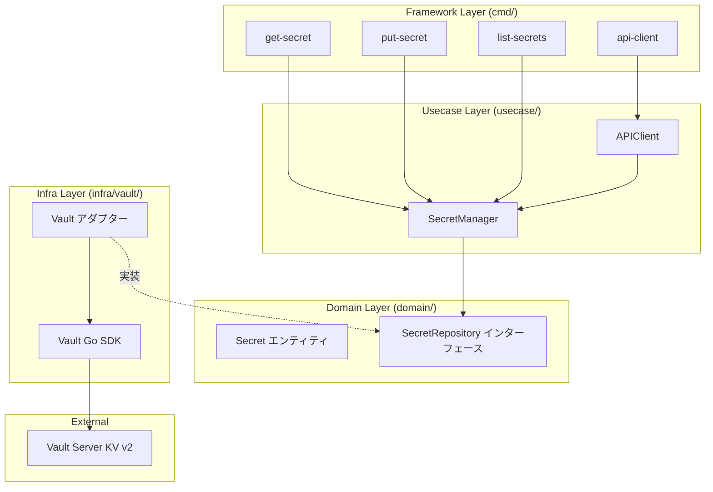

# シークレット管理実習：HashiCorp Vault による安全な API キー管理

> **⏱️ 所要時間**: 約 60 分
> **🎯 レベル**: 中級
> **💻 環境**: Linux | macOS (Podman)、Go 1.25.5+

この実習では、**HashiCorp Vault** と **Go** を使用して、API キー、データベース認証情報、その他のセンシティブデータをソースコードにハードコードすることなく安全に管理するシステムを構築します。

> **💡 用語集**: この実習で登場する[Secret Management](glossary_ja.md#security)や[Vault](glossary_ja.md#security)、[KV Engine](glossary_ja.md#security)などの専門用語は [用語集](glossary_ja.md) を参照してください。

## ゴール

安全なシークレット管理フローを構築・体験し、以下のスキルを習得します。

- シークレット管理がなぜ重要かを理解する。
- 一般的なアンチパターン（ハードコード、.env ファイル）を識別・回避する。
- HashiCorp Vault の基本（KV v2、トークン）を習得。
- Clean Architecture を使用して Vault をアプリケーションに統合する。
- シークレットのバージョニングとローテーションを実装する。

## 前提条件

- [ ] **Podman** 4.x 以上（`podman --version` で確認）
- [ ] **Go** 1.25 以上（`go version` で確認）
- [ ] **make**（`make vault-up`、`make init`、`make vault-down` で使用）
- [ ] ポート `8200` が空いていること（Vault API/UI）
- [ ] 推奨: [用語集](glossary_ja.md#security) のシークレット管理関連用語を一読しておく

---

## シークレット管理の課題（アンチパターン）

正しい方法を学ぶ前に、よくある間違いとそのリスクを確認します。

### ❌ アンチパターン 1：ハードコードされた認証情報

認証情報を Git 履歴に直接書き込む手法です。

- **問題点**: 履歴に永遠に残り、リポジトリへのアクセス権を持つ全員に露出します。

### ❌ アンチパターン 2：環境変数ファイル (.env)

- **問題点**: Git に誤ってコミットされやすく、誰がアクセスしたかの監査ログも残りません。

### ✅ 外部シークレットマネージャーの解決策

Vault を使うことで、中央集権的な管理、監査ログ、暗号化、自動ローテーションが実現します。

---

## アーキテクチャ

適切な関心の分離を持つ **クリーンアーキテクチャ** を実装します。



### 想定ディレクトリ構造

```text
infra/assets/secret_management/
├── cmd/                        # 各操作のエントリーポイント
├── domain/                     # 純粋な Go による定義
├── usecase/                    # シークレット管理のオーケストレーション
├── infra/                      # Vault アダプターの実装
├── Makefile                    # コンテナ管理コマンド
└── go.mod
```

---

## 準備

### 1. Vault の起動

```bash
cd infra/assets/secret_management
make vault-up
```

### 2. KV v2 シークレットエンジンの有効化

```bash
# コンテナ内で初期化を実行
make init
```

### ✅ チェックポイント

- [ ] `podman ps` で `workshop-vault` が実行中であることを確認した
- [ ] `make init` 実行後、`secret/` パスに KV v2 エンジンがマウントされていることを確認した
- [ ] `VAULT_TOKEN` 環境変数が適切に設定されていることを確認した

---

## 実習ステップ

### STEP 1: アンチパターンの確認

他のワークショップ資産などで、パスワードがハードコードされている箇所がないか探してみましょう。一度コミットされると、後から消しても履歴に残る恐怖を実感してください。

### STEP 2: 基本的なシークレット操作 (Put/Get)

```bash
# 保存
go run cmd/put-secret/main.go api/external-key "sk-live-abc123xyz789"
# Expected output: "=== Secret Stored Successfully ===" と保存した Key / Value が表示される
# 取得
go run cmd/get-secret/main.go api/external-key
# Expected output: "=== Secret Retrieved ===" に Value: sk-live-abc123xyz789 (Version: 1) が表示される
```

### STEP 3: 実践例 - API クライアント

起動時に Vault からキーを取得し、それを使って API 呼び出し（シミュレート）を行うパターンを確認します。

```bash
go run cmd/api-client/main.go
# Expected output: 取得したキーを使った処理の後、"[INFO] Demo completed successfully" が表示される
```

### STEP 4: バージョニングとローテーション

Vault KV v2 では、同じキーに新しい値を書き込むと自動的にバージョンが上がります。

```bash
# 更新
go run cmd/put-secret/main.go api/key "new-value"
# 履歴確認 (コンテナ内コマンド)
podman exec workshop-vault vault kv metadata get secret/api/key
# Expected output: current_version が増加したメタデータテーブルが表示される (例: 2)
```

`internal/usecase` レイヤーのコードを見て、Vault への依存が一切ない（`internal/domain` のインターフェースにのみ依存している）ことを確認してください。

### ✅ チェックポイント

- [ ] `go run cmd/put-secret` がエラーなく保存を完了できた
- [ ] `go run cmd/get-secret` で保存した値が正しく表示されることを確認した
- [ ] `metadata get` コマンドでシークレットのバージョンが上がっていることを確認した

---

## クリーンアーキテクチャのポイント

ビジネスロジックは、**「シークレットが Vault にあるか AWS にあるか」**を気にしません。`internal/domain/repository.go` で定義された抽象的な操作を通じてシークレットを取得し、`internal/infra` が実装詳細を担います。これにより、インフラの変更に対して非常に堅牢なシステムになります。

---

## 学んだこと

- ハードコードされた認証情報やコミットされた `.env` ファイルが危険なアンチパターンである理由
- 開発モードの Vault サーバーの起動と KV v2 シークレットエンジンの有効化方法
- Clean Architecture のアダプター経由でのシークレット保存・取得・一覧取得
- KV v2 がシークレットの履歴を保持し、ローテーションやロールバックを可能にする仕組み
- ドメイン層のインターフェースのみに依存することで usecase 層から Vault への依存をなくす方法

次のステップ: [RabbitMQ 実習](rabbitmq_ja.md) でシークレットを使うアプリケーション側を、[Terraform 実習](terraform_ja.md) で環境そのもののコード化を学びましょう。

## 片付け

```bash
make vault-down
```

---

## 次のステップ

- **動的シークレット**: データベースへの一時的なアクセス権限をオンデマンドで発行する機能を学ぶ。
- **Transit 認証**: アプリケーション側で復号鍵を持たずにデータを暗号化する仕組みを学ぶ。

---

## 参考文献

- [HashiCorp Vault ドキュメント](https://developer.hashicorp.com/vault/docs)
- [Vault KV v2 Secrets Engine](https://developer.hashicorp.com/vault/docs/secrets/kv/kv-v2)
- [Vault API: KV v2 Read Secret Metadata](https://developer.hashicorp.com/vault/api-docs/secret/kv/kv-v2)
- [Vault Go API Client](https://developer.hashicorp.com/vault/docs/api-docs/libraries)

---

## 🔧 トラブルシューティング

### 認証エラー (Permission Denied)

**症状**: `Error making API request: 403 Forbidden`

**原因と対処**:

- **トークンの期限切れ**: `VAULT_TOKEN` が正しいか、有効期限が切れていないか確認してください。
- **ポリシー不足**: 操作しようとしているパス (`secret/api/*` など) に対して適切な権限が付与されているか確認してください。

### サーバーに接続できない

**症状**: `dial tcp 127.0.0.1:8200: connect: connection refused`

**原因と対処**:

- **Vault が未起動**: `make vault-up` が完了しているか確認してください。
- **アドレスの誤り**: `VAULT_ADDR` 環境変数が `http://127.0.0.1:8200` に設定されているか確認してください。

---

## 💻 環境別注意事項

### macOS の場合

- `localhost` で接続できない場合は `127.0.0.1` を明示的に使用してください。

### Windows の場合

- WSL2 から Windows 側のブラウザで Vault UI を開くには、ポートフォワーディングが機能している必要があります。
- Windows の環境変数ではなく、WSL 内部の `.bashrc` 等で `VAULT_ADDR` を管理することを推奨します。
