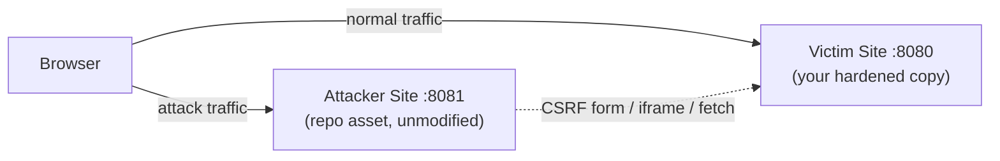

# Web Security Workshop (Part 2 - Defense): Hardening the Victim Application

> **⏱️ Estimated Time**: Approx. 90 minutes
> **🎯 Level**: Intermediate
> **💻 Environment**: Linux / macOS (Go 1.26.2+, a browser, `curl`)
>
> > **⚠️ Part 2 of 2**: Prerequisite is [Web Security Workshop (Part 1 - Attacks)](web_security_en.md). In this part you apply each countermeasure to a working copy of the victim application, rebuild, re-run the attacks from Part 1, and verify they no longer work.

## Three-Session Plan

| Session | Scope                 | Result                                       |
| ------- | --------------------- | -------------------------------------------- |
| 1       | Preparation, STEP 1–2 | Block XSS with CSP and escaping              |
| 2       | STEP 3–4              | Verify cookie attributes and CSRF token      |
| 3       | STEP 5–6              | Verify framing protection and CORS allowlist |

Allow roughly 30 minutes of operations per session, plus initial setup, reading and browser retesting.

## Purpose

In Part 1 you reproduced XSS, CSRF, Clickjacking, and CORS attacks against an intentionally vulnerable application. In this part you harden that application one countermeasure at a time — output escaping, CSP, cookie attributes, CSRF tokens, framing headers, and a CORS allowlist — and re-run each attack to confirm it is now blocked. The repository asset itself stays intentionally vulnerable; you work on a copy under `/tmp`.

## Goals

- Add a `Content-Security-Policy` response header and verify that injected scripts stop executing even before output escaping is fixed.
- Fix the root cause of XSS by escaping output with `html/template`.
- Harden the session cookie with `HttpOnly` and `SameSite` attributes, and watch both XSS cookie theft and the CSRF attack fail.
- Implement CSRF tokens (double-submit cookie pattern) and verify forged requests are rejected with 403.
- Stop Clickjacking with `X-Frame-Options` / CSP `frame-ancestors`.
- Replace CORS Origin Reflection with an allowlist and verify cross-origin data theft is blocked.

## Prerequisites

- [ ] Completed [Web Security Workshop (Part 1 - Attacks)](web_security_en.md) — the attacks must have worked on your machine
- [ ] Go 1.26.2+ installed (`go version`)
- [ ] A browser with DevTools (Chrome / Firefox / Edge)
- [ ] `curl` installed (for header-level verifications)
- [ ] Two terminal windows

## Architecture

You edit only the victim; the attacker stays exactly as shipped so every attack from Part 1 remains available for re-testing.



### Working Copy

The repository asset must remain intentionally vulnerable (Part 1 depends on it), so all edits happen on a copy:

```text
repository (unchanged)                     your working copy
infra/assets/web_security/                 /tmp/web_security_defense/
└── original stays unchanged               ├── attacker/ (unchanged)
                                          └── victim/ (edited below)
```

## Preparation

### 1. Create a Working Copy

Start from the repository root; Python 3 is required. Do not overwrite an existing /tmp/web_security_defense; choose another name consistently.

```bash
python3 -c 'import shutil; shutil.copytree("infra/assets/web_security", "/tmp/web_security_defense")'
ls /tmp/web_security_defense
# Expected output:
# attacker
# victim
```

### 2. Start the Applications

Run the victim from the copy and the attacker from the unchanged directory of the same copy.

```bash
# Terminal 1: Victim Site (your editable copy)
cd /tmp/web_security_defense/victim
go run main.go
# Expected output:
# 20xx/... INFO victim site starting addr=:8080

# Terminal 2: Attacker Site (unchanged copy)
cd /tmp/web_security_defense/attacker
go run main.go
# Expected output:
# 20xx/... INFO attacker site starting addr=:8081
```

> **Note**: After every STEP below, restart Terminal 1 (`Ctrl+C`, then `go run main.go` again). The store is in-memory, so a restart also resets the comments and the email address.

### 3. Baseline - Confirm the Attacks Still Work

Before hardening anything, quickly reproduce two attacks from Part 1 against the copy:

1. `http://localhost:8080/xss/stored` → click `Login` → submit `<script>alert("XSS: your cookie: " + document.cookie)</script>` → the alert fires and shows the session cookie.
2. From the victim home page, open the `CSRF Attack Page (port 8081)` and click "Claim Prize" → back on the home page, the email is now `hacker@evil.com`.

### ✅ Checkpoint

- [ ] Both servers run (victim from `/tmp/web_security_defense`, attacker from the unchanged copy)
- [ ] The stored-XSS alert still fires on the copy
- [ ] The CSRF attack still changes the email on the copy

## Workshop Steps

### STEP 1: Content Security Policy - Blunting XSS at the Browser

CSP tells the browser which scripts it may execute. Even while the output is still unescaped, a strict `script-src` blocks the injected inline `<script>` (STEP 1 of Part 1) and the inline event handler `` (STEP 2 of Part 1).

**Apply the change (`/tmp/web_security_defense/victim/main.go`):**

Add this wrapper next to the other handlers:

```go
// withSecurityHeaders adds browser-security response headers. It is applied
// only to the XSS demo pages: the home page still relies on inline onclick
// handlers, which a strict script-src policy would disable (see the CSP deep
// dive in the Reference section for the nonce-based solution).
func withSecurityHeaders(next http.HandlerFunc) http.HandlerFunc {
	return func(w http.ResponseWriter, r *http.Request) {
		w.Header().Set("Content-Security-Policy",
			"default-src 'self'; script-src 'self'; style-src 'self' 'unsafe-inline'")
		w.Header().Set("X-Content-Type-Options", "nosniff")
		next(w, r)
	}
}
```

Then route the XSS pages through it in `main()`:

```go
mux.HandleFunc("/xss/stored", withSecurityHeaders(storedXSSHandler))
mux.HandleFunc("/xss/reflected", withSecurityHeaders(reflectedXSSHandler))
```

`X-Content-Type-Options: nosniff` rides along as general hardening: it stops the browser from second-guessing the declared `Content-Type` (MIME sniffing).

**Re-run the attack:**

1. On `/xss/stored`, submit `<script>alert("XSS: your cookie: " + document.cookie)</script>` again.
2. The page reloads and the comment is stored — but **no alert appears**.
3. DevTools → Console shows why:

   ```text
   Refused to execute inline script because it violates the following Content
   Security Policy directive: "script-src 'self'"
   ```

4. The reflected variant is dead too: `http://localhost:8080/xss/reflected?q=` renders the raw text without executing anything.

**Verify with curl:**

```bash
curl -sI http://localhost:8080/xss/stored | grep -iE 'content-security-policy|x-content-type-options'
# Expected output:
# Content-Security-Policy: default-src 'self'; script-src 'self'; style-src 'self' 'unsafe-inline'
# X-Content-Type-Options: nosniff
```

**Why is the middleware scoped to the XSS pages?** The victim's home page uses inline `onclick` handlers (`Show Cookie`, `Login`). A global `script-src 'self'` would disable them. Real applications move such code into external scripts or tag it with per-response nonces — see the CSP deep dive in the Reference section.

### ✅ Checkpoint

- [ ] The stored-XSS payload no longer triggers an alert
- [ ] The Console shows the CSP violation message
- [ ] `curl -sI` shows both security headers

### STEP 2: Output Escaping with html/template - Fixing the Root Cause

CSP limits the blast radius; escaping removes the vulnerability. Go's `html/template` package escapes values contextually by default.

**Apply the change (`victim/main.go`):** add `"html/template"` to the imports, add a package-level template, and rewrite `storedXSSHandler`:

```go
var commentsTmpl = template.Must(template.New("comments").Parse(`
	<h1>Stored XSS</h1>
	<p>Submitted content is stored and displayed as-is.</p>
	<form method='POST'><input name='comment' style='width:300px'><input type='submit' value='Submit'></form>
	<h2>Comments</h2>
	<ul>
	{{range .}}<li>{{.}}</li>{{end}}
	</ul><a href='/'>Back to home</a>
`))

func storedXSSHandler(w http.ResponseWriter, r *http.Request) {
	if r.Method == http.MethodPost {
		comment := r.FormValue("comment")
		store.mu.Lock()
		store.Comments = append(store.Comments, comment)
		store.mu.Unlock()
		http.Redirect(w, r, "/xss/stored", http.StatusSeeOther)
		return
	}

	store.mu.Lock()
	comments := make([]string, len(store.Comments))
	copy(comments, store.Comments)
	store.mu.Unlock()

	w.Header().Set("Content-Type", "text/html; charset=utf-8")
	if err := commentsTmpl.Execute(w, comments); err != nil {
		slog.Error("execute template", "error", err)
	}
}
```

For the reflected page, escaping the single interpolation is enough (`template.HTMLEscapeString` is what `{{.}}` uses internally):

```go
func reflectedXSSHandler(w http.ResponseWriter, r *http.Request) {
	q := r.URL.Query().Get("q")
	w.Header().Set("Content-Type", "text/html; charset=utf-8")
	fmt.Fprintf(w, "<h1>Search Results</h1><p>0 results found for \"%s\".</p><a href='/'>Back to home</a>", template.HTMLEscapeString(q))
}
```

**What is happening?**

```text
Input:  <script>alert('XSS')</script>
        ↓ Automatic escaping (html/template)
Output: &lt;script&gt;alert('XSS')&lt;/script&gt;
        ↓ Browser display
Screen: <script>alert('XSS')</script> (shown as text; the script never runs)
```

**Re-run the attack:**

1. Restart, then submit the script payload on `/xss/stored` again.
2. This time the comment itself is displayed as literal text — you can read the `<script>` tag on the page, but the browser renders it instead of executing it.

**Verify with curl:**

```bash
curl -s http://localhost:8080/xss/stored | grep '<li>'
# Expected output (payload stored, but escaped):
# <li>Welcome to the workshop!</li><li>&lt;script&gt;alert(&#34;XSS: your cookie: &#34; &#43; document.cookie)&lt;/script&gt;</li>
```

### ✅ Checkpoint

- [ ] The payload appears as literal text on the page
- [ ] No CSP violation in the Console (nothing even tries to execute)
- [ ] `curl` shows `&lt;script&gt;` in the HTML source

### Pause and Resume: Session 1

Stop both victim and attacker servers with Ctrl+C. Keep edited source in /tmp/web_security_defense and do not repeat the initial copy. Comments/email are in memory and are lost on stopping. Clear localhost browser site data if old cookies remain, then log in again.

```bash
# Terminal A
cd /tmp/web_security_defense/victim
go run main.go
# Terminal B
cd /tmp/web_security_defense/attacker
go run main.go
# Expected output: servers on 8080 and 8081 (run in separate terminals)
```

Recreate attack data and repeat the XSS/CSRF checks already completed before continuing. Source changes persist; in-memory attack data must be recreated.

### STEP 3: Cookie Hardening - HttpOnly and SameSite

In Part 1, the `Login` button set the session cookie from JavaScript — such a cookie can never be `HttpOnly`, and it carried no `SameSite` attribute. Move the login to the server and set both.

**Apply the change (`victim/main.go`):** add two handlers and register them:

```go
func loginHandler(w http.ResponseWriter, r *http.Request) {
	http.SetCookie(w, &http.Cookie{
		Name:     sessionKey,
		Value:    sessionVal,
		Path:     "/",
		HttpOnly: true,                 // JavaScript can no longer read the session cookie
		SameSite: http.SameSiteLaxMode, // not sent on cross-site POST requests
		// Secure: true, // uncomment when serving over HTTPS
	})
	http.Redirect(w, r, "/", http.StatusSeeOther)
}

func logoutHandler(w http.ResponseWriter, r *http.Request) {
	http.SetCookie(w, &http.Cookie{
		Name:     sessionKey,
		Value:    "",
		Path:     "/",
		HttpOnly: true,
		SameSite: http.SameSiteLaxMode,
		MaxAge:   -1, // delete the cookie
	})
	http.Redirect(w, r, "/", http.StatusSeeOther)
}
```

```go
mux.HandleFunc("/login", loginHandler)
mux.HandleFunc("/logout", logoutHandler)
```

Then replace the two JavaScript-driven `<li>` lines in `homeHandler` with plain forms (the old `Logoff` button cleared the cookie via `document.cookie` — that can no longer touch an HttpOnly cookie):

```html
<li>
  <form method="POST" action="/login" style="display:inline">
    <button>Login (set session cookie)</button>
  </form>
</li>
<li>
  <form method="POST" action="/logout" style="display:inline">
    <button>Logoff (clear session cookie)</button>
  </form>
</li>
```

The `SameSite` levels, for reference:

```text
Strict: never sent on cross-site requests (not even top-level navigation)
Lax:    sent on same-site requests and top-level GET navigation (recommended default)
None:   always sent (requires Secure; only when you truly need cross-site cookies)
```

**Re-run the attacks:**

1. Restart, then use the new `Login` button. DevTools → Application → Cookies shows `session_id` with `HttpOnly` and `SameSite=Lax` flags.
2. Click `Show Cookie` on the home page → the alert is empty: `document.cookie` cannot see the session cookie anymore. XSS cookie theft is dead.
3. CSRF: open the attacker's CSRF page as **`http://127.0.0.1:8081/csrf`** (not `localhost:8081`!) and click "Claim Prize" → the browser does not attach the cookie to this cross-site POST → the victim site answers `Unauthorized` and the email stays unchanged.

> **📌 Why 127.0.0.1 instead of localhost?** SameSite compares _sites_, and a site is the scheme plus registrable domain — **the port is not part of it**. `http://localhost:8081` and `http://localhost:8080` are the _same_ site, so `SameSite=Lax` would still attach the cookie and the attack would succeed. `http://127.0.0.1:8081` and `http://localhost:8080` are genuinely **cross-site**, so Lax withholds the cookie on this cross-site POST. (CORS is different: an _origin_ does include the port, so the Part 1 CORS attacks work fine from `localhost:8081`.)

**Verify with curl:**

```bash
curl -s -o /dev/null -D - -X POST http://localhost:8080/login | grep -i 'set-cookie'
# Expected output:
# Set-Cookie: session_id=secret-session-123; Path=/; HttpOnly; SameSite=Lax
```

### ✅ Checkpoint

- [ ] `session_id` shows `HttpOnly` + `SameSite=Lax` in DevTools
- [ ] The `Show Cookie` alert no longer contains the session cookie
- [ ] The CSRF "Claim Prize" attack ends in `Unauthorized` and the email is unchanged

### STEP 4: CSRF Tokens - the Double-Submit Cookie Pattern

SameSite is a browser-enforced defense; the robust server-side check is a token the attacker cannot obtain. This lab uses the **double-submit cookie pattern**: on GET, the server issues a random token in a cookie **and** embedded in the form; on POST, it requires the two to match.

```text
Legitimate request (user filled the real form):
  Cookie: csrf_token=abc123           (issued by the server)
  Body:   csrf_token=abc123&email=... (rendered inside the real form)
  → match ✓ → processing continues

Forged request from the attacker site:
  Cookie: csrf_token=abc123           (attached automatically...)
  Body:   email=hacker@evil.com       (...but the attacker cannot read the token
                                       to embed it in the forged form)
  → mismatch ✗ → 403 Forbidden
```

**Apply the change (`victim/main.go`):** add `"crypto/rand"` and `"encoding/hex"` to the imports, add the generator:

```go
func generateCSRFToken() string {
	b := make([]byte, 16)
	if _, err := rand.Read(b); err != nil {
		slog.Error("generate csrf token", "error", err)
		return ""
	}
	return hex.EncodeToString(b)
}
```

and replace `updateEmailHandler`:

```go
func updateEmailHandler(w http.ResponseWriter, r *http.Request) {
	if !isAuthenticated(r) {
		http.Error(w, "Unauthorized", http.StatusUnauthorized)
		return
	}

	if r.Method == http.MethodPost {
		// Double-submit cookie pattern: the form token must match the token
		// delivered to the browser in the csrf_token cookie.
		formToken := r.FormValue("csrf_token")
		cookie, err := r.Cookie("csrf_token")
		if err != nil || formToken == "" || formToken != cookie.Value {
			http.Error(w, "Invalid CSRF token", http.StatusForbidden)
			return
		}

		newEmail := r.FormValue("email")
		store.mu.Lock()
		store.Email = newEmail
		store.mu.Unlock()
		w.Header().Set("Content-Type", "text/html; charset=utf-8")
		fmt.Fprintf(w, "Email updated to <strong>%s</strong>. <a href='/'>Back to home</a>", template.HTMLEscapeString(newEmail))
		return
	}

	store.mu.Lock()
	email := store.Email
	store.mu.Unlock()

	token := generateCSRFToken()
	http.SetCookie(w, &http.Cookie{
		Name:     "csrf_token",
		Value:    token,
		Path:     "/",
		SameSite: http.SameSiteLaxMode,
	})

	w.Header().Set("Content-Type", "text/html; charset=utf-8")
	fmt.Fprintf(w, `
		<h1>Update Email</h1>
		<form method="POST">
			<input type="hidden" name="csrf_token" value="%s">
			New email: <input name="email" value="%s">
			<input type="submit" value="Update">
		</form>
	`, token, template.HTMLEscapeString(email))
}
```

**Re-run the attack:**

In the browser, the attacker's "Claim Prize" form has no `csrf_token` field, so even a browser that did send the session cookie would now receive `403 Invalid CSRF token` instead of changing the email.

`curl` does not implement SameSite — which is exactly what lets you isolate the token check from STEP 3:

```bash
# Fetch the form: the server sets the csrf_token cookie and embeds the same
# value in the hidden field (extract it with grep)
curl -s -H 'Cookie: session_id=secret-session-123' \
  http://localhost:8080/update-email -o /tmp/ws.form
CSRF=$(grep -o 'name="csrf_token" value="[a-f0-9]*"' /tmp/ws.form | head -1 | sed 's/.*value="//;s/"$//')

# Forged POST (valid session, no token) -> rejected
curl -s -o /dev/null -w '%{http_code}\n' -X POST http://localhost:8080/update-email \
  -H 'Cookie: session_id=secret-session-123' -d 'email=hacker@evil.com'
# Expected output:
# 403

# Legitimate POST (token in both the cookie and the form) -> accepted
curl -s -o /dev/null -w '%{http_code}\n' -X POST http://localhost:8080/update-email \
  -H "Cookie: session_id=secret-session-123; csrf_token=$CSRF" \
  --data "csrf_token=$CSRF&email=new@example.com"
# Expected output:
# 200
```

### ✅ Checkpoint

- [ ] The victim's own update form still works (token cookie + hidden field match)
- [ ] A POST without the token is rejected with 403
- [ ] You understand why the attacker cannot forge the pair (they can trigger the cookie, but cannot read it into their form)

### Pause and Resume: Session 2

Stop both victim and attacker servers with Ctrl+C. Keep edited source in /tmp/web_security_defense and do not repeat the initial copy. Comments/email are in memory and are lost on stopping. Clear localhost browser site data if old cookies remain, then log in again.

```bash
# Terminal A
cd /tmp/web_security_defense/victim
go run main.go
# Terminal B
cd /tmp/web_security_defense/attacker
go run main.go
# Expected output: servers on 8080 and 8081 (run in separate terminals)
```

Recreate attack data and repeat the XSS/CSRF checks already completed before continuing. Source changes persist; in-memory attack data must be recreated.

### STEP 5: Frame Protection - X-Frame-Options and frame-ancestors

In Part 1, the attacker embedded `/follow` in a transparent iframe. Two response headers stop that.

**Apply the change (`victim/main.go`):** in `followHandler`, add the headers to the GET branch before writing the body:

```go
w.Header().Set("X-Frame-Options", "DENY")
w.Header().Set("Content-Security-Policy", "frame-ancestors 'none'")
```

Header values:

| Header / Value                | Effect                                     |
| :---------------------------- | :----------------------------------------- |
| `X-Frame-Options: DENY`       | Rejects all iframe embedding               |
| `X-Frame-Options: SAMEORIGIN` | Allows embedding only from the same origin |
| `ALLOW-FROM uri`              | Allows only a specific origin (deprecated) |
| CSP `frame-ancestors 'none'`  | Modern equivalent of DENY                  |
| CSP `frame-ancestors 'self'`  | Modern equivalent of SAMEORIGIN            |

Sending both is intentional: `X-Frame-Options` is the legacy header with universal support, while `frame-ancestors` is the modern CSP directive that replaces it.

**Re-run the attack:**

1. Open the attacker's `Clickjacking Attack Page` again.
2. The iframe area is now blank — the browser refused to frame `/follow`.
3. DevTools → Console:

   ```text
   Refused to display 'http://localhost:8080/follow' in a frame because it set
   'X-Frame-Options' to 'deny'.
   ```

   (Wording varies by browser; with `frame-ancestors` enforced the message mentions the CSP directive instead.)

4. "GET DONUTS" now clicks nothing.

**Verify with curl:**

```bash
curl -sI http://localhost:8080/follow | grep -iE 'x-frame-options|content-security-policy'
# Expected output:
# Content-Security-Policy: frame-ancestors 'none'
# X-Frame-Options: DENY
```

### ✅ Checkpoint

- [ ] The attacker's clickjacking page no longer shows the victim page in the iframe
- [ ] The Console shows the refusal message
- [ ] `curl -sI` shows both headers

### STEP 6: CORS Allowlist - Ending Origin Reflection

The final fix from Part 1: `/api/profile` echoed any `Origin` back with credentials allowed. Replace the reflection with an allowlist that does not contain the attacker's origin.

**Apply the change (`victim/main.go`):** add the allowlist and change the top of `profileHandler`:

```go
// allowedOrigins lists the origins permitted to read API responses from a
// browser. The attacker origin (http://localhost:8081) is intentionally absent.
var allowedOrigins = map[string]bool{
	// "https://trusted-frontend.example.com": true,
}

func profileHandler(w http.ResponseWriter, r *http.Request) {
	origin := r.Header.Get("Origin")
	if allowedOrigins[origin] {
		w.Header().Set("Access-Control-Allow-Origin", origin)
		w.Header().Set("Access-Control-Allow-Credentials", "true")
	}
	// ... rest of the handler unchanged (Content-Type, OPTIONS, auth, profile)
```

**Re-run the attack:**

1. Log in on the victim site, then open the attacker's `CORS Attack Page`.
2. Click "Verify Account" → instead of the stolen profile, the page shows an error such as:

   ```text
   Error: Failed to fetch
   ```

   (Chrome; Firefox says `NetworkError when attempting to fetch resource.`) With no `Access-Control-Allow-Origin` in the response, the browser refuses to hand the response to the attacker's JavaScript.

**Verify with curl:**

```bash
curl -s -D - -o /dev/null http://localhost:8080/api/profile \
  -H 'Origin: http://localhost:8081' -H 'Cookie: session_id=secret-session-123' \
  | grep -iE '^HTTP|access-control'
# Expected output (a 200 still crosses the network, but with NO
# Access-Control-Allow-Origin header the browser blocks JS from reading it):
# HTTP/1.1 200 OK

curl -s -D - -o /dev/null -X OPTIONS http://localhost:8080/api/profile \
  -H 'Origin: http://localhost:8081' -H 'Access-Control-Request-Method: GET' \
  | grep -iE '^HTTP|access-control'
# Expected output:
# HTTP/1.1 204 No Content
```

Note what curl makes visible: the server still answers 200 — CORS is defense **at the browser**. The fix removed the "you are allowed" signal, so the browser now keeps the response away from the attacker's script.

### ✅ Checkpoint

- [ ] The attacker's CORS page shows a fetch error instead of the profile
- [ ] No `Access-Control-Allow-Origin` header is returned for the attacker origin
- [ ] The preflight (OPTIONS) response carries no CORS permission either

## Optional Deep Dive

Background is available in [Web Security Reference](web_security_reference_en.md). Read topics as needed after retesting each defense.

## Defensive Countermeasures Checklist

| Vulnerability    | Item                                                   | Check |
| :--------------- | :----------------------------------------------------- | :---- |
| **XSS**          | Is user input being escaped?                           | □     |
|                  | Using automatic escaping (e.g., `html/template`)?      | □     |
|                  | Is the HttpOnly Cookie set?                            | □     |
|                  | Is CSP configured to restrict inline scripts?          | □     |
| **CSRF**         | Is the CSRF token implemented?                         | □     |
|                  | Is the SameSite attribute set to Lax or Strict?        | □     |
|                  | Is re-authentication required for critical operations? | □     |
| **Clickjacking** | Is the X-Frame-Options header set?                     | □     |
|                  | Is CSP frame-ancestors configured?                     | □     |
| **General**      | Is `X-Content-Type-Options: nosniff` set?              | □     |
|                  | Does the CORS configuration use an origin allowlist?   | □     |

## Comprehension Check

### Quiz

1. **Why can't an XSS payload steal a session cookie protected by HttpOnly?**
   - <details><summary>Answer</summary>HttpOnly tells the browser to keep the cookie inaccessible from JavaScript: it never appears in <code>document.cookie</code>, so an injected script cannot read or exfiltrate it. (The cookie is still sent with requests — HttpOnly only removes JavaScript's access.)</details>

2. **What is the difference between SameSite=Lax and SameSite=Strict?**
   - <details><summary>Answer</summary>Strict never sends the cookie on cross-site requests, not even when following a link from another site. Lax also withholds it on cross-site POSTs, but sends it on top-level GET navigation — which keeps normal link-following working while still blocking form-based CSRF.</details>

3. **In the double-submit cookie pattern, which two values are compared on POST?**
   - <details><summary>Answer</summary>The token submitted in the form (hidden field) and the token stored in the csrf_token cookie. An attacker site can cause the cookie to be attached, but cannot read its value to embed it in a forged form, so the pair never matches.</details>

4. **Why is CSP not a replacement for output escaping?**
   - <details><summary>Answer</summary>CSP is defense in depth enforced by the browser: a policy typo, a leftover 'unsafe-inline', or an old browser can re-open the hole, and CSP cannot fix the underlying injection. Escaping removes the vulnerability itself; CSP merely limits the damage if escaping is ever missed.</details>

5. **Why must an authenticated API never reflect the request's Origin header?**
   - <details><summary>Answer</summary>Reflection grants every origin individual permission, and combined with Access-Control-Allow-Credentials: true the browser will pass authenticated responses to any site's JavaScript. Only origins on an explicit allowlist should ever receive the header.</details>

## What you learned

- **Defense in depth**: escaping (STEP 2) removes the XSS vulnerability; CSP (STEP 1) and HttpOnly (STEP 3) limit the damage if escaping is ever missed — no single layer is enough.
- **Cookies**: `HttpOnly` blinds JavaScript to the session cookie; `SameSite=Lax` stops the browser from attaching it to cross-site POSTs — two attributes, two different attacks blunted.
- **CSRF tokens**: the double-submit cookie pattern makes forged requests detectable server-side, independent of browser behavior.
- **Framing**: `X-Frame-Options` / `frame-ancestors` decide who may embed your pages; without them, transparency is the attacker's friend.
- **CORS**: an explicit origin allowlist replaces Origin Reflection; the response may still cross the network, but the browser keeps it away from the attacker's script.
- Every fix was verified by re-running the actual attacks — the same loop (patch → rebuild → re-attack) you should use on production code.

**Next**: [`secure_coding_en.md`](../software/secure_coding_en.md) for implementation-level pitfalls (SQL injection, path traversal, race conditions), and [`oauth2_en.md`](oauth2_en.md) for token-based authorization.

## Cleanup

```bash
# 1. Stop both servers: press Ctrl+C in each terminal

# 2. Remove the working copy
rm -rf /tmp/web_security_defense

# 3. Confirm the repository asset is untouched (it must stay intentionally vulnerable)
git status infra/assets/web_security
# Expected output:
# nothing to commit, working tree clean
```

If step 3 ever reports changes, restore the asset with `git checkout -- infra/assets/web_security`.

---

## Troubleshooting

### Q: The home page buttons stopped working after adding CSP

**A:** A global `script-src 'self'` disables inline `onclick` handlers like the home page's `Show Cookie`. Scope the middleware to specific routes (as in STEP 1) or move the handlers into external scripts / nonce-tagged scripts (see the CSP deep dive).

### Q: After STEP 3, "Claim Prize" shows Unauthorized even though you are logged in

**A:** That is the countermeasure working — SameSite=Lax withholds the cookie from the cross-site POST. First make sure you opened the attacker page at `http://127.0.0.1:8081/csrf`: from `http://localhost:8081` the request is same-site (the port does not count), the cookie _is_ sent, and the attack succeeds — that is expected behavior, not a bug (see the note in STEP 3). If same-site operations fail too, clear `localhost:8080` cookies in DevTools (Application → Cookies) and log in again with the new Login button; a cookie set by the old JavaScript button carries no SameSite attribute.

### Q: Updating the email from the victim's own form returns 403

**A:** The csrf_token cookie must be present when the form is submitted. Open `/update-email` with a normal page load (GET) first — that sets the cookie and renders the matching hidden field. If you cleared cookies mid-flow, reload the form page and submit again.

### Q: go run fails with undefined: template (or rand / hex)

**A:** The new code needs imports the asset did not have. Make sure the import block contains `"html/template"`, `"crypto/rand"`, and `"encoding/hex"`.

---

## References

- [MDN: Content Security Policy (CSP)](https://developer.mozilla.org/en-US/docs/Web/HTTP/CSP)
- [MDN: Set-Cookie (HttpOnly / SameSite / Secure)](https://developer.mozilla.org/en-US/docs/Web/HTTP/Headers/Set-Cookie)
- [OWASP CSRF Prevention Cheat Sheet](https://cheatsheetseries.owasp.org/cheatsheets/Cross-Site_Request_Forgery_Prevention_Cheat_Sheet.html)
- [OWASP XSS Prevention Cheat Sheet](https://cheatsheetseries.owasp.org/cheatsheets/Cross_Site_Scripting_Prevention_Cheat_Sheet.html)
