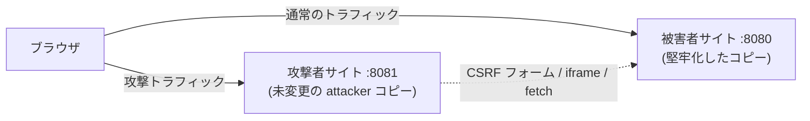

# Webセキュリティ実習（後編・防御編）：被害者アプリを堅牢化する

> **⏱️ 所要時間**: 約 90 分
> **🎯 レベル**: 中級
> **💻 環境**: Linux / macOS（Go 1.26.2+、ブラウザ、`curl`）
>
> > **⚠️ 全 2 パートの後編**: 前提は [Webセキュリティ実習（前編・攻撃体験）](web_security_ja.md) です。このパートでは、被害者アプリの作業用コピーに各対策を適用し、ビルドして、前編の攻撃を再実行して「もう成立しないこと」を検証します。

## 3 セッションの進め方

| 回  | 範囲            | 成果                                  |
| --- | --------------- | ------------------------------------- |
| 1   | 準備・STEP 1〜2 | CSP とエスケープで XSS の再現を止める |
| 2   | STEP 3〜4       | Cookie 属性と CSRF トークンを検証     |
| 3   | STEP 5〜6       | フレーム保護と CORS 許可リストを検証  |

各回の操作は約 30 分を目安とし、初回準備・読解・ブラウザでの再検証には追加の時間を確保します。

## 目的

前編では、意図的に脆弱なアプリケーションに対して XSS / CSRF / クリックジャッキング / CORS の各攻撃を再現しました。この後編では、そのアプリケーションを「出力エスケープ、CSP、Cookie 属性、CSRF トークン、フレーミング対策ヘッダー、CORS 許可リスト」と 1 つずつ堅牢化し、各攻撃を再実行して確実にブロックされることを確認します。リポジトリの asset そのものは意図的に脆弱なまま残し、作業は `/tmp` に置いたコピーに対して行います。

## ゴール

- `Content-Security-Policy` レスポンスヘッダーを追加し、出力エスケープ修正の前であっても注入スクリプトが実行されなくなることを確認する。
- `html/template` による出力エスケープで XSS の根本原因を修正する。
- セッション Cookie に `HttpOnly` と `SameSite` を設定し、XSS による Cookie 盗難と CSRF 攻撃の両方が失敗する様子を確認する。
- CSRF トークン（Double-Submit Cookie パターン）を実装し、偽造リクエストが 403 で拒否されることを確認する。
- `X-Frame-Options` / CSP `frame-ancestors` でクリックジャッキングを阻止する。
- CORS の Origin Reflection を許可リスト方式に置き換え、クロスオリジンからのデータ窃取がブロックされることを確認する。

## 前提条件

- [ ] [Webセキュリティ実習（前編・攻撃体験）](web_security_ja.md) を完了している（攻撃が自分の環境で再現できていること）
- [ ] Go 1.26.2+ がインストールされている（`go version`）
- [ ] 開発者ツール付きのブラウザ（Chrome / Firefox / Edge）
- [ ] `curl` がインストールされている（ヘッダーレベルの検証用）
- [ ] ターミナル 2 台

## アーキテクチャ

編集するのは被害者アプリだけです。攻撃者アプリは未編集のコピーを動かし続けるため、前編の全攻撃が再テストに常に使えます。



### 作業用コピー

リポジトリの asset は意図的に脆弱なまま残す必要があるため（前編が依存）、編集はすべてコピー上で行います。

```text
リポジトリ（変更しない）                作業用コピー
infra/assets/web_security/            /tmp/web_security_defense/
└── 原本は変更しない                    ├── attacker/（編集しない）
                                       └── victim/（以下の各 STEP で編集）
```

## 準備

### 1. 作業用コピーを作成

リポジトリルートから開始します。Python 3 が必要です。既存の `/tmp/web_security_defense` は上書きせず、別名を全手順で使ってください。

```bash
python3 -c 'import shutil; shutil.copytree("infra/assets/web_security", "/tmp/web_security_defense")'
ls /tmp/web_security_defense
# Expected output:
# attacker
# victim
```

### 2. アプリケーションの起動

被害者はコピーから、攻撃者は同じコピーの未編集ディレクトリから起動します。

```bash
# ターミナル1: 被害者サイト（編集可能なコピー）
cd /tmp/web_security_defense/victim
go run main.go
# Expected output:
# 20xx/... INFO victim site starting addr=:8080

# ターミナル2: 攻撃者サイト（未編集のコピー）
cd /tmp/web_security_defense/attacker
go run main.go
# Expected output:
# 20xx/... INFO attacker site starting addr=:8081
```

> **注意**: 以下の各 STEP の後には、ターミナル 1 を毎回再起動してください（`Ctrl+C` → 再度 `go run main.go`）。ストアはメモリ上にあるため、再起動するとコメントとメールアドレスもリセットされます。

### 3. ベースライン - 攻撃がまだ成立することを確認

対策前に、コピーに対して前編の攻撃を 2 つだけ簡単に再現しておきます。

1. `http://localhost:8080/xss/stored` → `Login` をクリック → `<script>alert("XSS: your cookie: " + document.cookie)</script>` を投稿 → アラートが表示され、セッション Cookie が見える。
2. 被害者サイトのホームから `CSRF Attack Page (port 8081)` を開き、「Claim Prize」をクリック → ホームに戻るとメールアドレスが `hacker@evil.com` になっている。

### ✅ Checkpoint

- [ ] 両サーバーが起動している（被害者は `/tmp/web_security_defense` から、攻撃者は未編集コピーから）
- [ ] コピーでも格納型 XSS のアラートが still 発火する
- [ ] コピーでも CSRF 攻撃でメールアドレスが still 変更される

## 実習ステップ

### STEP 1: Content Security Policy - ブラウザ側で XSS を無力化する

CSP は「このページで実行してよいスクリプト」をブラウザに宣言する仕組みです。出力がまだエスケープされていなくても、厳格な `script-src` は、注入されたインライン `<script>`（前編 STEP 1）とインラインイベントハンドラ ``（前編 STEP 2）をブロックします。

**変更を適用（`/tmp/web_security_defense/victim/main.go`）:**

他のハンドラーの近くに次のラッパーを追加します。

```go
// withSecurityHeaders adds browser-security response headers. It is applied
// only to the XSS demo pages: the home page still relies on inline onclick
// handlers, which a strict script-src policy would disable (see the CSP deep
// dive in the Reference section for the nonce-based solution).
func withSecurityHeaders(next http.HandlerFunc) http.HandlerFunc {
	return func(w http.ResponseWriter, r *http.Request) {
		w.Header().Set("Content-Security-Policy",
			"default-src 'self'; script-src 'self'; style-src 'self' 'unsafe-inline'")
		w.Header().Set("X-Content-Type-Options", "nosniff")
		next(w, r)
	}
}
```

次に `main()` で XSS ページをこのラッパー経由に登録します。

```go
mux.HandleFunc("/xss/stored", withSecurityHeaders(storedXSSHandler))
mux.HandleFunc("/xss/reflected", withSecurityHeaders(reflectedXSSHandler))
```

`X-Content-Type-Options: nosniff` は一般的な堅牢化として同時に追加します。ブラウザーが `Content-Type` を勝手に推測する（MIME スニッフィング）のを防ぎます。

**攻撃を再実行:**

1. `/xss/stored` で `<script>alert("XSS: your cookie: " + document.cookie)</script>` を再度投稿します。
2. ページはリロードされ、コメントは保存されますが、**アラートは出ません**。
3. 理由は開発者ツール → Console に表示されます:

   ```text
   Refused to execute inline script because it violates the following Content
   Security Policy directive: "script-src 'self'"
   ```

4. 反射型も同様に死んでいます。`http://localhost:8080/xss/reflected?q=` は生のテキストが表示されるだけで何も実行されません。

**curl で検証:**

```bash
curl -sI http://localhost:8080/xss/stored | grep -iE 'content-security-policy|x-content-type-options'
# Expected output:
# Content-Security-Policy: default-src 'self'; script-src 'self'; style-src 'self' 'unsafe-inline'
# X-Content-Type-Options: nosniff
```

**なぜミドルウェアを XSS ページに限定するのか？** 被害者アプリのホームページはインラインの `onclick` ハンドラー（`Show Cookie`、`Login`）を使っています。全局に `script-src 'self'` をかけるとこれらが動かなくなります。本物のアプリケーションでは、こうしたコードを外部スクリプトに移すか、レスポンスごとの nonce を付与します。詳細はリファレンス章の CSP 詳解を参照してください。

### ✅ Checkpoint

- [ ] 格納型 XSS のペイロードでアラートが出なくなった
- [ ] Console に CSP 違反のメッセージが表示される
- [ ] `curl -sI` で両方のセキュリティヘッダーが確認できる

### STEP 2: html/template による出力エスケープ - 根本原因を修正する

CSP は被害の範囲を狭めますが、エスケープは脆弱性そのものを取り除きます。Go の `html/template` パッケージは、コンテキストに応じてデフォルトでエスケープを行います。

**変更を適用（`victim/main.go`）:** import に `"html/template"` を追加し、パッケージレベルのテンプレートを定義して `storedXSSHandler` を書き換えます。

```go
var commentsTmpl = template.Must(template.New("comments").Parse(`
	<h1>Stored XSS</h1>
	<p>Submitted content is stored and displayed as-is.</p>
	<form method='POST'><input name='comment' style='width:300px'><input type='submit' value='Submit'></form>
	<h2>Comments</h2>
	<ul>
	{{range .}}<li>{{.}}</li>{{end}}
	</ul><a href='/'>Back to home</a>
`))

func storedXSSHandler(w http.ResponseWriter, r *http.Request) {
	if r.Method == http.MethodPost {
		comment := r.FormValue("comment")
		store.mu.Lock()
		store.Comments = append(store.Comments, comment)
		store.mu.Unlock()
		http.Redirect(w, r, "/xss/stored", http.StatusSeeOther)
		return
	}

	store.mu.Lock()
	comments := make([]string, len(store.Comments))
	copy(comments, store.Comments)
	store.mu.Unlock()

	w.Header().Set("Content-Type", "text/html; charset=utf-8")
	if err := commentsTmpl.Execute(w, comments); err != nil {
		slog.Error("execute template", "error", err)
	}
}
```

反射型ページは、単一の埋め込み箇所のエスケープだけで十分です（`template.HTMLEscapeString` は `{{.}}` が内部で使うのと同じ関数です）。

```go
func reflectedXSSHandler(w http.ResponseWriter, r *http.Request) {
	q := r.URL.Query().Get("q")
	w.Header().Set("Content-Type", "text/html; charset=utf-8")
	fmt.Fprintf(w, "<h1>Search Results</h1><p>0 results found for \"%s\".</p><a href='/'>Back to home</a>", template.HTMLEscapeString(q))
}
```

**何が起きているのか？**

```text
入力: <script>alert('XSS')</script>
       ↓ 自動エスケープ (html/template)
出力: &lt;script&gt;alert('XSS')&lt;/script&gt;
       ↓ ブラウザ表示
画面: <script>alert('XSS')</script> (テキストとして表示、スクリプトは実行されない)
```

**攻撃を再実行:**

1. 再起動してから、`/xss/stored` でスクリプトのペイロードを再度投稿します。
2. 今度はコメント自体がリテラルなテキストとして表示されます。ページ上で `<script>` タグが読めますが、ブラウザはこれを「実行」ではなく「描画」します。

**curl で検証:**

```bash
curl -s http://localhost:8080/xss/stored | grep '<li>'
# Expected output (payload stored, but escaped):
# <li>Welcome to the workshop!</li><li>&lt;script&gt;alert(&#34;XSS: your cookie: &#34; &#43; document.cookie)&lt;/script&gt;</li>
```

### ✅ Checkpoint

- [ ] ページ上にペイロードがリテラルなテキストとして表示される
- [ ] Console に CSP 違反が出ない（実行しようとするもの自体が存在しない）
- [ ] `curl` で HTML ソースに `&lt;script&gt;` が確認できる

### 中断・再開: セッション 1

被害者・攻撃者の両サーバーを Ctrl+C で停止します。`/tmp/web_security_defense` の編集済みソースを残し、準備のコピー作成は繰り返しません。コメント・メールアドレスはメモリ上のため停止で失われます。ブラウザ Cookie が残る場合は localhost のサイトデータを消して、再ログインします。

```bash
# Terminal A
cd /tmp/web_security_defense/victim
go run main.go
# Terminal B
cd /tmp/web_security_defense/attacker
go run main.go
# 期待される結果: 8080 と 8081 で起動（別ターミナルで実行）
```

前の回で対策した XSS / CSRF の攻撃を再投稿して確認し、次の STEP へ進みます。編集済みソースは残りますが、攻撃用データは再作成が必要です。

### STEP 3: Cookie の堅牢化 - HttpOnly と SameSite

前編では `Login` ボタンが JavaScript からセッション Cookie を設定していました。この方式では Cookie に `HttpOnly` を付与できませんし、`SameSite` 属性もありません。ログインをサーバー側に移し、両方を設定します。

**変更を適用（`victim/main.go`）:** 2 つのハンドラーを追加して登録します。

```go
func loginHandler(w http.ResponseWriter, r *http.Request) {
	http.SetCookie(w, &http.Cookie{
		Name:     sessionKey,
		Value:    sessionVal,
		Path:     "/",
		HttpOnly: true,                 // JavaScript can no longer read the session cookie
		SameSite: http.SameSiteLaxMode, // not sent on cross-site POST requests
		// Secure: true, // uncomment when serving over HTTPS
	})
	http.Redirect(w, r, "/", http.StatusSeeOther)
}

func logoutHandler(w http.ResponseWriter, r *http.Request) {
	http.SetCookie(w, &http.Cookie{
		Name:     sessionKey,
		Value:    "",
		Path:     "/",
		HttpOnly: true,
		SameSite: http.SameSiteLaxMode,
		MaxAge:   -1, // delete the cookie
	})
	http.Redirect(w, r, "/", http.StatusSeeOther)
}
```

```go
mux.HandleFunc("/login", loginHandler)
mux.HandleFunc("/logout", logoutHandler)
```

続いて `homeHandler` 内の JavaScript 駆動の 2 つの `<li>` 行をプレーンなフォームに置き換えます（旧 `Logoff` ボタンは `document.cookie` で Cookie を消していましたが、HttpOnly Cookie にはもう触れません）。

```html
<li>
  <form method="POST" action="/login" style="display:inline">
    <button>Login (set session cookie)</button>
  </form>
</li>
<li>
  <form method="POST" action="/logout" style="display:inline">
    <button>Logoff (clear session cookie)</button>
  </form>
</li>
```

参考として `SameSite` のレベル:

```text
Strict: クロスサイトリクエストでは一切送信されない（トップレベル遷移でも不送信）
Lax:    同一サイトのリクエストとトップレベルの GET 遷移では送信される（推奨のデフォルト）
None:   常に送信される（Secure 必須。本当にクロスサイト Cookie が必要な場合のみ）
```

**攻撃を再実行:**

1. 再起動して新しい `Login` ボタンを使います。開発者ツール → Application → Cookies で、`session_id` に `HttpOnly` と `SameSite=Lax` のフラグが付いていることを確認します。
2. ホームの `Show Cookie` をクリック → アラートは空です。`document.cookie` にはもうセッション Cookie が見えません。XSS による Cookie 盗難は死にました。
3. CSRF: 攻撃者の CSRF ページを **`http://127.0.0.1:8081/csrf`** として開いて（`localhost:8081` ではありません！）「Claim Prize」をクリック → ブラウザはこのクロスサイト POST に Cookie を付与しないため、被害者サイトは `Unauthorized` を返し、メールアドレスは変わりません。

> **📌 なぜ localhost ではなく 127.0.0.1 なのか?** SameSite が比較するのは「サイト」であり、サイトはスキーム + 登録可能ドメインで、**ポートは含まれません**。`http://localhost:8081` と `http://localhost:8080` は*同じ*サイトなので、`SameSite=Lax` でも Cookie は付与され、攻撃は成功してしまいます。`http://127.0.0.1:8081` と `http://localhost:8080` は厳密に**クロスサイト**になるため、Lax はこのクロスサイト POST の Cookie を保留します。（CORS は別物です。*オリジン*にはポートが含まれるため、前編の CORS 攻撃は `localhost:8081` からでも問題なく成立します。）

**curl で検証:**

```bash
curl -s -o /dev/null -D - -X POST http://localhost:8080/login | grep -i 'set-cookie'
# Expected output:
# Set-Cookie: session_id=secret-session-123; Path=/; HttpOnly; SameSite=Lax
```

### ✅ Checkpoint

- [ ] 開発者ツールで `session_id` に `HttpOnly` + `SameSite=Lax` が表示される
- [ ] `Show Cookie` のアラートにセッション Cookie が含まれなくなった
- [ ] CSRF の「Claim Prize」攻撃が `Unauthorized` で終わり、メールアドレスが変更されない

### STEP 4: CSRF トークン - Double-Submit Cookie パターン

SameSite はブラウザ実装の防御です。より堅牢なサーバー側の検証は「攻撃者が入手できないトークン」です。ここでは **Double-Submit Cookie パターン** を実装します。GET でサーバーがランダムなトークンを Cookie **と** フォーム埋め込みの両方で発行し、POST で両者の一致を要求します。

```text
正当なリクエスト（本物のフォームを利用）:
  Cookie: csrf_token=abc123           (サーバーが発行)
  Body:   csrf_token=abc123&email=... (本物のフォーム内に描画)
  → 一致 ✓ → 処理続行

攻撃者サイトからの偽造リクエスト:
  Cookie: csrf_token=abc123           (自動付与されるが…)
  Body:   email=hacker@evil.com       (攻撃者はトークンを読めないため
                                       偽造フォームに埋め込めない)
  → 不一致 ✗ → 403 Forbidden
```

**変更を適用（`victim/main.go`）:** import に `"crypto/rand"` と `"encoding/hex"` を追加し、トークン生成関数を加えます。

```go
func generateCSRFToken() string {
	b := make([]byte, 16)
	if _, err := rand.Read(b); err != nil {
		slog.Error("generate csrf token", "error", err)
		return ""
	}
	return hex.EncodeToString(b)
}
```

続いて `updateEmailHandler` を置き換えます。

```go
func updateEmailHandler(w http.ResponseWriter, r *http.Request) {
	if !isAuthenticated(r) {
		http.Error(w, "Unauthorized", http.StatusUnauthorized)
		return
	}

	if r.Method == http.MethodPost {
		// Double-submit cookie pattern: the form token must match the token
		// delivered to the browser in the csrf_token cookie.
		formToken := r.FormValue("csrf_token")
		cookie, err := r.Cookie("csrf_token")
		if err != nil || formToken == "" || formToken != cookie.Value {
			http.Error(w, "Invalid CSRF token", http.StatusForbidden)
			return
		}

		newEmail := r.FormValue("email")
		store.mu.Lock()
		store.Email = newEmail
		store.mu.Unlock()
		w.Header().Set("Content-Type", "text/html; charset=utf-8")
		fmt.Fprintf(w, "Email updated to <strong>%s</strong>. <a href='/'>Back to home</a>", template.HTMLEscapeString(newEmail))
		return
	}

	store.mu.Lock()
	email := store.Email
	store.mu.Unlock()

	token := generateCSRFToken()
	http.SetCookie(w, &http.Cookie{
		Name:     "csrf_token",
		Value:    token,
		Path:     "/",
		SameSite: http.SameSiteLaxMode,
	})

	w.Header().Set("Content-Type", "text/html; charset=utf-8")
	fmt.Fprintf(w, `
		<h1>Update Email</h1>
		<form method="POST">
			<input type="hidden" name="csrf_token" value="%s">
			New email: <input name="email" value="%s">
			<input type="submit" value="Update">
		</form>
	`, token, template.HTMLEscapeString(email))
}
```

**攻撃を再実行:**

ブラウザでは、攻撃者の「Claim Prize」フォームに `csrf_token` フィールドがないため、たとえセッション Cookie を送るブラウザでも、メールアドレスは変更されず `403 Invalid CSRF token` を受け取ります。

`curl` は SameSite を実装していません。これはちょうど、STEP 3 の防御とトークンの検証を分離して観察できるということです。

```bash
# フォームを取得: サーバーは csrf_token クッキーを設定すると同時に
# 同じ値を hidden フィールドに埋め込む (grep で抽出)
curl -s -H 'Cookie: session_id=secret-session-123' \
  http://localhost:8080/update-email -o /tmp/ws.form
CSRF=$(grep -o 'name="csrf_token" value="[a-f0-9]*"' /tmp/ws.form | head -1 | sed 's/.*value="//;s/"$//')

# 偽造 POST (セッションは有効、トークンなし) -> 拒否
curl -s -o /dev/null -w '%{http_code}\n' -X POST http://localhost:8080/update-email \
  -H 'Cookie: session_id=secret-session-123' -d 'email=hacker@evil.com'
# Expected output:
# 403

# 正当な POST (Cookie とフォームの両方にトークン) -> 受理
curl -s -o /dev/null -w '%{http_code}\n' -X POST http://localhost:8080/update-email \
  -H "Cookie: session_id=secret-session-123; csrf_token=$CSRF" \
  --data "csrf_token=$CSRF&email=new@example.com"
# Expected output:
# 200
```

### ✅ Checkpoint

- [ ] 被害者サイト自身の更新フォームは依然として動作する（トークン Cookie と hidden フィールドが一致）
- [ ] トークンなしの POST は 403 で拒否される
- [ ] 攻撃者がこのペアを偽造できない理由を説明できる（Cookie は付与させられるが、読んでフォームに埋めることはできない）

### 中断・再開: セッション 2

被害者・攻撃者の両サーバーを Ctrl+C で停止します。`/tmp/web_security_defense` の編集済みソースを残し、準備のコピー作成は繰り返しません。コメント・メールアドレスはメモリ上のため停止で失われます。ブラウザ Cookie が残る場合は localhost のサイトデータを消して、再ログインします。

```bash
# Terminal A
cd /tmp/web_security_defense/victim
go run main.go
# Terminal B
cd /tmp/web_security_defense/attacker
go run main.go
# 期待される結果: 8080 と 8081 で起動（別ターミナルで実行）
```

前の回で対策した XSS / CSRF の攻撃を再投稿して確認し、次の STEP へ進みます。編集済みソースは残りますが、攻撃用データは再作成が必要です。

### STEP 5: フレーム保護 - X-Frame-Options と frame-ancestors

前編では、攻撃者が `/follow` を透明な iframe に埋め込みました。2 つのレスポンスヘッダーがそれを阻止します。

**変更を適用（`victim/main.go`）:** `followHandler` の GET ブランチで、body を書き出す前にヘッダーを追加します。

```go
w.Header().Set("X-Frame-Options", "DENY")
w.Header().Set("Content-Security-Policy", "frame-ancestors 'none'")
```

ヘッダーの値:

| ヘッダー / 値                 | 効果                               |
| :---------------------------- | :--------------------------------- |
| `X-Frame-Options: DENY`       | すべての iframe 埋め込みを拒否     |
| `X-Frame-Options: SAMEORIGIN` | 同一オリジンからの埋め込みのみ許可 |
| `ALLOW-FROM uri`              | 特定のオリジンのみ許可（非推奨）   |
| CSP `frame-ancestors 'none'`  | DENY の現代的な代替                |
| CSP `frame-ancestors 'self'`  | SAMEORIGIN の現代的な代替          |

両方を送るのは意図的です。`X-Frame-Options` はあらゆるブラウザが対応するレガシーヘッダーで、`frame-ancestors` はそれを置き換える現代の CSP ディレクティブです。

**攻撃を再実行:**

1. 攻撃者の `Clickjacking Attack Page` を再度開きます。
2. iframe の領域が空白になります。ブラウザが `/follow` のフレーム表示を拒否しました。
3. 開発者ツール → Console:

   ```text
   Refused to display 'http://localhost:8080/follow' in a frame because it set
   'X-Frame-Options' to 'deny'.
   ```

   （文言はブラウザごとに異なります。`frame-ancestors` が効いている場合は CSP ディレクティブに言及するメッセージになります。）

4. 「GET DONUTS」をクリックしても何も起きなくなりました。

**curl で検証:**

```bash
curl -sI http://localhost:8080/follow | grep -iE 'x-frame-options|content-security-policy'
# Expected output:
# Content-Security-Policy: frame-ancestors 'none'
# X-Frame-Options: DENY
```

### ✅ Checkpoint

- [ ] 攻撃者のクリックジャッキングページに iframe 内の被害者ページが表示されなくなった
- [ ] Console に拒否メッセージが表示される
- [ ] `curl -sI` で両方のヘッダーが確認できる

### STEP 6: CORS 許可リスト - Origin Reflection をやめる

前編最後の修正です。`/api/profile` は任意の `Origin` を資格情報付きでそのまま返していました。この Reflection を、攻撃者のオリジンを含まない許可リストに置き換えます。

**変更を適用（`victim/main.go`）:** 許可リストを追加し、`profileHandler` の先頭を変更します。

```go
// allowedOrigins lists the origins permitted to read API responses from a
// browser. The attacker origin (http://localhost:8081) is intentionally absent.
var allowedOrigins = map[string]bool{
	// "https://trusted-frontend.example.com": true,
}

func profileHandler(w http.ResponseWriter, r *http.Request) {
	origin := r.Header.Get("Origin")
	if allowedOrigins[origin] {
		w.Header().Set("Access-Control-Allow-Origin", origin)
		w.Header().Set("Access-Control-Allow-Credentials", "true")
	}
	// ... ハンドラーの残りは変更なし (Content-Type, OPTIONS, 認証, プロフィール)
```

**攻撃を再実行:**

1. 被害者サイトでログインしてから、攻撃者の `CORS Attack Page` を開きます。
2. 「Verify Account」をクリック → 窃取したプロフィールの代わりに、次のようなエラーが表示されます:

   ```text
   Error: Failed to fetch
   ```

   （Chrome の場合。Firefox は `NetworkError when attempting to fetch resource.`）レスポンスに `Access-Control-Allow-Origin` がないため、ブラウザは攻撃者の JavaScript にレスポンスを渡しません。

**curl で検証:**

```bash
curl -s -D - -o /dev/null http://localhost:8080/api/profile \
  -H 'Origin: http://localhost:8081' -H 'Cookie: session_id=secret-session-123' \
  | grep -iE '^HTTP|access-control'
# Expected output (200 はネットワーク上を流れるが、Access-Control-Allow-Origin
# ヘッダーがなければブラウザは JS への読み取りをブロックする):
# HTTP/1.1 200 OK

curl -s -D - -o /dev/null -X OPTIONS http://localhost:8080/api/profile \
  -H 'Origin: http://localhost:8081' -H 'Access-Control-Request-Method: GET' \
  | grep -iE '^HTTP|access-control'
# Expected output:
# HTTP/1.1 204 No Content
```

curl が可視化してくれる点に注意してください。サーバーは依然として 200 を返します。CORS は**ブラウザ側の防御**です。この修正は「許可」のシグナルを取り去ったため、ブラウザはレスポンスを攻撃者のスクリプトに渡さなくなりました。

### ✅ Checkpoint

- [ ] 攻撃者の CORS ページにプロフィールではなく fetch エラーが表示される
- [ ] 攻撃者オリジンに対して `Access-Control-Allow-Origin` ヘッダーが返されない
- [ ] プリフライト (OPTIONS) のレスポンスにも CORS の許可がない

## 任意の深掘り

背景知識は [Web セキュリティ参考資料](web_security_reference_ja.md) に移しました。実習の各対策を再検証してから、必要な項目を読んでください。

## 防御策チェックリスト

| 脆弱性                   | 項目                                         | チェック |
| :----------------------- | :------------------------------------------- | :------- |
| **XSS**                  | ユーザー入力をエスケープしているか           | □        |
|                          | `html/template` 等の自動エスケープ機能を使用 | □        |
|                          | HttpOnly Cookie を設定                       | □        |
|                          | CSP を設定してインラインスクリプトを制限     | □        |
| **CSRF**                 | CSRF トークンを実装                          | □        |
|                          | SameSite 属性を Lax or Strict に設定         | □        |
|                          | 重要操作には再認証を要求                     | □        |
| **クリックジャッキング** | X-Frame-Options ヘッダーを設定               | □        |
|                          | CSP frame-ancestors を設定                   | □        |
| **一般**                 | `X-Content-Type-Options: nosniff` を設定     | □        |
|                          | CORS 設定がオリジン許可リスト方式か          | □        |

## 演習後の理解度確認

### 確認クイズ

1. **HttpOnly で保護されたセッション Cookie を、なぜ XSS ペイロードは盗めないのですか？**
   - <details><summary>解答</summary>HttpOnly はブラウザに対して「この Cookie を JavaScript からアクセス不可にする」と指示します。document.cookie に一切現れないため、注入されたスクリプトは読み取ることも外部送信することもできません。（Cookie 自体はリクエストに付与され続けます。HttpOnly が取り除くのは JavaScript のアクセス権だけです。）</details>

2. **SameSite=Lax と SameSite=Strict の違いは何ですか？**
   - <details><summary>解答</summary>Strict はクロスサイトリクエストでは一切 Cookie を送りません。他サイトのリンクをたどるトップレベル遷移でも送られません。Lax もクロスサイト POST では送らない一方、トップレベルの GET 遷移では送るため、通常のリンク遷移は壊さずにフォーム経由の CSRF を防げます。</details>

3. **Double-Submit Cookie パターンでは、POST 時にどの 2 つの値を比較しますか？**
   - <details><summary>解答</summary>フォームから送られたトークン（hidden フィールド）と、csrf_token Cookie に保存されたトークンです。攻撃者サイトは Cookie を付与させることまではできますが、その値を読んで偽造フォームに埋め込むことはできないため、この組は決して一致しません。</details>

4. **なぜ CSP は出力エスケープの代替にはならないのですか？**
   - <details><summary>解答</summary>CSP はブラウザが強制する多層防御です。ポリシーの書き間違いや残存する 'unsafe-inline'、古いブラウザで穴が開き直す可能性があり、CSP は注入自体を修正できません。エスケープは脆弱性そのものを取り除き、CSP はエスケープ漏れがあった場合の被害を限定するだけです。</details>

5. **認証付き API は、なぜリクエストの Origin ヘッダーを反射してはいけないのですか？**
   - <details><summary>解答</summary>Reflection はすべてのオリジンに個別の許可を与えるのと同じで、Access-Control-Allow-Credentials: true と組み合わさると、ブラウザは認証済みレスポンスを任意のサイトの JavaScript に渡してしまいます。このヘッダーを返してよいのは、明示的な許可リストに載ったオリジンだけです。</details>

## 学んだこと

- **多層防御**: エスケープ（STEP 2）が XSS の脆弱性を取り除き、CSP（STEP 1）と HttpOnly（STEP 3）がエスケープ漏れ時の被害を限定します。単一のレイヤーでは十分ではありません。
- **Cookie**: `HttpOnly` はセッション Cookie を JavaScript から隠し、`SameSite=Lax` はクロスサイト POST への付与を止めます。2 つの属性が、異なる 2 つの攻撃をそれぞれ鈍らせました。
- **CSRF トークン**: Double-Submit Cookie パターンは、ブラウザ挙動に依存せず偽造リクエストをサーバー側で検出可能にします。
- **フレーミング**: `X-Frame-Options` / `frame-ancestors` が自ページの埋め込み可否を決めます。なければ、透明性は攻撃者の味方です。
- **CORS**: 明示的なオリジン許可リストが Origin Reflection に取って代わります。レスポンスはネットワークを流れても、ブラウザが攻撃者のスクリプトへ渡しません。
- すべての修正は実際の攻撃の再実行で検証しました。この「修正 → 再ビルド → 再攻撃」のループは、本番コードでも同じように使うべきです。

**次のステップ**: [`secure_coding_ja.md`](../software/secure_coding_ja.md) で実装レベルの落とし穴（SQL インジェクション、パストラバーサル、競合状態）、[`oauth2_ja.md`](oauth2_ja.md) でトークンベースの認可。

## 片付け

```bash
# 1. 両サーバーの停止: 各ターミナルで Ctrl+C を押す

# 2. 作業用コピーの削除
rm -rf /tmp/web_security_defense

# 3. リポジトリの asset が無変更であることを確認（意図的に脆弱なまま残す）
git status infra/assets/web_security
# Expected output:
# nothing to commit, working tree clean
```

手順 3 で変更が報告された場合は `git checkout -- infra/assets/web_security` で asset を復元してください。

---

## トラブルシューティング

### Q: CSP 追加後にホームページのボタンが動かなくなった

**A:** 全体に適用した `script-src 'self'` は、ホームページの `Show Cookie` のようなインライン `onclick` ハンドラーを無効化します。STEP 1 のようにミドルウェアを特定ルートに限定するか、ハンドラーを外部スクリプト / nonce 付きスクリプトに移してください（CSP 詳解を参照）。

### Q: STEP 3 の後、ログインしているのに「Claim Prize」が Unauthorized になる

**A:** それは対策が効いている証拠です。SameSite=Lax により、クロスサイト POST には Cookie が付与されません。まず攻撃者ページを `http://127.0.0.1:8081/csrf` で開いたか確認してください。`http://localhost:8081` からはリクエストが same-site（ポートはサイト判定に含まれない）となり、Cookie は*送られて*攻撃は成功します — これはバグではなく想定された挙動です（STEP 3 の注記を参照）。同じサイト内の操作まで失敗する場合は、開発者ツール（Application → Cookies）で `localhost:8080` の Cookie を消してから、新しい Login ボタンでログインし直してください。旧 JavaScript ボタンで設定された Cookie には SameSite 属性がありません。

### Q: 被害者サイト自身のフォームからのメール更新が 403 になる

**A:** フォーム送信時には csrf_token Cookie が必要です。まず `/update-email` を通常のページ読み込み（GET）で開いてください。Cookie が設定され、対応する hidden フィールドが描画されます。途中で Cookie を消した場合は、フォームページを再読み込みしてから送信してください。

### Q: go run が undefined: template（または rand / hex）で失敗する

**A:** 新しいコードには asset になかった import が必要です。import ブロックに `"html/template"`、`"crypto/rand"`、`"encoding/hex"` が含まれているか確認してください。

---

## 参考文献

- [MDN: Content Security Policy (CSP)](https://developer.mozilla.org/ja/docs/Web/HTTP/CSP)
- [MDN: Set-Cookie（HttpOnly / SameSite / Secure）](https://developer.mozilla.org/ja/docs/Web/HTTP/Headers/Set-Cookie)
- [OWASP CSRF Prevention Cheat Sheet](https://cheatsheetseries.owasp.org/cheatsheets/Cross-Site_Request_Forgery_Prevention_Cheat_Sheet.html)
- [OWASP XSS Prevention Cheat Sheet](https://cheatsheetseries.owasp.org/cheatsheets/Cross_Site_Scripting_Prevention_Cheat_Sheet.html)
