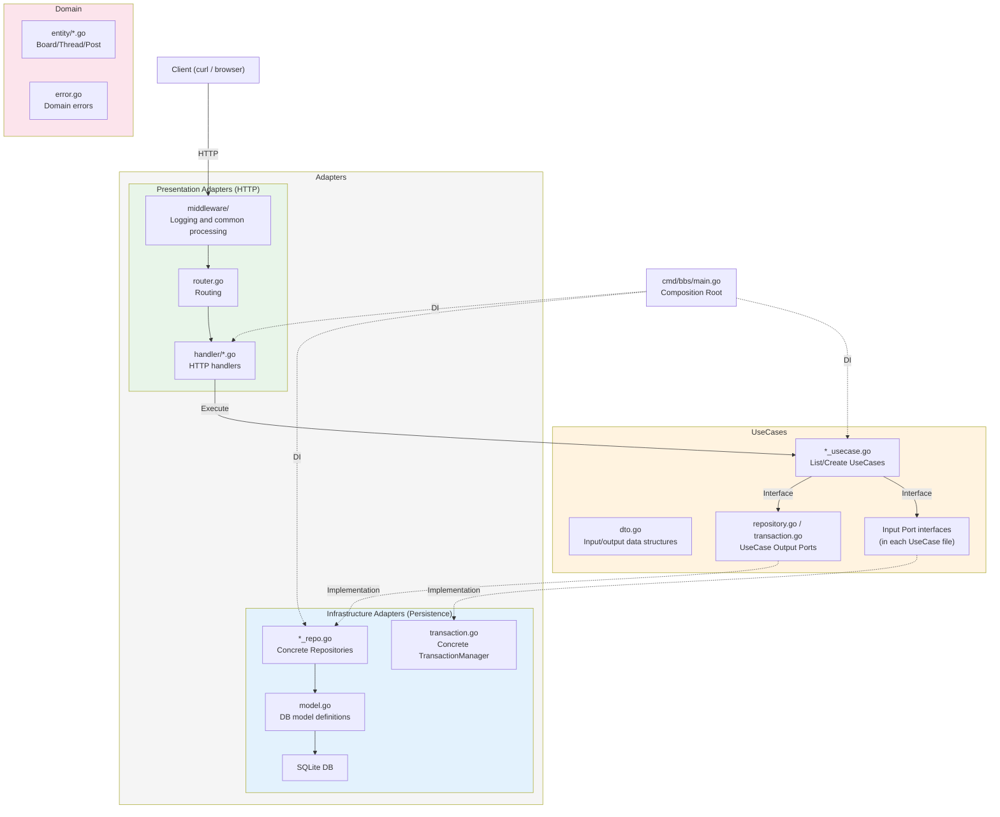

# BBS (A 2channel-style bulletin board)

A 2channel-style bulletin board implemented in Go + SQLite. Built on Clean Architecture principles, with strict control over dependency direction and separation of responsibilities.

## Features

- **Clean Architecture 3-layer variant**: Domain logic is fully isolated from external concerns (HTTP, DB). The Adapters layer is organized into Presentation (input) and Infrastructure (output).
- **SQLite persistence**: Runs as a single binary.
- **Threads and posts**: Board listing, thread creation, posting replies, and age/sage support.
- **Transaction management**: Guarantees consistency during thread creation and posting.

## Getting Started

### 1. Build

```bash
go build -o bbs ./cmd/bbs/
```

### 2. Start the server

By default, a SQLite DB file named `bbs.db` is created.

```bash
./bbs
```

### 3. Options

You can specify the DB path via the `BBS_DB` environment variable.

```bash
# Use a specific path
BBS_DB=/tmp/bbs.db ./bbs

# In-memory DB (for testing)
BBS_DB=:memory: ./bbs
```

The server listens on `localhost:8080`.
On first startup, the following boards are created automatically.

| name        | description           |
| ----------- | --------------------- |
| programming | Programming General   |
| news        | News & Current Events |
| chat        | Casual Chat           |

## API Specification

### List boards

```bash
curl http://localhost:8080/api/boards
```

### List threads

```bash
curl http://localhost:8080/api/boards/programming/threads
```

### Create a thread

```bash
curl -X POST http://localhost:8080/api/boards/programming/threads \
  -H 'Content-Type: application/json' \
  -d '{"title":"Go language thread","author":"gopher","body":"Go is great!"}'
```

### List posts

```bash
curl http://localhost:8080/api/threads/1/posts
```

### Create a post

```bash
curl -X POST http://localhost:8080/api/threads/1/posts \
  -H 'Content-Type: application/json' \
  -d '{"author":"anonymous","body":"sage test","sage":true}'
```

Note: with `sage: true`, the thread's last activity timestamp (`last_posted_at`) is not updated (the thread is not bumped).

If `author` is omitted, `名無しさん` (anonymous) is used for both thread creation and posting. In threads with `owner_only: true`, only the author name established at creation time may post.

## Architecture Diagram



## Layer-by-Layer Details

### 1. Domain layer (no dependencies)

The core of the business rules.

- **Entity**: `Board`, `Thread`, `Post`. Holds business logic (e.g., bump judgment based on sage, validation).
- **Port**: Defined only when it represents a domain concern in itself. In this BBS, the Repository and TransactionManager are UseCase Ports owned by the application workflow.
- **Error**: Domain exceptions shared across the application.

### 2. UseCases layer (depends only on Domain)

Orchestrates application-specific business scenarios.

- Use cases such as `CreateThreadUseCase` combine multiple entities and repositories to carry out a sequence of work.
- `repository.go` and `transaction.go` own the Output Ports for persistence repositories and transaction boundaries.
- Data is passed using DTOs defined in `dto.go`, keeping the coupling to other layers loose.

### 3. Adapters layer (depends on UseCases, Domain, and external libraries)

Forms the boundary with external systems and users.

#### Presentation Adapters (HTTP)

- **Handler**: Parses HTTP requests, invokes UseCases, and returns results as JSON.
- **Router**: Maps URL paths to handlers.

#### Infrastructure Adapters (Persistence)

- **Repository**: Issues SQL and converts between entities and DB models (`Model`).
- **TransactionManager**: Provides transaction control without leaking technical details (such as `sql.Tx`) into the domain layer.

## Why Clean Architecture Excels at Maintainability

### Fundamental principle: dependencies always point inward

The essence of Clean Architecture is that **dependencies point in one direction only — from the outside in**.
The inner layers hold "essential rules that rarely change," while the outer layers hold "replaceable technical details."

```text
Framework (HTTP/gRPC)  →  UseCase (application procedure)  →  Domain (business rules)
                              ↓                                   ↑
                         Infra Adapter (DB/external API) ──────────────┘
                              (implements the UseCase's Output Port)
```

Because inner layers know **nothing** about outer layers, changes on the outside never ripple inward.
Here is how this property plays out concretely in three scenarios.

---

### Scenario 1: Changing the transport (HTTP → gRPC)

Consider a situation where "we want to migrate the REST API to gRPC."

#### Layers that must change: Adapters layer (Presentation) only

| What changes            | Change                                                                   |
| ----------------------- | ------------------------------------------------------------------------ |
| `handler/*.go`          | Replace `http.ResponseWriter` conversion with protobuf messages          |
| `router.go`             | `http.ServeMux` → gRPC service registration (`RegisterBbsServiceServer`) |
| `middleware/logging.go` | HTTP middleware → gRPC UnaryInterceptor                                  |
| `cmd/bbs/main.go`       | `http.ListenAndServe` → `grpc.NewServer()` + `net.Listen`                |

The Framework layer keeps the same structure: "input conversion → UseCase invocation → output conversion."
The internal logic of the handlers does not change; only the DTO conversion target (JSON → protobuf) and the error conversion target (HTTP status → gRPC status) change.

**Current HTTP handler (for reference):**

```go
func (h *ThreadHandler) CreateThread(w http.ResponseWriter, r *http.Request) {
    // HTTP-specific input conversion
    slug := r.PathValue("slug")
    var req createThreadRequest
    json.NewDecoder(r.Body).Decode(&req)

    // UseCase invocation (this part is transport-agnostic)
    out, err := h.createThread.Execute(r.Context(), usecase.CreateThreadInput{
        BoardSlug: slug, Title: req.Title, Author: req.Author, Body: req.Body,
    })

    // HTTP-specific output conversion (domain error → HTTP status)
    if errors.Is(err, domain.ErrBoardNotFound) {
        writeError(w, http.StatusNotFound, err.Error())
        return
    }
    writeJSON(w, http.StatusCreated, out)
}
```

**gRPC version (conceptual):**

```go
func (s *BBSServer) CreateThread(ctx context.Context, req *pb.CreateThreadRequest) (*pb.CreateThreadResponse, error) {
    // gRPC-specific input conversion
    // UseCase invocation (← exactly the same)
    out, err := s.createThread.Execute(ctx, usecase.CreateThreadInput{
        BoardSlug: req.BoardSlug, Title: req.Title, Author: req.Author, Body: req.Body,
    })

    // gRPC-specific output conversion (domain error → gRPC status)
    if errors.Is(err, domain.ErrBoardNotFound) {
        return nil, status.Errorf(codes.NotFound, err.Error())
    }
    return toProtoThread(out), nil
}
```

Notice that the `Execute` call is **exactly identical**.
The UseCase signature `Execute(ctx, Input) (Output, error)` is transport-agnostic, so it works as-is.

#### Layers that need no change

| Layer             | Reason                                                                                                                     |
| ----------------- | -------------------------------------------------------------------------------------------------------------------------- |
| **Domain**        | Entities (Board, Thread, Post), Port interfaces, and domain errors import no gRPC types at all                             |
| **UseCase**       | The `Execute` method signature is unchanged. DTOs (`CreateThreadInput`, `CreateThreadOutput`) depend on no transport       |
| **Infra Adapter** | Repository implementations (SQL queries), TransactionManager (`sql.Tx`) — how the DB is accessed is unrelated to transport |

#### Comparison with no layer separation

```go
// Everything mixed into a single function
func CreateThread(w http.ResponseWriter, r *http.Request) {
    slug := r.PathValue("slug")           // HTTP dependency
    db, _ := sql.Open("sqlite3", "bbs.db") // DB dependency
    tx, _ := db.Begin()                    // technical detail
    res, _ := tx.Exec("INSERT INTO ...")   // SQL
    w.WriteHeader(201)                     // HTTP dependency
    json.NewEncoder(w).Encode(res)         // JSON dependency
}
```

Here, migrating to gRPC means **rewriting the entire function**. The business rules are buried inside framework-dependent code, and you can no longer tell where the rules end and the technical details begin.

---

### Scenario 2: Adding a business rule (only the thread owner may post)

This is the case of adding a rule that "only the thread owner can post."
Adding a business rule ripples changes from the inside out, but each layer's change is **minimal and directly tied to that layer's responsibility**.

#### What changes

| Layer         | Change                                                                                                     | Role                   |
| ------------- | ---------------------------------------------------------------------------------------------------------- | ---------------------- |
| **Domain**    | Add `Thread.Owner` field, add `CanPost()` / `EnableOwnerOnlyMode()` methods, add `ErrNotThreadOwner` error | Define the rule        |
| **UseCase**   | Add a single line calling `thread.CanPost(in.Author)`                                                      | Apply the rule         |
| **Infra**     | Add an `owner` column to the `threads` table and update reads/writes                                       | Follow in persistence  |
| **Framework** | Add one line to error conversion: `ErrNotThreadOwner → 403 Forbidden`                                      | Follow in presentation |

**Domain — defining the rule:**

```go
// entity/thread.go
type Thread struct {
    // ...existing fields
    Owner     string // added: thread owner
    OwnerOnly bool   // added: owner-only mode
}

// Business rule encapsulated
func (t *Thread) CanPost(author string) bool {
    if !t.OwnerOnly {
        return true
    }
    return t.Owner == author
}

// added: encapsulate enabling owner-only mode (protects the invariant)
func (t *Thread) EnableOwnerOnlyMode(owner string) error {
    if owner == "" {
        return errors.New("owner must not be empty when owner-only mode is enabled")
    }
    t.OwnerOnly = true
    t.Owner = owner
    return nil
}
```

```go
// error.go
var ErrNotThreadOwner = errors.New("only thread owner can post")
```

**UseCase — applying the rule (one line added):**

```go
func (u *CreatePostUseCase) Execute(ctx context.Context, in CreatePostInput) (*CreatePostOutput, error) {
    thread, err := u.threadRepo.FindByID(ctx, in.ThreadID)
    // ...

    // ↓ just add this single line
    if !thread.CanPost(in.Author) {
        return nil, domain.ErrNotThreadOwner
    }

    // ...the rest of the logic is unchanged
}
```

**Framework — following in presentation (one case added):**

```go
// handler/post_handler.go — error handling inside CreatePost
case errors.Is(err, domain.ErrNotThreadOwner):
    writeError(w, http.StatusForbidden, err.Error())  // ← one line added
```

#### Key point: the rule has a single, clear home

The decision logic exists in **exactly one place**: `Thread.CanPost()`.

- **Domain** knows "what the rule is" (the body of `CanPost`)
- **UseCase** knows "when to apply the rule" (the timing of the `CanPost` call)
- **Framework** knows "how to present a rule violation" (403 Forbidden)
- **Infra** knows "how to store the data the rule needs" (the owner column)

No layer carries anything beyond its own responsibility.

#### Resilient to further spec changes

Even if the spec changes to "the thread owner plus invited people may post":

```go
// Only Domain changes
func (t *Thread) CanPost(author string) bool {
    return t.Owner == author || t.IsInvited(author)
}
```

UseCase, Infra, and Framework need **no changes at all**.
Callers do not know what is inside `CanPost()`, so changes to its internals have no impact.
This is the direct benefit of "dependencies pointing inward."

#### Comparison with no layer separation

```go
// Business rule buried in the Handler
func CreatePost(w http.ResponseWriter, r *http.Request) {
    // Fetch the thread owner via SQL
    row := db.QueryRow(
        "SELECT author FROM posts WHERE thread_id=? AND number=1", threadID,
    )
    var owner string
    row.Scan(&owner)
    // Get the poster from the HTTP request
    author := r.FormValue("author")
    if owner != author {                    // ← business rule buried here
        w.WriteHeader(403)                  // ← HTTP dependency
        json.NewEncoder(w).Encode(map[string]string{"error": "forbidden"})
        return
    }
    // INSERT ...
}
```

In this code:

- The rule "the thread owner is the author of post #1" is buried in **SQL**
- The rule "no one but the owner may post" is buried in the **HTTP handler**
- If the spec changes to "invited people are also OK," it is **unclear what to fix**
- Migrating HTTP → gRPC would require **rewriting this rule** too

---

### Scenario 3: Changing the DB (SQLite → PostgreSQL)

For reference, here is the pattern for changing the persistence layer.

#### Layers that must change: Infra Adapter and the Composition Root

| What changes                | Change                                                                    |
| --------------------------- | ------------------------------------------------------------------------- |
| `infra/persistence/sqlite/` | Create a new `infra/persistence/postgres/`                                |
| Each `*_repo.go`            | Fix SQL syntax differences (`?` → `$1`, `AUTOINCREMENT` → `SERIAL`)       |
| `transaction.go`            | Handling of `sql.Tx` stays the same; change configuration like the DSN    |
| `model.go`                  | Adjust type mappings for PostgreSQL                                       |
| `cmd/bbs/main.go`           | Change the DB driver, connection settings, and concrete repository wiring |

#### Layers that need no change

| Layer            | Reason                                                                                                                     |
| ---------------- | -------------------------------------------------------------------------------------------------------------------------- |
| **Domain**       | No persistence Ports or DB-specific types, so no changes needed                                                            |
| **UseCase**      | Depends on Output Ports (`BoardRepository`, `TransactionManager`), so swapping the concrete implementation changes nothing |
| **Presentation** | Handlers just call UseCases and know nothing about the DB kind                                                             |

Only the Composition Root (`cmd/bbs/main.go`) knows where concrete implementations are swapped:

```go
// For SQLite
boardRepo := sqlite.NewBoardRepository(db)

// For PostgreSQL (change only this)
boardRepo := postgres.NewBoardRepository(db)
```

---

### Scenario 4: Integrating an external API (Slack notification on new posts)

This is the case of adding a feature that "notifies Slack whenever a new post is made in a thread."
This is the pattern of **defining a new Port and adding an Infra Adapter**, which keeps the impact on existing code to a minimum.

#### What changes

| Layer         | Change                                                                                 | Role                                                                                                                                         |
| ------------- | -------------------------------------------------------------------------------------- | -------------------------------------------------------------------------------------------------------------------------------------------- |
| **UseCase**   | Define a new `port.NotificationGateway` interface                                      | Defining the abstraction "a notification is needed." Notification is a tool of the application workflow, so it is defined as a UseCase Port. |
| **UseCase**   | Inject `NotificationGateway` into `CreatePostUseCase`; call it after a successful post | Controlling the timing of notifications                                                                                                      |
| **Infra**     | Create `infra/notification/slack_gateway.go`                                           | Concrete implementation of the Slack API                                                                                                     |
| **Framework** | No change                                                                              | —                                                                                                                                            |

**UseCase — a new Port:**

```go
// internal/usecase/port/notification.go (new file)
package port

type NotificationGateway interface {
    NotifyNewPost(ctx context.Context, threadTitle string, postAuthor string, postBody string) error
}
```

`NotificationGateway` abstracts "the means of notification."
Whether it is Slack, Email, or LINE, the UseCase does not know (and Domain does not even know notifications exist).

**UseCase — invoking the notification (two lines added):**

```go
type CreatePostUseCase struct {
    threadRepo ThreadRepository
    postRepo   PostRepository
    tm         TransactionManager
    notifier   NotificationGateway  // ← added
}

func (u *CreatePostUseCase) Execute(ctx context.Context, in CreatePostInput) (*CreatePostOutput, error) {
    // ...existing posting logic (unchanged)

    var out *CreatePostOutput
    if err := u.tm.RunInTransaction(ctx, func(txCtx context.Context) error {
        // ...existing persistence (unchanged)
        out = &CreatePostOutput{Post: toPostDTO(post)}
        return nil
    }); err != nil {
        return nil, err
    }

    // ↓ two lines added (run outside the transaction — a notification failure must not roll back the post)
    u.notifier.NotifyNewPost(ctx, thread.Title, post.Author, post.Body)

    return out, nil
}
```

**Infra — Slack implementation (new file):**

```go
// infra/notification/slack_gateway.go (new file)
type SlackGateway struct {
    webhookURL string
}

func NewSlackGateway(webhookURL string) *SlackGateway {
    return &SlackGateway{webhookURL: webhookURL}
}

func (g *SlackGateway) NotifyNewPost(ctx context.Context, threadTitle, author, body string) error {
    payload := fmt.Sprintf(`{"text":"[%s] %s: %s"}`, threadTitle, author, body)
    req, _ := http.NewRequestWithContext(ctx, "POST", g.webhookURL, strings.NewReader(payload))
    // ... send the HTTP request
}
```

**Composition Root — one line added to DI:**

```go
notifier := slack.NewSlackGateway("https://hooks.slack.com/...")
createPost := usecase.NewCreatePostUseCase(threadRepo, postRepo, tm, notifier)
```

#### Layers that need no change

| Layer                   | Reason                                                 |
| ----------------------- | ------------------------------------------------------ |
| **Entity**              | Board, Thread, Post — unrelated to notifications       |
| **Framework (Handler)** | HTTP request processing knows nothing of notifications |

#### Key point: swapping the notification target is easy

To switch from Slack to Email:

```go
// Swap possible in the Composition Root alone
notifier := email.NewEmailGateway(smtpConfig)
```

UseCase, Domain, and Framework need no changes at all.
The `NotificationGateway` interface decides "what to notify," and "how to notify" is left to the Infra Adapter.

#### Comparison with no layer separation

```go
// NG: notification processing buried directly in the Handler
func CreatePost(w http.ResponseWriter, r *http.Request) {
    // ...save the post to the DB
    // Slack notification hardcoded
    http.Post("https://hooks.slack.com/...", "application/json", bytes.NewReader(payload))
    w.WriteHeader(201)
}
```

In this case:

- Switching Slack → Email requires **rewriting the Handler**
- Retry and error handling for notification failures also get mixed into the Handler
- Every test run sends a real notification to Slack (cannot be mocked)

---

### Scenario 5: Adding authentication (JWT Bearer Token)

This is the case of adding a feature that "requires JWT authentication when posting."
This is the pattern of **adding a cross-cutting concern to the Framework layer**, changing no inner layer at all.

#### What changes

| Layer         | Change                                                 | Role                         |
| ------------- | ------------------------------------------------------ | ---------------------------- |
| **Framework** | Create `middleware/auth.go` and apply it in the Router | Authentication/authorization |
| Other layers  | **No change**                                          | —                            |

**Framework — authentication middleware (new file):**

```go
// middleware/auth.go (new file)
func Auth(secret string) func(http.Handler) http.Handler {
    return func(next http.Handler) http.Handler {
        return http.HandlerFunc(func(w http.ResponseWriter, r *http.Request) {
            token := strings.TrimPrefix(r.Header.Get("Authorization"), "Bearer ")
            if token == "" {
                writeError(w, http.StatusUnauthorized, "missing token")
                return
            }
            claims, err := validateJWT(token, secret)
            if err != nil {
                writeError(w, http.StatusUnauthorized, "invalid token")
                return
            }
            // Store the authenticated user info in the context
            ctx := context.WithValue(r.Context(), authKey{}, claims)
            next.ServeHTTP(w, r.WithContext(ctx))
        })
    }
}
```

**Router — applying the middleware (one place changed):**

```go
// router.go
mux.HandleFunc("POST /api/boards/{slug}/threads", auth(secret)(threadHandler.CreateThread))
mux.HandleFunc("POST /api/threads/{threadID}/posts", auth(secret)(postHandler.CreatePost))
// GET endpoints stay unauthenticated (existing behavior preserved)
```

#### Layers that need no change

| Layer       | Reason                                                                                                                   |
| ----------- | ------------------------------------------------------------------------------------------------------------------------ |
| **Domain**  | Entities and Ports do not know "who" is operating. Authentication is a Framework responsibility                          |
| **UseCase** | The `Execute(ctx, Input)` signature is unchanged. If the authenticated user is needed, just add a field to the Input DTO |
| **Infra**   | DB access has nothing to do with authentication                                                                          |

#### Key point: authentication logic never mixes into the business

In Clean Architecture, **authentication is an outer concern**.
The UseCase does not know "whether the caller is authenticated"; it simply receives an Input and processes it.
As a result:

- Changing the authentication scheme (JWT → API Key → OAuth) requires no UseCase changes
- An unauthenticated internal-API edition is easy to build (just remove the middleware)
- UseCase tests never need to mock authentication

#### Comparison with no layer separation

```go
// NG: authentication mixed into the business logic
func CreatePost(w http.ResponseWriter, r *http.Request) {
    token := r.Header.Get("Authorization")  // ← HTTP dependency
    if !validateJWT(token) {                 // ← authentication buried here
        w.WriteHeader(401)
        return
    }
    // ...DB processing
}
```

In this case, the authentication check must be duplicated across every endpoint,
and a change of authentication scheme ripples into all of them.

---

### Protection by data boundaries

Type conversion happens at each layer boundary, so Entities are never contaminated by external concerns.

```text
HTTP Request JSON
    ↓ (decoded by the Handler)
UseCase Input DTO (no JSON tags)
    ↓ (Entity created by the UseCase)
Entity (no ORM tags, no JSON tags)
    ↓ (converted by the Infra Adapter)
DB Model (with SQL tags, a distinct type from the Entity)
    ↓
SQLite
```

If you skip this conversion and put JSON tags or ORM tags on the Entity:

```go
// NG: Entity contaminated by external concerns
type Post struct {
    ID   int64  `json:"id" gorm:"primaryKey"`  // knows both JSON and ORM
    Body string `json:"body"`                   // depends on the transport format
}
```

Then migrating to gRPC (protobuf tags) would force changes to the Entity — the inner layer ends up at the mercy of the outer layers.
Clean Architecture prevents this **lazy type sharing** and requires explicit DTOs and mappings at each boundary.

### Protection by error boundaries

Errors are also converted at layer boundaries, so technical details never leak inward.

```text
Infra Adapter:  sql.ErrNoRows → domain.ErrBoardNotFound    (DB error converted to a domain error)
UseCase:        returns domain.ErrBoardNotFound as-is       (technology-agnostic)
Framework:      domain.ErrBoardNotFound → 404 Not Found     (domain error converted to an HTTP status)
```

If you skip this conversion:

```go
// NG: the UseCase comes to know about DB errors
func (u *CreateThreadUseCase) Execute(...) {
    board, err := u.boardRepo.FindBySlug(ctx, slug)
    if err == sql.ErrNoRows {  // ← depends on database/sql!
        // ...
    }
}
```

The UseCase becomes dependent on `database/sql` and can no longer switch databases.
In this project, the Infra Adapter converts `sql.ErrNoRows` into `domain.ErrBoardNotFound`, so the UseCase only needs to know the standard library's `errors`.

### Test stability

Because tests are independent per layer, adding tests after a change only affects the layers involved.

```text
Domain Test:    Thread.CanPost("owner", "other") → false        (no DB, no HTTP)
UseCase Test:   mock Repository → ErrNotThreadOwner is returned  (no DB, no HTTP)
Infra Test:     verify SQL correctness against real SQLite       (no HTTP)
Framework Test: mock UseCase → 403 is returned                   (no DB, no business logic)
```

- Business rule change → add only Domain and UseCase tests
- Transport change → rewrite only Framework tests
- DB change → rewrite only Infra tests

Existing tests never break.

### Summary: types of changes and their impact scope

| Type of change                             | Layers affected                                 | Layers untouched               |
| ------------------------------------------ | ----------------------------------------------- | ------------------------------ |
| Transport change (HTTP → gRPC)             | Presentation Adapter, Composition Root          | Domain, UseCase, Infra Adapter |
| DB change (SQLite → PostgreSQL)            | Infra Adapter, Composition Root                 | Domain, UseCase, Presentation  |
| Adding/changing a business rule            | Domain, UseCase                                 | Presentation, Infra Adapter    |
| External service integration (Slack, etc.) | UseCase (Port), Infra Adapter, Composition Root | Entity, Presentation           |
| Transport authentication (JWT, etc.)       | Presentation Adapter, Composition Root          | Domain, UseCase, Infra Adapter |

**If the DB changes, only the Infra Adapter and wiring; if the transport changes, only the Presentation Adapter and wiring; if a business rule changes, only Domain and UseCase.**
This "localization of impact" is the source of Clean Architecture's maintainability.

Each layer carries **only its own responsibility** and changes only in response to its own reasons for change.
It is never rewritten for another layer's reasons.

## Project Structure

```text
.
├── cmd/bbs/            # Entry point (Composition Root)
├── internal/
│   ├── domain/         # Domain layer (Entity, Error)
│   ├── usecase/        # UseCase layer (Interactors, DTO, Input/Output Ports)
│   └── adapters/       # Adapters layer
│       ├── presentation/   # Presentation Adapters (HTTP Handler, Router, Middleware)
│       │   └── http/
│       └── infra/          # Infrastructure Adapters (Persistence/SQLite)
│           └── persistence/sqlite/
└── bbs.db              # Default database file
```
