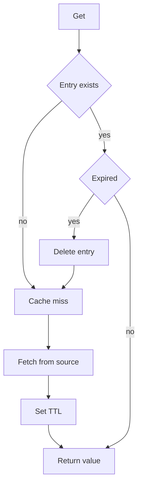
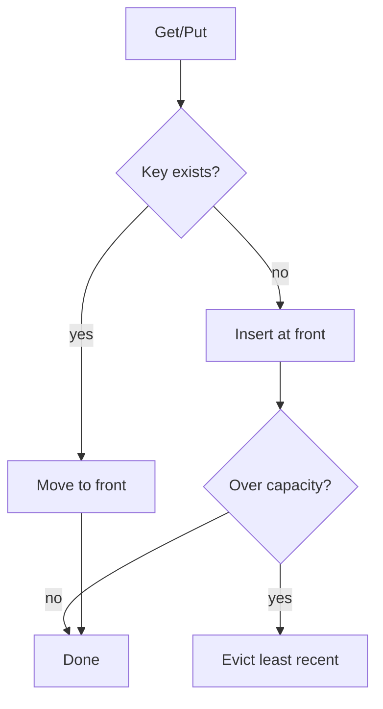
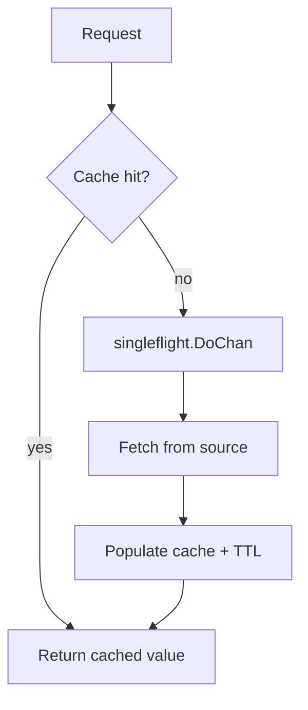
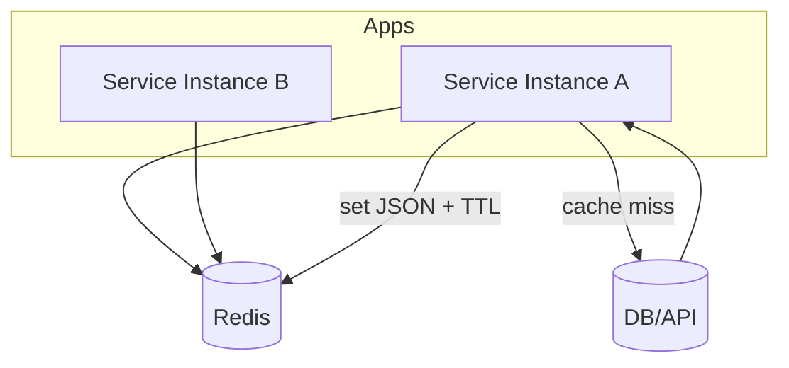
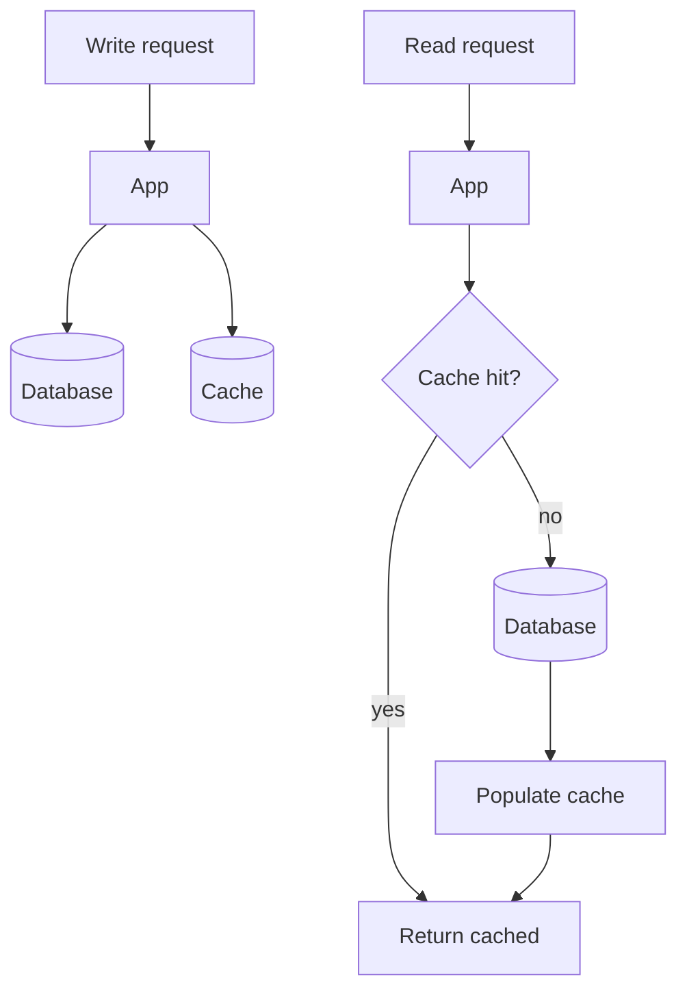

# Caching Patterns in Go

> **⏱️ Estimated Time**: Approx. 60 minutes (all patterns; each pattern can also be read on its own)
> **🎯 Level**: Intermediate
> **💻 Environment**: Go 1.26.0+, any OS
>
> **📖 Reference catalog**: This document is a reference catalog, not a step-by-step hands-on guide. Each pattern is self-contained — jump straight to the pattern you need. Every pattern section pairs a core-code excerpt (quoted verbatim from the companion asset) with the path of its runnable reference implementation.

[English](go_cache_patterns_en.md) | [日本語](go_cache_patterns_ja.md)

## Table of Contents

- [How to Use This Catalog](#how-to-use-this-catalog)
- [Understanding Cache Systems and Cache Tools](#understanding-cache-systems-and-cache-tools)
- [Pattern 1: Thread-Safe In-Memory TTL Cache](#pattern-1-thread-safe-in-memory-ttl-cache)
- [Pattern 2: LRU Cache with Bounded Memory](#pattern-2-lru-cache-with-bounded-memory)
- [Pattern 3: Cache-Aside with Singleflight Protection](#pattern-3-cache-aside-with-singleflight-protection)
- [Pattern 4: Distributed Redis Cache with Go-Redis](#pattern-4-distributed-redis-cache-with-go-redis)
- [Pattern 5: Write-Through Cache Pattern](#pattern-5-write-through-cache-pattern)

---

## How to Use This Catalog

This document is a **reference catalog**, not a hands-on tutorial: there is no environment to set up and nothing to build here. Each pattern section explains the concept, then shows the core code excerpted verbatim from the companion asset, followed by the full implementation path.

For a hands-on exercise with a real distributed cache, see [Redis Workshop: Real-time Game Leaderboard](../infra/cache_en.md). The sibling catalog [Message Queue Patterns in Go](go_mq_patterns_en.md) covers the messaging side.

### Companion Assets

| Pattern                                     | Reference implementation                                                                                        |
| :------------------------------------------ | :-------------------------------------------------------------------------------------------------------------- |
| 1. Thread-Safe In-Memory TTL Cache          | [pattern1_ttl_cache/main.go](assets/go_cache_patterns/pattern1_ttl_cache/main.go)                               |
| 2. LRU Cache with Bounded Memory            | [pattern2_lru_cache/main.go](assets/go_cache_patterns/pattern2_lru_cache/main.go)                               |
| 3. Cache-Aside with Singleflight Protection | [pattern3_cache_aside_singleflight/main.go](assets/go_cache_patterns/pattern3_cache_aside_singleflight/main.go) |
| 4. Distributed Redis Cache with Go-Redis    | [pattern4_redis_cache/main.go](assets/go_cache_patterns/pattern4_redis_cache/main.go)                           |
| 5. Write-Through Cache Pattern              | [pattern5_write_through/main.go](assets/go_cache_patterns/pattern5_write_through/main.go)                       |

---

## Choose a Pattern by Need

| Need                        | Candidate                  | Property                                     | Not guaranteed                          |
| --------------------------- | -------------------------- | -------------------------------------------- | --------------------------------------- |
| Expire stale entries        | TTL                        | Time-based refetch                           | Memory capacity bound                   |
| Bound capacity              | LRU                        | Prioritize recently used entries             | Freshness                               |
| Coalesce simultaneous reads | Singleflight + Cache-Aside | Combine same-key fetches                     | Persistence or cross-process coalescing |
| Share across processes      | Redis                      | Shared cache                                 | Atomic DB/cache updates                 |
| Update cache during writes  | Write-Through              | Order operations within this example wrapper | Transactions across stores              |

## Understanding Cache Systems and Cache Tools

> **Document Structure**: This document first explains fundamental cache concepts and strategies, then proceeds to Go implementation examples.

### Fundamentals

#### What Is Cache?

Cache is a temporary storage layer that holds frequently accessed data closer to where it is needed.
Its primary purpose is to **speed up data retrieval** and **reduce load** on slower primary data sources such as databases.

**Analogy**
Keeping your favorite coffee mug on your desk instead of walking to the kitchen every time.

---

#### Why Cache Matters: Performance Impact

##### Instant Response Times

- Serves data directly from cache
- Avoids slow database queries
- Sub-millisecond latency

##### Reduced Backend Load

- Absorbs traffic spikes
- Prevents database bottlenecks

##### Cost Savings

- Fewer database queries
- Reduced network bandwidth usage
- Lower server resource consumption

**Real-world example**
E-commerce platforms cache product details to survive flash sales without melting their databases.

---

#### Cache Architecture: Where Is Cache Stored?

##### Local Cache

- Stored in application memory (RAM)
- Extremely fast access
- Limited capacity
- Data lost on process crash

##### Distributed Cache

- Shared across multiple servers
- Scales horizontally
- More resilient than local cache
- Slightly higher latency than local memory

##### Edge Cache

- Located geographically close to users
- Typically implemented via CDNs
- Minimizes internet latency
- Improves global user experience

---

#### Caching Strategies: How Data Flows

##### 1. Write-Through

- Writes go to cache and database synchronously
- Consistency requires coordination of concurrent writes and cache fills
- Increased write latency

##### 2. Write-Back

- Writes go to cache first
- Database updated asynchronously
- Faster writes
- Risk of data loss if cache fails

##### 3. Cache-Aside (Lazy Loading)

- Application checks cache first
- On miss, load from database and cache it
- Good balance between performance and freshness
- Most commonly used in practice

---

#### Cache Invalidation: The Hard Problem

> “There are only two hard things in Computer Science: cache invalidation and naming things.”

Cached data can become **stale** when the source of truth changes.

##### Common Invalidation Approaches

###### Time-Based Expiration (TTL)

- Cached entries expire automatically after a fixed duration

###### Manual Purging

- Explicitly delete cache entries when data changes
- Requires careful coordination

###### Event-Driven Invalidation

- Cache cleared based on database events or message queues
- More complex, more accurate

---

#### Featured Tool: Redis

Redis is an open-source, in-memory data store commonly used as:

- Cache
- Database
- Message broker

It is widely adopted in high-performance systems.

##### Key Features

- Sub-millisecond read/write latency
- Rich data structures:
  - Strings
  - Hashes
  - Lists
  - Sets
  - Sorted sets
- Optional persistence to disk
- Atomic operations

##### Common Use Cases

###### Session Storage

- Fast authentication
- Shared session state across services

###### Leaderboards

- Real-time ranking using sorted sets
- Gaming and competition platforms

###### Real-Time Analytics

- Counters
- Streaming metrics
- Dashboards and monitoring

---

#### Decision Guide: When to Use Cache

##### Ideal Use Cases

- Read-heavy workloads
- Relatively stable data
- Expensive computations or queries

##### Not Suitable For

- Write-heavy systems
- Strong, immediate consistency requirements
- Unbounded or unpredictable data sets

##### Trade-offs to consider

- Added system complexity
- Risk of stale data
- Operational overhead

---

#### Summary: Cache as a Performance Multiplier

1. **Cache reduces latency**
   Faster access, lower backend pressure, better user experience.

2. **Choose the right strategy**
   Cache type, placement, and invalidation must match system needs.

3. **Redis provides flexibility**
   Feature-rich and scalable for modern applications.

4. **Experiment and measure**
   Start simple, instrument everything, and validate with real metrics.

## Pattern 1: Thread-Safe In-Memory TTL Cache

### Core Concept

A foundational caching pattern that stores string keys mapped to byte slice values with time-to-live (TTL) expiration.
Thread-safe via mutex synchronization, making it safe for concurrent goroutines.

### TTL Cache Flow Diagram



### Key Implementation Details

- `sync.Mutex` protects concurrent access
- Each entry stores:
  - value
  - expiration timestamp
- Lazy expiration checks on `Get` operations
- Zero external dependencies

### When to Use

Best for **single-instance applications** that need basic caching without distributed requirements.

Typical use cases:

- Configuration data
- Computed results
- API responses with predictable lifespans

### Trade-offs

- Memory can grow unbounded without active cleanup
- No LRU eviction
- Expiration control relies entirely on TTL values

### Core Code (Excerpt)

Excerpt from [pattern1_ttl_cache/main.go](assets/go_cache_patterns/pattern1_ttl_cache/main.go) — lazy expiration check on `Get`:

```go
type cacheEntry struct {
	value     []byte
	expiresAt time.Time
}

type TTLCache struct {
	mu    sync.Mutex
	items map[string]cacheEntry
}

// ... (NewTTLCache and Set omitted — see the full file) ...

func (c *TTLCache) Get(key string) ([]byte, bool) {
	c.mu.Lock()
	defer c.mu.Unlock()
	entry, ok := c.items[key]
	if !ok {
		return nil, false
	}
	if !time.Now().Before(entry.expiresAt) {
		delete(c.items, key)
		return nil, false
	}
	return bytes.Clone(entry.value), true
}
```

### Reference Implementation

`software/assets/go_cache_patterns/pattern1_ttl_cache/main.go`

---

## Pattern 2: LRU Cache with Bounded Memory

### LRU Overview

A cache with predictable memory usage that evicts cold data automatically using a Least Recently Used (LRU) policy.

### LRU Flow Diagram



### Implementation Steps

1. **Initialize with Capacity**
   - Set maximum entry count
   - Use `container/list` (doubly-linked list)

2. **Track Access Order**
   - Move accessed items to the front
   - Maintains recency ordering

3. **Evict on Overflow**
   - Remove least-recently-used entry from the tail when capacity is reached

4. **Maintain Hash Map**
   - Map keys to list nodes
   - Ensures O(1) lookup performance

### Why This Works

The `container/list` package provides O(1) operations for:

- Access
- Updates
- Eviction

This makes the pattern production-ready for **memory-constrained environments**.

### Core Code (Excerpt)

Excerpt from [pattern2_lru_cache/main.go](assets/go_cache_patterns/pattern2_lru_cache/main.go) — capacity check and eviction on `Put`:

```go
func (c *LRUCache) Put(key string, value []byte) {
	c.mu.Lock()
	defer c.mu.Unlock()

	if element, ok := c.items[key]; ok {
		element.Value = lruEntry{key: key, value: bytes.Clone(value)}
		c.order.MoveToFront(element)
		return
	}

	element := c.order.PushFront(lruEntry{key: key, value: bytes.Clone(value)})
	c.items[key] = element

	if c.order.Len() > c.capacity {
		c.removeOldest()
	}
}

func (c *LRUCache) removeOldest() {
	tail := c.order.Back()
	if tail == nil {
		return
	}
	entry := tail.Value.(lruEntry)
	delete(c.items, entry.key)
	c.order.Remove(tail)
}
```

### LRU Reference Implementation

`software/assets/go_cache_patterns/pattern2_lru_cache/main.go`

---

## Pattern 3: Cache-Aside with Singleflight Protection

### Overview

The most widely deployed caching pattern in production systems.
Designed to prevent **cache stampede** scenarios where many concurrent cache misses overwhelm the backend.

### Cache-Aside Flow Diagram



### Request Flow

1. **Check Cache**
   - Attempt read from cache layer first

2. **Query Source**
   - On cache miss, fetch from database or API using `singleflight`

3. **Populate Cache**
   - Store fetched data with appropriate TTL

4. **Return Result**
   - Serve the result to all waiting requests

### Singleflight Explained

The `golang.org/x/sync/singleflight` package coalesces duplicate requests into a single backend call.

**Example:**
If 200 goroutines request the same uncached key simultaneously:

- Only **one** hits the database
- The other 199 wait for the shared result

### Why It Matters

#### Without Singleflight

- 200 concurrent database queries
- Backend overload
- Response time spikes
- Cascading service failures

#### With Singleflight

- One database query
- Stable response times
- Graceful traffic spike handling

### Core Code (Excerpt)

Excerpt from [pattern3_cache_aside_singleflight/main.go](assets/go_cache_patterns/pattern3_cache_aside_singleflight/main.go) — `DoChan` collapses concurrent cache misses into one store fetch:

```go
func (c *CacheAside) Get(ctx context.Context, key string) (string, error) {
	if err := ctx.Err(); err != nil {
		return "", err
	}
	if value, ok := c.cache.Get(key); ok {
		return value, nil
	}

	// singleflight collapses concurrent cache misses into one store fetch.
	result := c.group.DoChan(key, func() (interface{}, error) {
		if value, ok := c.cache.Get(key); ok {
			return value, nil
		}
		fresh, err := c.store.Fetch(ctx, key)
		if err != nil {
			return "", err
		}
		c.cache.Set(key, fresh, c.cacheT)
		return fresh, nil
	})
	select {
	case <-ctx.Done():
		return "", ctx.Err()
	case r := <-result:
		if r.Err != nil {
			return "", r.Err
		}
		return r.Val.(string), nil
	}
}
```

### Cache-Aside Reference Implementation

`software/assets/go_cache_patterns/pattern3_cache_aside_singleflight/main.go`

---

## Pattern 4: Distributed Redis Cache with Go-Redis

### Redis Cache Overview

Redis is the industry-standard distributed caching solution.
Multiple application instances share a single cache, enabling horizontal scaling and shared state.

### Redis Flow Diagram



### Key Characteristics

#### JSON Serialization

- Marshal Go structs to JSON
- Human-readable
- Debuggable via `redis-cli`

#### Native TTL Support

- Redis handles expiration automatically
- TTL set on write
- No manual cleanup required

#### Shared State

- All application instances access the same cache
- Ideal for:
  - Microservices
  - Load-balanced deployments
  - Session consistency

### Client Library

`redis/go-redis/v9` provides:

- Idiomatic Go APIs
- Connection pooling
- Pipelining
- Cluster support

Minimal wrapper code required for production use.

### Core Code (Excerpt)

Excerpt from [pattern4_redis_cache/main.go](assets/go_cache_patterns/pattern4_redis_cache/main.go) — JSON serialization plus native TTL on write, `redis.Nil` treated as a cache miss on read:

```go
func SetUser(ctx context.Context, client *redis.Client, user User, ttl time.Duration) error {
	payload, err := json.Marshal(user)
	if err != nil {
		return err
	}
	return client.Set(ctx, cacheKey(user.ID), payload, ttl).Err()
}

func GetUser(ctx context.Context, client *redis.Client, id string) (User, bool, error) {
	value, err := client.Get(ctx, cacheKey(id)).Result()
	if err == redis.Nil {
		return User{}, false, nil
	}
	if err != nil {
		return User{}, false, err
	}

	var user User
	if err := json.Unmarshal([]byte(value), &user); err != nil {
		return User{}, false, err
	}
	return user, true, nil
}
```

### Redis Reference Implementation

`software/assets/go_cache_patterns/pattern4_redis_cache/main.go`

---

## Pattern 5: Write-Through Cache Pattern

### Write-Through Overview

Synchronously updates both database and cache on every write.
This pattern prioritizes **consistency over write performance**.

### Write-Through Flow Diagram



### Write Flow

1. **Receive Write Request**
   - Application receives data update from client

2. **Update Database**
   - Persist changes to the primary datastore

3. **Update Cache**
   - Immediately synchronize cache with new data

4. **Confirm Success**
   - Return success only after both operations complete

### Advantages

- Cache consistency when every access uses the same synchronized wrapper
- No stale reads after writes
- Simple mental model for data state

### Write-Through Trade-offs

- Slower write operations
- Cache must be available
- Increased write latency

### Core Code (Excerpt)

Excerpt from [pattern5_write_through/main.go](assets/go_cache_patterns/pattern5_write_through/main.go) — one mutex serializes the complete store/cache operation; the database is updated before the cache on every write:

```go
type writeThroughCache struct {
	// Serialize the complete store/cache operation, including read-through fills.
	mu    sync.Mutex
	store *memoryStore
	cache *memoryCache
}

// ... (newWriteThroughCache omitted — see the full file) ...

func (w *writeThroughCache) Put(key string, value record) error {
	w.mu.Lock()
	defer w.mu.Unlock()
	if err := w.store.Put(key, value); err != nil {
		return err
	}
	w.cache.Set(key, value)
	return nil
}
```

### Write-Through Reference Implementation

`software/assets/go_cache_patterns/pattern5_write_through/main.go`

The TTL and LRU caches copy byte slices on both insertion and retrieval. Expiry checks and deletion share one lock, so cleanup cannot delete a concurrent replacement. Singleflight waiters can cancel independently; the first caller still supplies the shared fetch context. The write-through example serializes reads and writes through one wrapper; direct writes to the backing store or another wrapper are outside this guarantee.

---

## What you learned

- How to pick a cache strategy (TTL expiry, LRU eviction, cache-aside, write-through) that matches your workload's read/write balance and consistency requirements
- How to keep a concurrent in-memory cache race-free while bounding its memory usage
- How `singleflight` collapses duplicate cache-miss fetches into one backend call, preventing a cache stampede
- How to integrate a distributed Redis cache into a Go service with go-redis

**Next step**: run the hands-on version of the distributed pattern in [Redis Workshop: Real-time Game Leaderboard](../infra/cache_en.md).

---

## References

- [sync package (Mutex, RWMutex)](https://pkg.go.dev/sync)
- [singleflight: duplicate function call suppression](https://pkg.go.dev/golang.org/x/sync/singleflight)
- [go-redis client](https://github.com/redis/go-redis)
- [Redis documentation: data types](https://redis.io/docs/latest/develop/data-types/)
