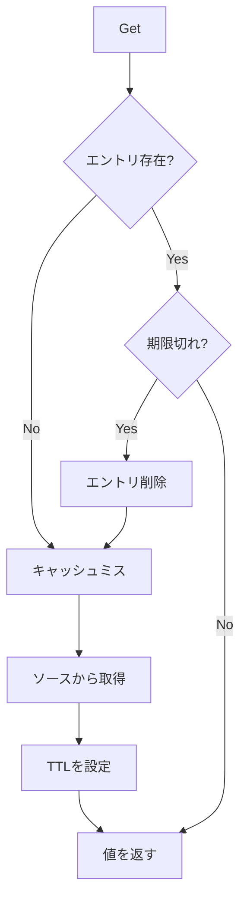
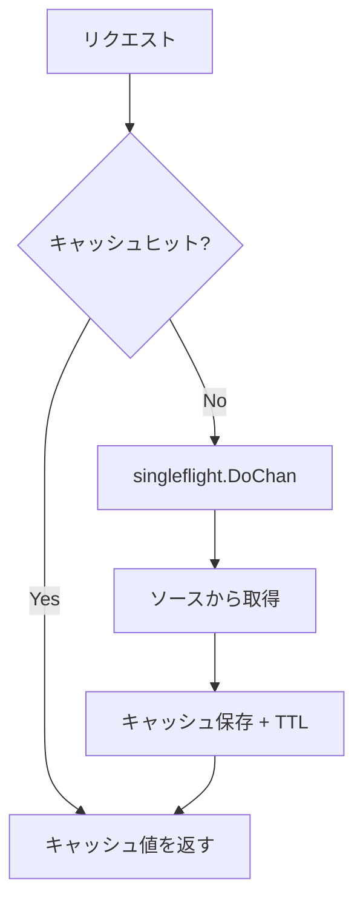
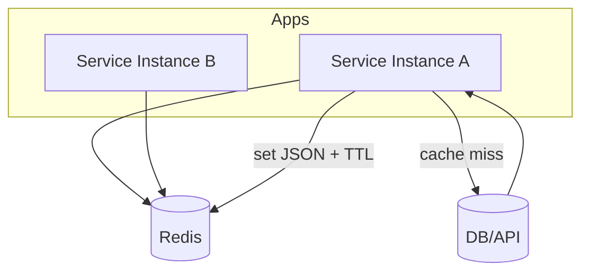
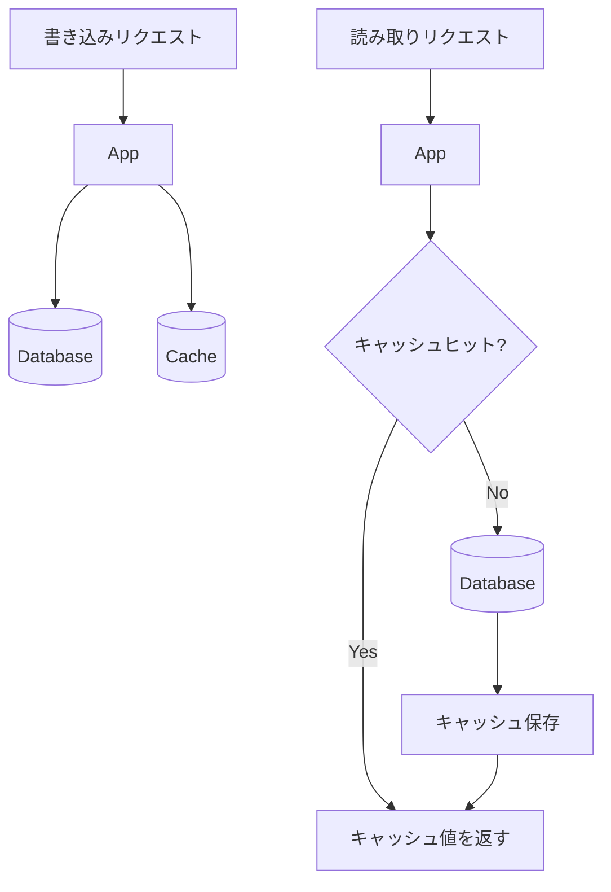

# Go言語におけるキャッシュパターン

> **⏱️ 所要時間**: 全パターンで約 60 分（各パターンは単独でも読めます）
> **🎯 レベル**: Intermediate
> **💻 環境**: Go 1.26.0+、OS 不問
>
> **📖 参照カタログ**: 本書はステップバイステップのハンズオンではなく、リファレンス型（カタログ）です。各パターンは独立した内容なので、必要なパターンだけをピックアップして読んでください。各パターンのセクションでは、対応アセットからそのまま抜粋した核心コードと、実行可能なリファレンス実装のパスを併記します。

[English](go_cache_patterns_en.md) | [日本語](go_cache_patterns_ja.md)

## 目次

- [このカタログの使い方](#このカタログの使い方)
- [キャッシュシステムとツールの理解](#キャッシュシステムとツールの理解)
- [パターン1: スレッドセーフなインメモリTTLキャッシュ](#パターン1-スレッドセーフなインメモリttlキャッシュ)
- [パターン2: メモリ制限付きLRUキャッシュ](#パターン2-メモリ制限付きlruキャッシュ)
- [パターン3: Singleflight保護付きキャッシュアサイド](#パターン3-singleflight保護付きキャッシュアサイド)
- [パターン4: Go-Redisによる分散Redisキャッシュ](#パターン4-go-redisによる分散redisキャッシュ)
- [パターン5: ライトスルーキャッシュパターン](#パターン5-ライトスルーキャッシュパターン)

---

## このカタログの使い方

本書は**リファレンス型（カタログ）**であり、ハンズオン形式ではありません。セットアップすべき環境もビルドするものもありません。各パターンのセクションでは概念を解説した後、対応アセットからそのまま抜粋した核心コードと、完全な実装のパスを示します。

実際の分散キャッシュを使ったハンズオンは [Redis 実習：Sorted Sets で作るリアルタイム・ゲームランキング](../infra/cache_ja.md) を参照してください。メッセージング側のカタログは [Go言語におけるメッセージキューパターン](go_mq_patterns_ja.md) です。

### 対応アセット

| パターン                                   | リファレンス実装                                                                                                |
| :----------------------------------------- | :-------------------------------------------------------------------------------------------------------------- |
| 1. スレッドセーフなインメモリTTLキャッシュ | [pattern1_ttl_cache/main.go](assets/go_cache_patterns/pattern1_ttl_cache/main.go)                               |
| 2. メモリ制限付きLRUキャッシュ             | [pattern2_lru_cache/main.go](assets/go_cache_patterns/pattern2_lru_cache/main.go)                               |
| 3. Singleflight保護付きキャッシュアサイド  | [pattern3_cache_aside_singleflight/main.go](assets/go_cache_patterns/pattern3_cache_aside_singleflight/main.go) |
| 4. Go-Redisによる分散Redisキャッシュ       | [pattern4_redis_cache/main.go](assets/go_cache_patterns/pattern4_redis_cache/main.go)                           |
| 5. ライトスルーキャッシュパターン          | [pattern5_write_through/main.go](assets/go_cache_patterns/pattern5_write_through/main.go)                       |

---

## 用途からパターンを選ぶ

| 困っていること                 | 候補                       | 得られる性質                   | 保証しないこと               |
| ------------------------------ | -------------------------- | ------------------------------ | ---------------------------- |
| 期限で古い値を失効させる       | TTL                        | 時間に基づく再取得             | メモリ容量の上限             |
| 容量を抑える                   | LRU                        | 最近使った値を優先             | 値の鮮度                     |
| 同時の取得要求を集約する       | Singleflight + Cache-Aside | 同一キーの取得をまとめる       | 永続化、プロセス間の集約     |
| 複数プロセスで共有する         | Redis                      | 共通のキャッシュ               | DB とキャッシュの原子的更新  |
| 書き込みでキャッシュも更新する | Write-Through              | 例の単一ラッパー内で順序を制御 | 複数ストアのトランザクション |

## キャッシュシステムとツールの理解

> **本資料の構成**: まずキャッシュの基礎概念と戦略を解説し、その後で Go による実装例に進みます。

### 基礎

#### キャッシュとは？

キャッシュとは、頻繁にアクセスされるデータを、それが必要とされる場所の近くに保持しておく一時的なストレージ層のことです。
主な目的は、**データ取得の高速化**と、データベースのような低速な一次データソースへの**負荷軽減**です。

**例え**
キッチンまで毎回取りに行く代わりに、お気に入りのコーヒーマグをデスクに置いておくようなものです。

---

#### なぜキャッシュが重要なのか：パフォーマンスへの影響

##### レスポンスタイムの即時化

- キャッシュからデータを直接提供
- 遅いデータベースクエリを回避
- サブミリ秒単位のレイテンシ

##### バックエンド負荷の軽減

- トラフィックスパイク（急増）を吸収
- データベースのボトルネックを防止

##### コスト削減

- データベースクエリ数の削減
- ネットワーク帯域幅の使用量削減
- サーバーリソース消費の低減

**実例**
E コマースプラットフォームでは、フラッシュセール中にデータベースがダウンしないよう、商品詳細をキャッシュしています。

---

#### キャッシュアーキテクチャ：キャッシュの保存場所

##### ローカルキャッシュ

- アプリケーションのメモリ（RAM）に保存
- 非常に高速なアクセス
- 容量に制限がある
- プロセスのクラッシュでデータが失われる

##### 分散キャッシュ

- 複数のサーバー間で共有される
- 水平スケールが可能
- ローカルキャッシュより耐障害性が高い
- ローカルメモリよりわずかにレイテンシが高い

##### エッジキャッシュ

- 地理的にユーザーに近い場所に配置
- 通常、CDN を介して実装される
- インターネットレイテンシを最小化
- グローバルなユーザー体験を向上

---

#### キャッシュ戦略：データの流れ

##### 1. ライトスルー (Write-Through)

- 書き込みはキャッシュとデータベースに同期的に行われる
- 整合性の維持には並行する書き込みとキャッシュ充填の調整が必要
- 書き込みレイテンシの増加

##### 2. ライトバック (Write-Back)

- 書き込みはまずキャッシュに行われる
- データベースは非同期で更新される
- 高速な書き込み
- キャッシュ障害時にデータ損失のリスクがある

##### 3. キャッシュアサイド (Cache-Aside / Lazy Loading)

- アプリケーションはまずキャッシュを確認する
- ミス（見つからない）場合、データベースからロードしてキャッシュに保存する
- パフォーマンスと鮮度のバランスが良い
- 実務で最も一般的に使用される

---

#### キャッシュの無効化：困難な問題

> 「計算機科学にはハードなことが2つだけある。キャッシュの無効化と、名前付けだ。」

一次データの情報源（Source of Truth）が変更されると、キャッシュされたデータは**古く（Stale）**なります。

##### 一般的な無効化のアプローチ

###### 時間ベースの有効期限 (TTL)

- キャッシュエントリは一定時間後に自動的に期限切れになる

###### 手動パージ

- データ変更時に明示的にキャッシュエントリを削除する
- 注意深い調整が必要

###### イベント駆動型の無効化

- データベースイベントやメッセージキューに基づいてキャッシュをクリアする
- 複雑だが、より正確

---

#### 注目のツール：Redis

Redis は、オープンソースのインメモリデータストアで、一般的に以下として使用されます：

- キャッシュ
- データベース
- メッセージブローカー

高性能なシステムで広く採用されています。

##### Redisの主な特徴

- サブミリ秒の読み書きレイテンシ
- 豊富なデータ構造：
  - 文字列 (Strings)
  - ハッシュ (Hashes)
  - リスト (Lists)
  - セット (Sets)
  - ソート済みセット (Sorted Sets)
- オプションのディスク永続化
- アトミック操作

##### 一般的なユースケース

###### セッションストレージ

- 高速な認証
- サービス間でのセッション状態の共有

###### リーダーボード（ランキング）

- ソート済みセットを使用したリアルタイムランキング
- ゲームや競技プラットフォーム

###### リアルタイム分析

- カウンター
- ステリーミングメトリクス
- ダッシュボードとモニタリング

---

#### 決定ガイド：いつキャッシュを使うべきか

##### 理想的なユースケース

- 読み取り頻度が高いワークロード
- 比較的安定したデータ
- コストの高い計算やクエリ

##### 適さないケース

- 書き込み頻度が極端に高いシステム
- 強力かつ即時の整合性が求められる要件
- 無制限または予測不可能なデータセット

##### 考慮すべきトレードオフ

- システムの複雑さの増加
- 古いデータのリスク
- 運用上のオーバーヘッド

---

#### まとめ：パフォーマンス増強としてのキャッシュ

1. **キャッシュはレイテンシを削減する**
   高速なアクセス、バックエンドの圧力軽減、より良いユーザー体験。

2. **適切な戦略を選ぶ**
   キャッシュの種類、配置、無効化戦略はシステム要件に合わせる必要がある。

3. **Redisは柔軟性を提供する**
   機能豊富で、現代のアプリケーション向けにスケーラブル。

4. **実験と計測**
   シンプルに始め、全てを計測し、実際のメトリクスで検証する。

## パターン1: スレッドセーフなインメモリTTLキャッシュ

### コアコンセプト

文字列キーをバイトスライスの値にマッピングし、生存時間（TTL）を設定して期限切れ管理を行う基本的なキャッシュパターンです。
Mutex 同期によりスレッドセーフになっており、並行するゴルーチンから安全にアクセスできます。

### TTLキャッシュのフロー図



### 主な実装詳細

- `sync.Mutex` で並行アクセスを保護
- 各エントリの保持内容：
  - 値
  - 有効期限のタイムスタンプ
- `Get` 操作時の遅延有効期限チェック（Lazy Expiration）
- 外部依存なし

### 使用場面

分散要件のない**単一インスタンスのアプリケーション**での基本的なキャッシュに最適です。

典型的なユースケース：

- 設定データ
- 計算結果
- 予測可能な寿命を持つ API レスポンス

### トレードオフ

- アクティブなクリーンアップがないとメモリが無制限に増加する可能性がある
- LRU（Least Recently Used）エビクション（追い出し）がない
- 有効期限管理は完全に TTL 値に依存する

### 核心コード（抜粋）

[pattern1_ttl_cache/main.go](assets/go_cache_patterns/pattern1_ttl_cache/main.go) より抜粋 —— `Get` 時の遅延有効期限チェック：

```go
type cacheEntry struct {
	value     []byte
	expiresAt time.Time
}

type TTLCache struct {
	mu    sync.Mutex
	items map[string]cacheEntry
}

// ... (NewTTLCache と Set は省略 — 全文は asset を参照) ...

func (c *TTLCache) Get(key string) ([]byte, bool) {
	c.mu.Lock()
	defer c.mu.Unlock()
	entry, ok := c.items[key]
	if !ok {
		return nil, false
	}
	if !time.Now().Before(entry.expiresAt) {
		delete(c.items, key)
		return nil, false
	}
	return bytes.Clone(entry.value), true
}
```

### リファレンス実装

`software/assets/go_cache_patterns/pattern1_ttl_cache/main.go`

---

## パターン2: メモリ制限付きLRUキャッシュ

### LRUの概要

Least Recently Used (LRU) ポリシーを使用して、冷たい（使われていない）データを自動的に追い出し、メモリ使用量を予測可能にするキャッシュです。

### LRUフロー図

```mermaid
flowchart TD
    A[Get/Put] --> B{キー存在?}
    B -- Yes --> C[先頭へ移動]
    B -- No --> D[先頭に挿入]
    D --> E{容量オーバー?}
    E -- Yes --> F[末尾(最古)を削除]
    E -- No --> G[完了]
    C --> G
```

### 実装ステップ

1. **容量を指定して初期化**
   - 最大エントリ数を設定
   - `container/list`（双方向連結リスト）を使用

2. **アクセス順序の追跡**
   - アクセスされたアイテムをリストの先頭に移動
   - 最新性（Recency）の順序を維持

3. **オーバーフロー時の追い出し**
   - 容量に達した場合、リストの末尾から最も使われていないエントリを削除

4. **ハッシュマップの維持**
   - キーをリストノードにマッピング
   - O(1) のルックアップ性能を保証

### なぜ機能するのか

`container/list` パッケージは以下の操作に対して O(1) を提供します：

- アクセス
- 更新
- 追い出し (Eviction)

これにより、**メモリ制約のある環境**でもプロダクション利用に耐えうるパターンとなります。

### 核心コード（抜粋）

[pattern2_lru_cache/main.go](assets/go_cache_patterns/pattern2_lru_cache/main.go) より抜粋 —— `Put` 時の容量チェックとエビクション：

```go
func (c *LRUCache) Put(key string, value []byte) {
	c.mu.Lock()
	defer c.mu.Unlock()

	if element, ok := c.items[key]; ok {
		element.Value = lruEntry{key: key, value: bytes.Clone(value)}
		c.order.MoveToFront(element)
		return
	}

	element := c.order.PushFront(lruEntry{key: key, value: bytes.Clone(value)})
	c.items[key] = element

	if c.order.Len() > c.capacity {
		c.removeOldest()
	}
}

func (c *LRUCache) removeOldest() {
	tail := c.order.Back()
	if tail == nil {
		return
	}
	entry := tail.Value.(lruEntry)
	delete(c.items, entry.key)
	c.order.Remove(tail)
}
```

### LRUリファレンス実装

`software/assets/go_cache_patterns/pattern2_lru_cache/main.go`

---

## パターン3: Singleflight保護付きキャッシュアサイド

### 概要

本番システムで最も広く展開されているキャッシュパターンです。
多数の同時キャッシュミスがバックエンドを圧倒する**キャッシュスタンピード**シナリオを防ぐように設計されています。

### キャッシュアサイドのフロー図



### リクエストフロー

1. **キャッシュ確認**
   - まずキャッシュ層からの読み取りを試みる

2. **ソースへのクエリ**
   - キャッシュミス時、`singleflight` を使用してデータベースや API からフェッチする

3. **キャッシュへの配置**
   - 取得したデータを適切な TTL と共に保存する

4. **結果を返す**
   - 待機中のすべてのリクエストに結果を提供する

### Singleflightの解説

`golang.org/x/sync/singleflight` パッケージは、重複するリクエストを単一のバックエンド呼び出しにまとめます。

**例:**
200 のゴルーチンが同時に同じ未キャッシュのキーをリクエストした場合：

- **1つ**だけがデータベースにアクセスします
- 他の 199 は共有された結果を待ちます

### なぜ重要なのか

#### Singleflightなし

- 200 の同時データベースクエリ
- バックエンドの過負荷
- レスポンスタイムの急増
- 連鎖的なサービス障害

#### Singleflightあり

- 1 つのデータベースクエリ
- 安定したレスポンスタイム
- トラフィックスパイクの優雅な処理

### 核心コード（抜粋）

[pattern3_cache_aside_singleflight/main.go](assets/go_cache_patterns/pattern3_cache_aside_singleflight/main.go) より抜粋 —— `DoChan` が並行するキャッシュミスを 1 回のストアフェッチに集約：

```go
func (c *CacheAside) Get(ctx context.Context, key string) (string, error) {
	if err := ctx.Err(); err != nil {
		return "", err
	}
	if value, ok := c.cache.Get(key); ok {
		return value, nil
	}

	// singleflight collapses concurrent cache misses into one store fetch.
	result := c.group.DoChan(key, func() (interface{}, error) {
		if value, ok := c.cache.Get(key); ok {
			return value, nil
		}
		fresh, err := c.store.Fetch(ctx, key)
		if err != nil {
			return "", err
		}
		c.cache.Set(key, fresh, c.cacheT)
		return fresh, nil
	})
	select {
	case <-ctx.Done():
		return "", ctx.Err()
	case r := <-result:
		if r.Err != nil {
			return "", r.Err
		}
		return r.Val.(string), nil
	}
}
```

### キャッシュアサイドのリファレンス実装

`software/assets/go_cache_patterns/pattern3_cache_aside_singleflight/main.go`

---

## パターン4: Go-Redisによる分散Redisキャッシュ

### Redisキャッシュの概要

Redis は業界標準の分散キャッシュソリューションです。
複数のアプリケーションインスタンスが単一のキャッシュを共有し、水平スケーリングと状態共有を可能にします。

### Redisフロー図



### 分散キャッシュの主な特徴

#### JSONシリアライズ

- Go の構造体を JSON にマーシャル（変換）
- 人間が読める形式
- `redis-cli` でデバッグ可能

#### ネイティブTTLサポート

- Redis が有効期限を自動的に処理
- 書き込み時に TTL を設定
- 手動クリーンアップ不要

#### 共有状態

- 全てのアプリケーションインスタンスが同じキャッシュにアクセス
- 以下の用途に最適：
  - マイクロサービス
  - ロードバランスされたデプロイメント
  - セッション整合性

### クライアントライブラリ

`redis/go-redis/v9` は以下を提供します：

- Go らしい（Idiomatic な）API
- コネクションプーリング
- パイプライン処理
- クラスタサポート

本番利用に必要なラッパーコードは最小限で済みます。

### 核心コード（抜粋）

[pattern4_redis_cache/main.go](assets/go_cache_patterns/pattern4_redis_cache/main.go) より抜粋 —— 書き込み時の JSON シリアライズとネイティブ TTL、読み取り時の `redis.Nil` をキャッシュミスとして扱う処理：

```go
func SetUser(ctx context.Context, client *redis.Client, user User, ttl time.Duration) error {
	payload, err := json.Marshal(user)
	if err != nil {
		return err
	}
	return client.Set(ctx, cacheKey(user.ID), payload, ttl).Err()
}

func GetUser(ctx context.Context, client *redis.Client, id string) (User, bool, error) {
	value, err := client.Get(ctx, cacheKey(id)).Result()
	if err == redis.Nil {
		return User{}, false, nil
	}
	if err != nil {
		return User{}, false, err
	}

	var user User
	if err := json.Unmarshal([]byte(value), &user); err != nil {
		return User{}, false, err
	}
	return user, true, nil
}
```

### Redisリファレンス実装

`software/assets/go_cache_patterns/pattern4_redis_cache/main.go`

---

## パターン5: ライトスルーキャッシュパターン

### ライトスルーの概要

書き込みごとにデータベースとキャッシュの両方を同期的に更新します。
このパターンは**書き込み性能よりも整合性を優先**します。

### ライトスルーのフロー図



### 書き込みフロー

1. **書き込みリクエスト受信**
   - アプリケーションがクライアントからデータ更新を受け取る

2. **データベース更新**
   - プライマリデータストアに変更を永続化

3. **キャッシュ更新**
   - 新しいデータで即座にキャッシュを同期

4. **成功確認**
   - 両方の操作が完了した後にのみ成功を返す

### 利点

- すべてのアクセスが同じ同期化されたラッパーを通る場合にキャッシュ整合性が保たれる
- 書き込み後の読み取りで古いデータ（Stale Read）が発生しない
- データ状態のメンタルモデルがシンプル

### ライトスルーのトレードオフ

- 書き込み操作が遅くなる
- キャッシュが利用可能である必要がある
- 書き込みレイテンシの増加

### 核心コード（抜粋）

[pattern5_write_through/main.go](assets/go_cache_patterns/pattern5_write_through/main.go) より抜粋 —— 1 つの Mutex でストアとキャッシュの操作全体を直列化し、書き込みごとにデータベースを先に更新：

```go
type writeThroughCache struct {
	// Serialize the complete store/cache operation, including read-through fills.
	mu    sync.Mutex
	store *memoryStore
	cache *memoryCache
}

// ... (newWriteThroughCache は省略 — 全文は asset を参照) ...

func (w *writeThroughCache) Put(key string, value record) error {
	w.mu.Lock()
	defer w.mu.Unlock()
	if err := w.store.Put(key, value); err != nil {
		return err
	}
	w.cache.Set(key, value)
	return nil
}
```

### ライトスルーのリファレンス実装

`software/assets/go_cache_patterns/pattern5_write_through/main.go`

TTL と LRU キャッシュは保存時・取得時にバイト列をコピーします。期限判定と削除を同じロック内で行い、並行更新された値を削除しないようにします。Singleflight の待機は呼び出しごとにキャンセルできますが、共有取得のコンテキストは最初の呼び出しのものです。Write-through の読み書きは同じラッパーで直列化します。ストアへの直接書き込みや別ラッパー経由の更新は保証の対象外です。

---

## 学んだこと

- 読み書きの比率と整合性要件に応じて、キャッシュ戦略（TTL 期限切れ、LRU 退避、キャッシュアサイド、ライトスルー）を選ぶ判断基準
- 並行アクセスされるインメモリキャッシュを、メモリ使用量を制限しながらレースコンディションなしで動かす方法
- `singleflight` によってキャッシュミス時の重複フェッチを 1 回のバックエンド呼び出しに集約し、キャッシュスタンピードを防ぐ方法
- go-redis を使って Go サービスに分散 Redis キャッシュを組み込む方法

**次のステップ**: 分散パターンの実習版を [Redis 実習：Sorted Sets で作るリアルタイム・ゲームランキング](../infra/cache_ja.md) で試してみましょう。

---

## 参考文献

- [sync パッケージ (Mutex, RWMutex)](https://pkg.go.dev/sync)
- [singleflight: 重複する関数呼び出しの抑制](https://pkg.go.dev/golang.org/x/sync/singleflight)
- [go-redis クライアント](https://github.com/redis/go-redis)
- [Redis ドキュメント: データタイプ](https://redis.io/docs/latest/develop/data-types/)
